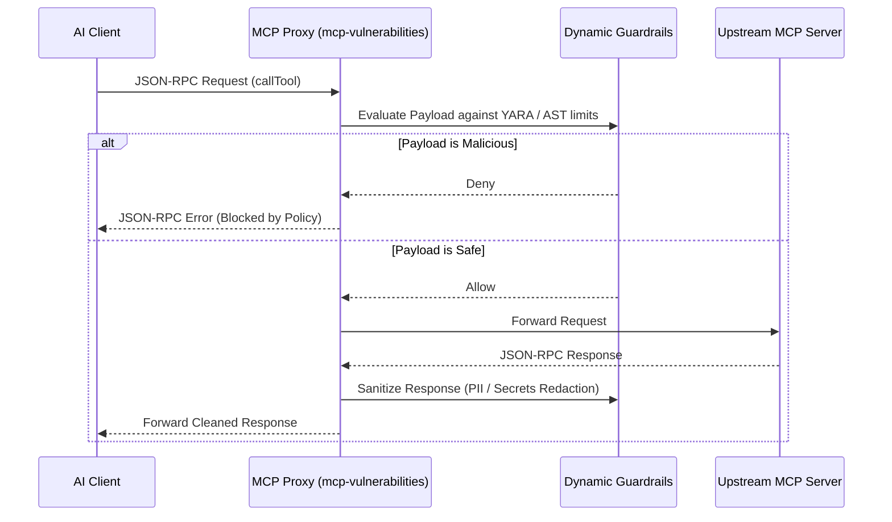

# Cumulative Synthesis — Master Competitive Gap Analysis & Strategic Roadmap

## 1. Executive Summary & Ecosystem Landscape

**The State of MCP Security in 2026**  
The landscape of Model Context Protocol (MCP) security is rapidly shifting from basic static file audits to robust, runtime zero-trust guardrails and verifiable cryptographic attestations. As the ecosystem matures, the threats involve not just known static vulnerabilities (CVEs) in configurations, but active runtime exploits, supply chain tampering, hallucinated dependencies, and unverified AI tool execution boundaries.

**Competitive Positioning**  
Currently, `mcp-vulnerabilities` leads the field in areas such as polyglot ecosystem versioning correlation, automated multi-client configuration patching, and static passport analysis (via Airgapped EphemeralSandbox). However, critical competitive gaps exist when benchmarking against real-time defense layers, full-scale ecosystem telemetry, advanced interprocedural static reachability, and cryptographic provenance guarantees. 

Our core insight is that `mcp-vulnerabilities` must transition from a static intelligence catalog to an active, holistic lifecycle security platform bridging static SCA, supply chain integrity, and dynamic runtime proxy enforcement.

---

## 2. Grand Unified Competitive Feature Matrix

This matrix compares `mcp-vulnerabilities` v1.1.0 capabilities against leading ecosystem solutions spanning Runtime Security, Developer Tooling, Registries, Enterprise SCA, and Supply Chain standard implementations.

| Feature Domain | `mcp-vulnerabilities` v1.1.0 | Competitor Benchmarks | Status / Gap |
| :--- | :--- | :--- | :--- |
| **Analysis Paradigm** | Static Analysis, AST, Local Airgapped Sandbox | Dynamic Analysis, Exploit Sim, Cloud Sandboxes | Static-only runtime limitation |
| **Inline MCP Proxy Interception** | **None** | **Verity MCP Auditor:** AST intercept, proxy guardrails | **Critical Gap** |
| **Call-Graph Reachability** | **None** (Flags all vulnerable lockfile deps) | **Snyk / Semgrep:** Deep interprocedural taint flow | **Critical Gap** |
| **Data & OS Guardrails** | Ephemeral Docker sandbox only | **Cursor / Verity:** OS namespace isolation, SQL guards | Lacks kernel/OS exportable sandboxing |
| **Protocol Inspection & UI** | Static SARIF / HTML Reports | **Anthropic Inspector:** Interactive Web UI / Tracing | Missing dynamic test harnesses |
| **Reputation & Trust Scoring** | Only CVEs and OWASP compliance tiers | **Smithery / Glama:** Verified publishers, community stars | **Critical Gap** (No composite score) |
| **Supply Chain Attestation** | Missing (TLS transit only) | **Sigstore (Cosign/Rekor), in-toto / SLSA L3** | **Critical Gap** (No keyless signing) |
| **Typosquatting Detection** | **None** | **Snyk / Semgrep:** Threat intel & heuristics | **Moderate Gap** |
| **AI BOM Compliance** | Partial (CycloneDX v1.5 endpoints/services) | **CycloneDX v1.6 AI Extension** | **Moderate Gap** (Lacks ML model/hardware limits) |
| **Automated Remediation** | Interactive Terminal CLI Fixes | **Snyk / Trivy:** Automated GitHub PR Bots | **Moderate Gap** |
| **Package Distribution** | Interactive configuration patching | **Smithery:** One-click install CLI recipes | Minor Gap |
| **IDE/LSP Integration** | **None** | **Snyk / Semgrep:** Inline editor diagnostics | Minor Gap |

---

## 3. Consolidated Competitive Gap Register

### HIGH Priority Strategic Gaps
- **Inline MCP Proxy Interception:** Inability to intercept JSON-RPC messages and real-time tool calls to actively block threats dynamically.
- **Interprocedural Call-Graph Reachability Analysis:** High false-positive rates due to the inability to map exposed MCP tool entrypoints to imported vulnerable dependency symbols deep in the call stack.
- **Cryptographic Signing & Rekor Transparency Log:** Lack of keyless attestation for vulnerability feeds and releases, leaving downstream consumers susceptible to cache poisoning or MITM attacks.
- **Server Reputation & Composite Trust Scoring:** Absence of a composite algorithm blending CVEs, community signals (stars, forks, uptime), and verified publisher identities, unlike centralized registry leaders.

### MEDIUM Priority Strategic Gaps
- **Web-based Interactive Protocol Debugger & Fuzzing Harness:** Missing a dynamic testing environment like Anthropic Inspector for protocol tracing, edge-case mutation, and zero-day testing.
- **Typosquatting / LLM Hallucinated Package Detection:** Inability to identify malicious payloads from hallucinated package names or misspelled dependencies (e.g., via Levenshtein distance against known safe catalogs).
- **Automated GitHub PR Bot:** Relying on manual CLI intervention to push fixed client configurations, rather than an automated repository patching bot service.
- **Full CycloneDX v1.6 AI Extension Mapping:** Missing strict AI/ML BOM elements such as machine learning model parameters, dataset boundaries, and hardware capability limits.

### LOW Priority Strategic Gaps
- **LSP Inline Editor Diagnostics:** No real-time squiggle warnings in IDEs (like VSCode/Cursor) during server configuration.
- **SPDX 3.0 Export Format:** Purely relying on CycloneDX limits integration with SPDX-exclusive enterprise systems.
- **One-Click Registry Package Install Recipes:** Missing zero-friction CLI install recipes for newly discovered safe servers.

---

## 4. Target Architecture Blueprints

### Architecture Blueprint 1: Inline Reverse Proxy Interceptor (`mcp-vulnerabilities proxy`)
A lightweight, asynchronous proxy intercepting JSON-RPC over `stdio` or `sse` to actively filter tool calls against static AST taint rules and runtime regex patterns.



### Architecture Blueprint 2: Static Reachability & Taint Call-Graph Engine (`mcp-vulnerabilities reachability`)
An enhanced static analyzer parsing server code to trace paths from `@mcp.tool` entrypoints to imported vulnerable dependencies, substantially reducing false positives.

```mermaid
graph TD
    A[Parse Server Source] --> B[Identify MCP Tool Entrypoints]
    A --> C[Map 3rd-Party Imports]
    B --> D[AST Call-Graph Traversal]
    C --> D
    D --> E{Is 3rd-Party Symbol Called?}
    E -- Yes --> F[Check OSV Vulnerable Symbols]
    E -- No --> G[Mark Dependency Unreachable]
    F --> H{Match OSV Symbol?}
    H -- Yes --> I[Flag as VULNERABLE (Reachable)]
    H -- No --> G
```

### Architecture Blueprint 3: Sigstore Keyless Attestation Pipeline (`mcp-vulnerabilities sign`)
Augmenting the GitHub Actions release workflow with OIDC keyless signing to secure the provenance and distribution of vulnerability catalogs and release artifacts.

**Workflow Integration Snippet:**
```yaml
      - name: Keyless Sign with Sigstore
        run: |
          pip install sigstore
          sigstore sign dist/*.whl
          sigstore sign docs/data/vulnerabilities.json.gz
```

---

## 5. Multi-Wave Product Roadmap & Version Milestones

* **Release v1.2.0 (Supply Chain & Provenance)**
  * **Objective:** Fortify artifact distribution and capability mapping.
  * **Deliverables:** Sigstore Cosign keyless signing of daily vulnerability feeds, OpenSSF Scorecard integration for upstream repositories, and full CycloneDX v1.6 AI BOM standard integration.

* **Release v1.3.0 (Advanced SCA & Reachability)**
  * **Objective:** Evolve static analysis accuracy and reduce manual intervention.
  * **Deliverables:** Interprocedural call-graph reachability engine to eliminate false positives, typosquatting / hallucinated package detector via Levenshtein distance heuristics, and automated GitHub PR bots for hands-free client repository remediation.

* **Release v2.0.0 (The Unified MCP Security Platform)**
  * **Objective:** Expand into runtime protection and real-time dynamic validation.
  * **Deliverables:** The `mcp-vulnerabilities proxy` daemon for inline interception and dynamic blocking, OS-level runtime database/filesystem guardrails, and a real-time protocol fuzzing harness for automated zero-day discovery.
