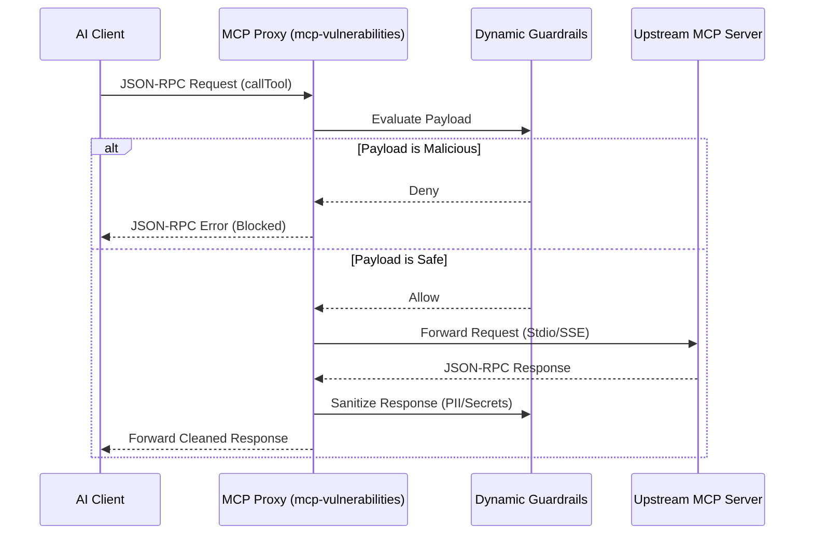
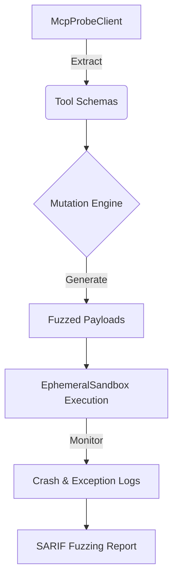

# Competitive Analysis: Verity MCP Auditor, Anthropic Inspector SDK & Runtime Sandboxes

## 1. Architectural Context & Executive Summary

While `mcp-vulnerabilities` specializes in vulnerability ingestion, static configuration auditing, polyglot package correlation, and multi-client remediation, parallel ecosystem products operate significantly at runtime. These competitive solutions focus on dynamic, in-memory execution, inline policy enforcement, and OS-level sandboxing, domains currently untouched by `mcp-vulnerabilities` static-first design.

This document conducts a deep technical benchmarking comparing `mcp-vulnerabilities` against the primary runtime solutions in the MCP ecosystem:
1. **Verity MCP Auditor**: Provides real-time SQL/NoSQL AST interception, dynamic schema discovery, fingerprinting, and automated exploit simulation.
2. **Anthropic MCP Inspector SDK**: Official developer toolkit providing interactive web UI for testing tools, resources, and prompts over stdio/SSE transports with protocol message replay and schema validation.
3. **Cursor Local Sandbox**: OS-level namespace/cgroup isolation for MCP server sub-processes restricting network and filesystem access.

---

## 2. Architectural Feature Matrix & Runtime Gap Analysis

| Capability / Feature | `mcp-vulnerabilities` (v1.1.0) | Verity MCP Auditor | Anthropic Inspector | Cursor Local Sandbox |
| :--- | :--- | :--- | :--- | :--- |
| **Analysis Paradigm** | Static Analysis, AST, SBOM | Dynamic Analysis, Exploit Sim | Interactive Dynamic Test | Runtime OS Isolation |
| **Tool Interception** | **NO** (Static compliance only) | **YES** (AST intercept, proxy) | **YES** (Message trace/replay) | **NO** (Process level) |
| **Data Guardrails** | **NO** | **YES** (SQL/NoSQL guard) | **NO** | **YES** (FS/Network deny) |
| **Protocol Inspection** | **NO** | **NO** | **YES** (Trace, validate) | **NO** |
| **Fuzzing Harness** | **NO** | **YES** (Exploit generation) | **NO** | **NO** |
| **OS Sandboxing** | Ephemeral Docker only | **NO** | **NO** | **YES** (Namespaces, cgroups) |
| **Inline MCP Proxy** | **NO** | **YES** | **NO** | **NO** |
| **Interactive Web UI** | Static GitHub Pages only | **NO** | **YES** (Built-in React UI) | **NO** |

### Runtime Proxy Capabilities Evaluation
`mcp-vulnerabilities` currently **cannot** act as an inline MCP proxy. It lacks the architectural components required to intercept JSON-RPC messages between an AI client and an MCP server, filter them against dynamic security policies, and forward them conditionally.

---

## 3. Grading of Missed Capabilities

### HIGH Severity Gaps

1. **Lack of Inline MCP Proxy Interceptor**
   - **Gap**: `mcp-vulnerabilities` cannot actively block threats at runtime. If a vulnerable server is running, the AI client can send malicious payloads (e.g., destructive SQL or shell injection) that will execute successfully.
   - **Impact**: Limits the tool to purely preventative and reactive phases, offering zero protection during the active execution phase. Verity excels here.

2. **Lack of Protocol Message Recorder and Automated Fuzzing Harness**
   - **Gap**: Unknown or proprietary MCP servers cannot be dynamically tested for vulnerabilities. Without a fuzzing harness, discovering new vulnerabilities relies entirely on static AST rules (which only work for open-source Python code) or third-party NVD disclosures.
   - **Impact**: Severe limitation on zero-day vulnerability discovery for compiled or closed-source servers.

### MEDIUM Severity Gaps

1. **Lack of Built-in Web-Based Interactive MCP Debugger UI**
   - **Gap**: Anthropic Inspector provides a seamless developer experience for manually testing tool inputs and reviewing outputs. `mcp-vulnerabilities` relies on CLI outputs and SARIF reports.
   - **Impact**: High friction for security analysts attempting to manually verify complex exploit chains or reproduce dynamic findings.

2. **Absence of Kernel-Level Sandbox Enforcement Profiles**
   - **Gap**: Cursor uses OS-native sandboxing (namespaces/seccomp). While `mcp-vulnerabilities` has the `EphemeralSandbox` for testing, it cannot export these profiles (e.g., AppArmor, seccomp-bpf filters, Landlock policies) to AI clients (like Claude Desktop) to enforce during normal operation.
   - **Impact**: Missed opportunity to standardize runtime execution environments across disparate AI clients.

### LOW Severity Gaps

1. **Absence of Exportable Mock MCP Servers**
   - **Gap**: No mechanism to generate safe, mock versions of vulnerable servers for client integration testing or honeypot deployment.
   - **Impact**: Lower priority, primarily affects QA and deception-based security models.

---

## 4. Architectural Proposals & Implementation Specifications

### Proposal 1: `mcp-vulnerabilities proxy` (Inline Interception Daemon)

**Objective**: Introduce an inline JSON-RPC proxy that sits between the AI Client and the MCP Server, enforcing dynamic guardrails.

**Architecture**:
- **Protocol**: Stdio pass-through using asynchronous pipelines (`asyncio.subprocess`).
- **Pipeline**:
  1. AI Client sends `JSON-RPC Request` (e.g., `callTool`).
  2. Proxy intercepts `Request`.
  3. Proxy evaluates against `DynamicGuardrails` (YARA, AST taint, RegEx).
  4. If safe, forward to MCP Server via Stdio.
  5. Intercept `Response`, sanitize output (e.g., redaction of PII/Secrets).
  6. Forward `Response` to AI Client.



**Code Blueprint (Conceptual)**:
```python
import asyncio
import json
import sys

class McpProxyDaemon:
    def __init__(self, target_cmd, ruleset):
        self.target_cmd = target_cmd
        self.ruleset = ruleset
        self.process = None
    
    async def start(self):
        self.process = await asyncio.create_subprocess_exec(
            *self.target_cmd,
            stdin=asyncio.subprocess.PIPE,
            stdout=asyncio.subprocess.PIPE
        )
        await asyncio.gather(
            self._proxy_client_to_server(),
            self._proxy_server_to_client()
        )

    async def _evaluate_guardrails(self, msg: dict) -> bool:
        # Dynamic inspection logic
        return True

    async def _proxy_client_to_server(self):
        loop = asyncio.get_running_loop()
        reader = asyncio.StreamReader()
        protocol = asyncio.StreamReaderProtocol(reader)
        await loop.connect_read_pipe(lambda: protocol, sys.stdin)
        
        async for line in reader:
            msg = json.loads(line)
            if await self._evaluate_guardrails(msg):
                self.process.stdin.write(line)
                await self.process.stdin.drain()
            else:
                sys.stdout.write(json.dumps({"error": "Blocked by MCP Proxy Policy"}) + "\n")
                sys.stdout.flush()

    async def _proxy_server_to_client(self):
        async for line in self.process.stdout:
            # Optionally redact output here
            sys.stdout.write(line.decode())
            sys.stdout.flush()
```

### Proposal 2: Dynamic Fuzzing Harness

**Objective**: Generate synthetic JSON-RPC payloads based on statically extracted tool schemas to crash or exploit unknown servers.

**Architecture**:
- Utilize the existing `McpProbeClient` to fetch schemas via `client.tools`.
- Integrate a mutation engine to generate edge-case inputs (e.g., massive strings, SQLi payloads, path traversal payloads).
- Execute tools dynamically in the `EphemeralSandbox` and monitor `stderr` or exit codes for crashes/exceptions.



### Proposal 3: Exportable AppArmor/Seccomp Profiles

**Objective**: Standardize OS-level isolation by generating configuration files that AI clients can consume.

**Architecture**:
- Map the static capability surface (e.g., network access required, filesystem read paths required) extracted during static analysis to native OS constructs.
- Generate generic AppArmor or JSON seccomp filters.
- Extend `ConfigExporter` to optionally attach these profiles alongside standard server configurations.
