# Implementation Plan: Full-System Empirical Audit & Competitive Intelligence Review (Wave 11–13)

## 1. Architectural Context & Technical Objective

With the completion and release of `mcp-vulnerabilities` **v1.1.0**, the codebase comprises 86 Python modules, 12 major subsystems, a sharded static web portal, and multi-client remediation integrations.

To ensure production hardening, zero blind spots, and unmatched strategic positioning across the AI developer ecosystem, this master plan establishes:
1. **Autonomous Live-Run Invariant Testing**: Full empirical validation of each workflow with live transports, real multi-client configurations, genuine OSV feeds, and process pools.
2. **Exhaustive Code-Level Review**: In-depth inspection of all error boundaries, edge cases, and failure modes across all 86 modules.
3. **Competitive Gap Analysis**: Empirical benchmarking against parallel products (Verity, Anthropic Inspector, Cursor Sandbox, Smithery, Glama, Snyk, Semgrep, Trivy, OSV-Scanner, Sigstore).
4. **Structured Severity Reports**: Standalone technical reports per task grading findings by **HIGH**, **MEDIUM**, and **LOW** severity with concrete patch proposals.
5. **Two Master Cumulative Artifacts**:
   - `docs/audit/CUMULATIVE_TECHNICAL_AUDIT_REPORT.md`
   - `docs/audit/CUMULATIVE_COMPETITIVE_GAP_ANALYSIS_AND_ROADMAP.md`

---

## 2. Wave Breakdown & Dependency Structure

```mermaid
graph TD
    subgraph Wave 11: Empirical Live Audit [Parallel Wave 11]
        T59[Task 59: Ingestion & OSV Schema]
        T60[Task 60: Universal 9-Client Discovery]
        T61[Task 61: Supply-Chain Tamper & Shadow Tools]
        T62[Task 62: Behavioral Topology Prober & Transports]
        T63[Task 63: Polyglot Correlator & Fixer]
        T64[Task 64: Interactive Hub & CLI TUI]
        T65[Task 65: Multi-Core Site Builder & Cache]
        T66[Task 66: Web Portal UI & Parity]
    end

    subgraph Wave 12: Competitive Benchmarks [Parallel Wave 12]
        T67[Task 67: Verity & Anthropic Runtime]
        T68[Task 68: Smithery & Glama Registries]
        T69[Task 69: Snyk, Semgrep, Trivy & OSV-Scanner]
        T70[Task 70: Sigstore & SBOM Standards]
    end

    subgraph Wave 13: Cumulative Synthesis [Synthesis Wave 13]
        T71[Task 71: Cumulative Technical Audit Report]
        T72[Task 72: Cumulative Competitive Gap & Roadmap]
    end

    T59 & T60 & T61 & T62 & T63 & T64 & T65 & T66 --> T71
    T67 & T68 & T69 & T70 --> T72
```



---

## 3. Task Catalog & Scope

### Track 1: Empirical Live-Run Invariant Audits (Tasks 59–66)

| Task ID | Title | Scope & Subsystems | Target Deliverable |
|:---:|:---|:---|:---|
| **Task 59** | Ingestion, OSV Schema Normalization & Monotonic Stream Audit | `converters/*.py`, `pipeline.py`, `deduplicator.py`, `validator.py`, `state.py` | `docs/audit/audit_task59_ingestion_and_schema.md` |
| **Task 60** | Universal 9-Client Discovery & Multi-Config Edge Case Audit | `audit/parsers.py`, `audit/config_exporter.py` | `docs/audit/audit_task60_universal_9client_audit.md` |
| **Task 61** | Supply-Chain Tamper & Shadow Tool Drift Detection Audit | `audit/tamper_detector.py`, `fingerprints/canonicalizer.py`, `sarif.py` | `docs/audit/audit_task61_supply_chain_tamper.md` |
| **Task 62** | Behavioral Topology Server Prober & Transports Audit | `probe/*.py`, `fingerprints/matcher.py` | `docs/audit/audit_task62_behavioral_topology_prober.md` |
| **Task 63** | Polyglot Vulnerability Correlator & Native Multi-Client Fixer Audit | `audit/fixer.py`, `fingerprints/correlator.py` | `docs/audit/audit_task63_polyglot_and_fixer.md` |
| **Task 64** | Interactive Terminal Hub & Command TUI Robustness Audit | `hub.py`, `cli.py` | `docs/audit/audit_task64_interactive_hub_tui.md` |
| **Task 65** | Multi-Core Parallel Site Builder & Two-Tier SHA Cache Audit | `site_builder.py`, `cache.py` | `docs/audit/audit_task65_parallel_site_builder.md` |
| **Task 66** | Web Security Portal Responsive UI & Parity Audit | `docs/index.html`, `docs/app.js`, `docs/updates.js`, `docs/style.css` | `docs/audit/audit_task66_web_portal_ui_parity.md` |

### Track 2: Competitive Benchmark & Gap Research Tasks (Tasks 67–70)

| Task ID | Title | Scope & Comparison Target | Target Deliverable |
|:---:|:---|:---|:---|
| **Task 67** | Benchmark vs. Verity MCP Auditor & Anthropic Security Controls | Verity MCP DB Guard/Oracle, Anthropic MCP Inspector SDK, Cursor Sandbox | `docs/audit/competitive_task67_verity_anthropic_runtime.md` |
| **Task 68** | Benchmark vs. Smithery.ai & Glama.ai Registry Security | Smithery build pipelines, Glama metadata discovery, MCP manifest standards | `docs/audit/competitive_task68_smithery_glama_registries.md` |
| **Task 69** | Benchmark vs. Snyk, Semgrep, Trivy & OSV-Scanner | Snyk OpenSource, Semgrep Rule Engine, Aqua Trivy, Google OSV-Scanner | `docs/audit/competitive_task69_snyk_semgrep_trivy_osv.md` |
| **Task 70** | Benchmark vs. Supply-Chain Attestation & SBOM Standards | Sigstore / Cosign, in-toto attestations, CycloneDX v1.5, OpenSSF Scorecards | `docs/audit/competitive_task70_supply_chain_attestation.md` |

### Track 3: Master Cumulative Synthesis (Tasks 71–72)

| Task ID | Title | Scope & Aggregation | Target Deliverable |
|:---:|:---|:---|:---|
| **Task 71** | Master Cumulative Technical Audit Report Synthesis | Aggregates all empirical audit findings from Tasks 59–66 | `docs/audit/CUMULATIVE_TECHNICAL_AUDIT_REPORT.md` |
| **Task 72** | Master Cumulative Competitive Gap Analysis & Roadmap Synthesis | Aggregates all competitive gap findings from Tasks 67–70 | `docs/audit/CUMULATIVE_COMPETITIVE_GAP_ANALYSIS_AND_ROADMAP.md` |

---

## 4. Standardized Reporting Protocol (High / Medium / Low)

Every task report must strictly adhere to the following schema:

```markdown
# Technical Report: [Task ID] - [Title]
**Scope**: [Subsystem / Target System]
**Execution Mode**: [Live Empirical Run / Competitive Intelligence]
**Date**: [YYYY-MM-DD]

## 1. Executive Summary & Verification Metrics
- Total Scenarios / Criteria Evaluated: N
- Passing / Met: X / N
- Critical Gaps / Bugs Discovered:
  - 🔴 HIGH: count
  - 🟡 MEDIUM: count
  - 🟢 LOW: count

## 2. Invariant Verification Ledger
| Invariant ID | Description | Live-Run Result | Latency | Root-Cause Notes |
|:---:|:---|:---:|:---:|:---|

## 3. Discovered Findings & Gaps (Categorized by Severity)
### 🔴 HIGH Severity
- **Finding ID**: GAP-XX / BUG-XX
- **Location**: `path/to/file.py:line` or Target Competitor
- **Description**: Technical explanation of vulnerability, edge-case failure, or major feature absence.
- **Impact**: Security loophole, silent failure, data corruption, or severe competitive lag.
- **Empirical Evidence**: Command output, error trace, or comparison matrix.
- **Actionable Remediation**: Concrete code patch or architectural enhancement.

### 🟡 MEDIUM Severity
...
### 🟢 LOW Severity
...

## 4. Proposed Code Patches & Enhancements
```python
# Verified, drop-in replacement or enhancement code
```
```

---

## 5. Jules Delegation & Parallel Execution Protocol

- Tasks are defined with clean file isolation and zero merge collisions.
- Track 1 empirical tasks author their respective tests under `tests/audit/test_audit_task*.py` and their reports under `docs/audit/audit_task*.md`.
- Track 2 competitive benchmark tasks author their research and comparative tests under `tests/audit/test_competitive_task*.py` and reports under `docs/audit/competitive_task*.md`.
- All runs leverage `jules-gate wait --interactive` with zero-token polling and automated git lock merging (`--auto-rebase --skip-ci`).
