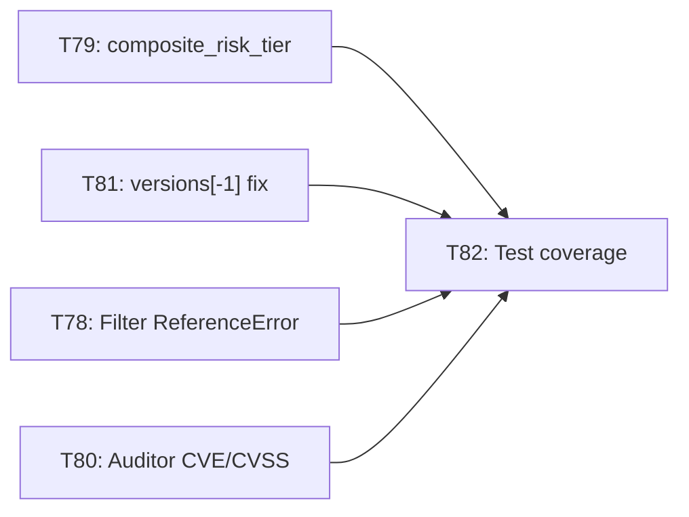

# Implementation Plan: Wave 15 — Wave 14 Code Review Remediation (Tasks 78–82)

Source: [`code_review_wave14_portal_and_analytics.md`](../reports/code_review_wave14_portal_and_analytics.md) (Score 68/100).
Goal: Close every HIGH/MED defect from the Wave 14 review so Tasks 73–77 reach 100% acceptance.

## 1. Task Catalog

| Task | Title | Defects | Priority | Files |
| :---: | :--- | :---: | :---: | :--- |
| **78** | Advisory Filter `ReferenceError` Fix | W14-01 | `P0` | `docs/app.js` |
| **79** | Precomputed `composite_risk_tier` in Catalog Index | W14-02 | `P0` | `site_builder.py`, `docs/app.js`, `docs/updates.js` |
| **80** | Config Auditor CVE IDs & CVSS Scores | W14-03 | `P0` | `docs/app.js`, `docs/style.css` |
| **81** | Latest-Version Analytics & Catalog Tool Ingestion | W14-05 | `P1` | `site_builder.py` |
| **82** | Wave 14 Automated Test Coverage (`test_analytics.py`) | W14-04 | `P1` | `tests/test_analytics.py`, `tests/test_wave14_portal.py` |

## 2. Dependency Graph

- **Parallel wave A:** T78, T80 (frontend, `docs/app.js` — different functions), T79 + T81 (both `site_builder.py`; run sequentially or as one Jules session to avoid conflicts).
- **Wave B:** T82 after A merges (tests assert the fixed behavior).

> [!WARNING]
> T79 and T81 both edit `src/mcp_vulnerabilities/site_builder.py` (`build_site_parallel` ~L505–545 and analytics loop ~L640–690). Dispatch them in one session or serialize to avoid 3-way conflicts like Task 76.

## 3. Out of Scope (LOW defects, tracked for a later hygiene task)
W14-06 (undefined CSS vars / `.badge-eco`), W14-07 (sub-tab reset), W14-08 (`.fp-badge` keyboard a11y), W14-09 (`rel="noopener"`), W14-10 (sparkline `viewBox`).

## 4. Verification Protocol
1. `node -c docs/app.js docs/updates.js` — syntax clean.
2. `.venv/bin/pytest -q` — no regressions (baseline 346 passed, 5 skipped) + new tests green.
3. Rebuild site data (`python -m mcp_vulnerabilities.site_builder`) and confirm `mcp_catalog_index.json` has `composite_risk_tier`.
4. Chrome DevTools check on live Pages: zero console errors; vulnerable cards show non-LOW risk; auditor shows CVE IDs.
5. Commits with `[skip ci]` during dev; one final push without it to trigger CI + Pages.
