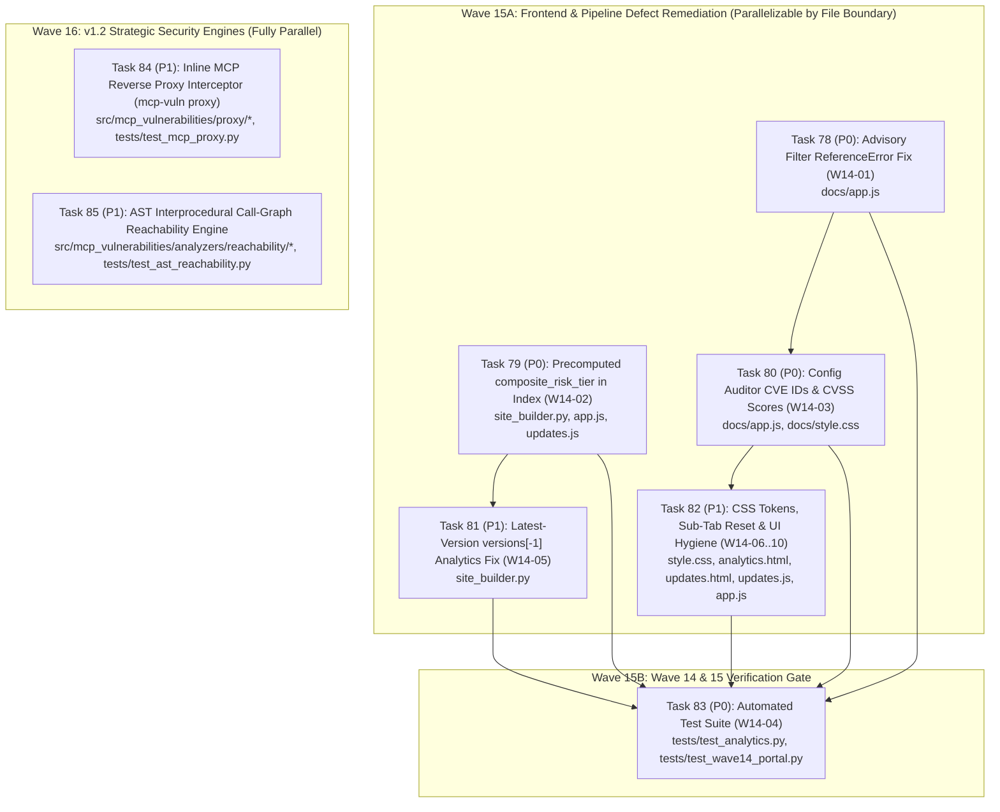

# Implementation Plan: Wave 15 (Wave 14 Code Review Remediation) & Wave 16 (v1.2 Runtime Proxy & AST Reachability)

**Source Audit Reports:**
- [`docs/reports/code_review_wave14_portal_and_analytics.md`](../reports/code_review_wave14_portal_and_analytics.md) (Wave 14 Scorecard: `68 / 100`, 10 cataloged defects `DEFECT-W14-01` through `DEFECT-W14-10`)
- [`docs/audit/CUMULATIVE_COMPETITIVE_GAP_ANALYSIS_AND_ROADMAP.md`](../audit/CUMULATIVE_COMPETITIVE_GAP_ANALYSIS_AND_ROADMAP.md) (v1.2 Strategic Architectural Blueprints: Inline MCP Reverse Proxy & AST Call-Graph Reachability Engine)

---

## 1. Executive Summary & Strategic Objectives

Following the v1.1.4 release of Wave 14 (*Web Security Intelligence, Fingerprint Synergy & Enhanced Analytics*), a comprehensive line-by-line security and frontend architectural review (`code_review_wave14_portal_and_analytics.md`) graded Wave 14 at **68 / 100**, identifying **10 concrete defects** (4 High, 2 Medium, 4 Low):
1. **`DEFECT-W14-01` (HIGH):** Uncaught `ReferenceError: server is not defined` in `docs/app.js:1302` inside `applyAdvisoryFilters()` when `#filterToolsOnly` is checked.
2. **`DEFECT-W14-02` (HIGH):** Architectural data starvation in `getServerCompositeRisk(s)` (`docs/app.js:683–710`) where `mcp_catalog_index.json` omits `versions`, causing all 344+ vulnerable servers to fall back to `Risk: LOW` on directory cards.
3. **`DEFECT-W14-03` (HIGH):** Missing CVE IDs, CVSS scores, and severity badges in the in-browser Config Auditor posture report (`docs/app.js:553–561`).
4. **`DEFECT-W14-04` (HIGH):** Missing automated test suite `tests/test_analytics.py` and zero frontend/portal invariant tests for Wave 14 deliverables.
5. **`DEFECT-W14-05` (MEDIUM):** Ascending-sort index inversion in `src/mcp_vulnerabilities/site_builder.py` (lines 506 and 651) inspecting `versions[0]` (oldest alpha release) instead of `versions[-1]` (latest production release), starving the Secrets Perimeter and Capability Surface analytics.
6. **`DEFECT-W14-06`..`W14-10` (MEDIUM/LOW):** Undefined CSS design tokens (`--bg-tertiary`, `--primary-color`, `.badge-eco`), modal primitive sub-tab desynchronization on version switch, missing keyboard accessibility on `.fp-badge`, missing `rel="noopener"` on external feed links, and missing responsive `viewBox` on `#historical-sparkline`.

Simultaneously, the **Cumulative Competitive Gap Analysis & Roadmap** (`Task 72`) prioritized two core **v1.2** engineering capabilities to close the highest-severity competitive gaps against Verity, Anthropic Inspector, Snyk, and Semgrep:
- **v1.2 Blueprint 1 — Inline MCP Reverse Proxy Interceptor (`mcp-vuln proxy`)**: Real-time STDIO/SSE JSON-RPC firewall intercepting `tools/list` and `tools/call` frames to block known vulnerable tools, shadow tool injections, and malicious payloads before they reach target servers.
- **v1.2 Blueprint 2 — AST Interprocedural Call-Graph Reachability Engine**: Static Python & JS/TS AST call-graph analyzer tracing from `@mcp.tool` entrypoints into third-party dependencies to distinguish genuinely reachable vulnerabilities (`REACHABLE`) from unused transitive imports (`UNREACHABLE_IMPORT`).

This implementation plan structures **8 self-contained, Jules-ready engineering tasks (Tasks 78–85)** across **Wave 15** and **Wave 16**.

---

## 2. Wave & Dependency Topology (DAG)



> [!IMPORTANT]
> **Merge Conflict Avoidance & Pipelining Protocol**:
> - **Backend Pipeline Track (`src/mcp_vulnerabilities/site_builder.py`)**: Tasks **79** and **81** both modify `site_builder.py`. Execute Task 79 first (or combine on a single rebased branch) followed by Task 81 using `--auto-rebase`.
> - **Frontend Portal Track (`docs/app.js`, `docs/style.css`, `docs/updates.js`)**: Tasks **78**, **80**, and **82** touch overlapping frontend files. Use `--auto-rebase` when merging or sequence `T78 ➔ T80 ➔ T82`.
> - **Independent v1.2 Track (Wave 16)**: Tasks **84** (`src/mcp_vulnerabilities/proxy/`) and **85** (`src/mcp_vulnerabilities/analyzers/reachability/`) operate in isolated new subpackages and can run 100% in parallel with Wave 15!

---

## 3. Master Task Catalog (Tasks 78–85)

| Task ID | Task Title | Wave | Priority | Defects / Blueprint | Target Files | Contract Card |
| :---: | :--- | :---: | :---: | :--- | :--- | :--- |
| **Task 78** | **Advisory Filter `ReferenceError` Fix & Vulnerable Tools Predicate** | Wave 15A | `P0` | `DEFECT-W14-01` | `docs/app.js` | [`task78_advisory_filter_reference_error_fix.md`](task78_advisory_filter_reference_error_fix.md) |
| **Task 79** | **Precomputed `composite_risk_tier` & `highest_cve_severity` in Catalog Index** | Wave 15A | `P0` | `DEFECT-W14-02` | `src/mcp_vulnerabilities/site_builder.py`, `docs/app.js`, `docs/updates.js` | [`task79_precomputed_composite_risk_tier_catalog_index.md`](task79_precomputed_composite_risk_tier_catalog_index.md) |
| **Task 80** | **In-Browser Config Auditor CVE IDs, CVSS Scores & Posture Report** | Wave 15A | `P0` | `DEFECT-W14-03` | `docs/app.js`, `docs/style.css` | [`task80_config_auditor_cve_ids_and_cvss_scores.md`](task80_config_auditor_cve_ids_and_cvss_scores.md) |
| **Task 81** | **Latest-Version (`versions[-1]`) Analytics & Catalog Tool Ingestion Fix** | Wave 15A | `P1` | `DEFECT-W14-05` | `src/mcp_vulnerabilities/site_builder.py` | [`task81_latest_version_analytics_and_catalog_ingestion.md`](task81_latest_version_analytics_and_catalog_ingestion.md) |
| **Task 82** | **CSS Design Tokens, Sub-Tab Reset, Sparkline `viewBox` & UI Hygiene** | Wave 15A | `P1` | `DEFECT-W14-06`..`W14-10` | `docs/style.css`, `docs/analytics.html`, `docs/updates.html`, `docs/updates.js`, `docs/app.js` | [`task82_css_variables_accessibility_and_ui_hygiene.md`](task82_css_variables_accessibility_and_ui_hygiene.md) |
| **Task 83** | **Wave 14 & 15 Automated Test Suite (`test_analytics.py` & `test_wave14_portal.py`)** | Wave 15B | `P0` | `DEFECT-W14-04` | `tests/test_analytics.py`, `tests/test_wave14_portal.py` | [`task83_wave14_automated_test_coverage.md`](task83_wave14_automated_test_coverage.md) |
| **Task 84** | **v1.2 Inline MCP Reverse Proxy Interceptor (`mcp-vuln proxy`)** | Wave 16 | `P1` | `Blueprint 1 (Task 67/72)` | `src/mcp_vulnerabilities/proxy/*`, `src/mcp_vulnerabilities/cli.py`, `tests/test_mcp_proxy.py` | [`task84_inline_mcp_reverse_proxy_interceptor.md`](task84_inline_mcp_reverse_proxy_interceptor.md) |
| **Task 85** | **v1.2 AST Interprocedural Call-Graph Reachability Engine** | Wave 16 | `P1` | `Blueprint 2 (Task 69/72)` | `src/mcp_vulnerabilities/analyzers/reachability/*`, `src/mcp_vulnerabilities/transitive.py`, `src/mcp_vulnerabilities/cli.py`, `tests/test_ast_reachability.py` | [`task85_ast_call_graph_reachability_engine.md`](task85_ast_call_graph_reachability_engine.md) |

---

## 4. Detailed Technical Specifications per Task

### 4.1 Task 78: Advisory Filter `ReferenceError` Fix (`DEFECT-W14-01`)
- **Root Cause:** In `docs/app.js` (~L1301–1303), inside `applyAdvisoryFilters()`, the filter callback `allAdvisories.filter((adv) => { ... })` checks:
  ```javascript
  if (el.filterToolsOnly && el.filterToolsOnly.checked) {
    if (!server.tools_count || server.tools_count === 0) return false;
  }
  ```
  Because `server` is not in scope inside `applyAdvisoryFilters()`, checking `#filterToolsOnly` and viewing/filtering advisories throws an uncaught `ReferenceError: server is not defined`.
- **Technical Fix:**
  Replace the invalid `server.tools_count` check in `applyAdvisoryFilters()` with a helper predicate `advisoryHasVulnerableTools(adv)` that returns `true` when:
  1. `Array.isArray(adv.database_specific?.vulnerable_tools) && adv.database_specific.vulnerable_tools.length > 0`, OR
  2. `Array.isArray(adv.affected)` and at least one `aff` entry has `Array.isArray(aff.database_specific?.vulnerable_tools) && aff.database_specific.vulnerable_tools.length > 0`.
  Preserve the server-level check in `applyDirectoryFilters()` (~L662) where `server` is legitimately in scope.

### 4.2 Task 79: Precomputed `composite_risk_tier` in Catalog Index (`DEFECT-W14-02`)
- **Root Cause:** `getServerCompositeRisk(server)` (`docs/app.js:683–710`) iterates `server.versions` to find the highest CVE severity across vulnerable versions. However, `site_builder.py` (~L505–545) intentionally omits `versions` from `mcp_catalog_index.json` to keep the initial index payload lightweight. Consequently, `server.versions` is always `undefined` when rendering directory cards, causing every vulnerable server to display `Risk: LOW` (its `static_risk_tier`).
- **Technical Fix:**
  1. In `src/mcp_vulnerabilities/site_builder.py`, define a deterministic severity rank mapping: `{"CRITICAL": 4, "HIGH": 3, "MEDIUM": 2, "MODERATE": 2, "LOW": 1, "NONE": 0, "UNKNOWN": 0}`.
  2. While constructing each `catalog_index` entry in `build_site_parallel()`, inspect all `versions` (and their `advisories`) from the full `record` dict before stripping `versions`. Compute:
     - `highest_cve_severity`: The highest advisory severity string (`"CRITICAL"`, `"HIGH"`, `"MEDIUM"`, `"LOW"`, or `None` if not vulnerable). If `is_vulnerable` is `True` and an advisory lacks an explicit severity string, default that advisory's floor to `"HIGH"`.
     - `composite_risk_tier`: The higher-ranked tier between `static_risk_tier` and `highest_cve_severity` (normalizing `"MODERATE"` to `"MEDIUM"`).
  3. In `docs/app.js` and `docs/updates.js`, update `getServerCompositeRisk(server)` to immediately return `server.composite_risk_tier` if present and non-empty, falling back to the `server.versions` traversal (used when full shard data is loaded) and finally `server.static_risk_tier || "LOW"`.

### 4.3 Task 80: Config Auditor CVE IDs & CVSS Scores (`DEFECT-W14-03`)
- **Root Cause:** Task 77 Scenario 2 requires the in-browser Config Auditor posture report to display CVE IDs, CVSS scores, and recommended safe versions for each vulnerable package. Currently, `renderAuditResults()` (`docs/app.js:553–561`) only prints generic text (`Found <pkg> which has known vulnerabilities`) without any CVE IDs or CVSS scores.
- **Technical Fix:**
  1. Add a helper `findMatchingAdvisoriesForPackage(pkgName, ecosystem, pinnedVersion)` in `docs/app.js` that searches `allAdvisories` (matching `affected[].package.name` case-insensitively and normalizing npm/pypi names).
  2. For each matched advisory, extract:
     - `id` (e.g. `CVE-2025-10193` or `GHSA-...` plus aliases),
     - `severity` (`database_specific.severity` or derived from CVSS),
     - `cvss_score` (`database_specific.cvss_score` or parsed from `severity[]`),
     - `summary` (escaped via `escapeHtml()`).
  3. Update `auditConfigContent()` and `renderAuditResults()` to attach `matchedAdvisories` to each audited server result and render structured `.audit-cve-list` badges showing the CVE ID, CVSS score pill (e.g., `CVSS 9.8 CRITICAL`), and summary, plus a total matched CVE counter in the audit summary banner.

### 4.4 Task 81: Latest-Version (`versions[-1]`) Analytics & Catalog Ingestion Fix (`DEFECT-W14-05`)
- **Root Cause:** `versions` on each server record in `site_builder.py` are sorted in ascending SemVer order (`_parse_sort_version`, lines 153 and 378), meaning `versions[0]` is the oldest historical release and `versions[-1]` is the latest release. However:
  - Line 506 uses `versions[0].get("tools", [])` for `mcp_catalog_index.json` (`tools_count`, `tools_sample`),
  - Line 651 uses `v = versions[0]` in the analytics aggregation loop for capability classification and `required_env_vars`.
- **Technical Fix:**
  1. Introduce a helper `_select_representative_version(versions: list[dict]) -> dict` in `src/mcp_vulnerabilities/site_builder.py` that selects `versions[-1]` (the latest release), with a fallback to the newest version in `reversed(versions)` that has non-empty `tools` if `versions[-1]` has zero tools.
  2. Use `_select_representative_version(versions)` at both line ~506 (catalog index construction) and line ~651 (analytics capability & secrets perimeter loop), and also check `record.get("required_env_vars")` alongside `v.get("required_env_vars")` so secrets perimeter counts are never lost.

### 4.5 Task 82: CSS Design Tokens, Sub-Tab Reset, Sparkline `viewBox` & UI Hygiene (`DEFECT-W14-06`..`W14-10`)
- **Scope & Fixes:**
  1. **`DEFECT-W14-06` (`docs/style.css`, `docs/analytics.html`)**: Define `--bg-tertiary`, `--primary-color`, `--bg-card`, `--bg-hover`, and `--badge-bg` in `:root` in `docs/style.css`, and add `.badge-eco` styling so transport badges, fingerprint badges, active primitive tabs, and analytics chart cards have solid, high-contrast backgrounds.
  2. **`DEFECT-W14-07` (`docs/app.js`, `docs/updates.js`)**: In `selectVersion()`, reset the active primitive sub-tab to `"tools"` (`modal-tools-tab`) so switching versions never leaves the tab bar desynchronized from the displayed container.
  3. **`DEFECT-W14-08` (`docs/app.js`, `docs/updates.js`)**: Add `role="button"`, `tabindex="0"`, and `onkeydown="if(event.key==='Enter'||event.key===' '){event.preventDefault();this.click();}"` on `.fp-badge` elements.
  4. **`DEFECT-W14-09` (`docs/updates.html`)**: Add `rel="noopener"` to all `target="_blank"` Atom/JSON feed links in the header and footer.
  5. **`DEFECT-W14-10` (`docs/updates.html`, `docs/updates.js`)**: Add `viewBox="0 0 1000 80" preserveAspectRatio="none"` to `<svg id="historical-sparkline">` and use a fixed 1000×80 coordinate space in `renderSparkline()` so the SVG scales fluidly across mobile and desktop viewports without distortion.

### 4.6 Task 83: Wave 14 & 15 Automated Test Suite (`DEFECT-W14-04`)
- **Deliverables:**
  1. `tests/test_analytics.py`: Fixture-driven unit and integration tests for `build_site_parallel()` verifying:
     - `patched_remediable_count` vs `zero_day_unpatched_count` math (`INVARIANT_1A`),
     - Capability surface aggregation (`filesystem_access`, `shell_execution`, `network_egress`, `mutating_tools`, `read_only_tools`),
     - Secrets perimeter (`required_env_vars`), transport topology (`stdio` vs `sse`), and tool shadowing detection,
     - `versions[-1]` latest-version selection (`Task 81`),
     - `composite_risk_tier` and `highest_cve_severity` stamping (`Task 79`).
  2. `tests/test_wave14_portal.py`: Static & Node.js verification tests checking:
     - `node -c docs/app.js` and `node -c docs/updates.js` syntax validity,
     - Absence of `server.` references inside `applyAdvisoryFilters()` (`Task 78`),
     - Presence of CVE/CVSS rendering logic in `docs/app.js` (`Task 80`),
     - Presence of required CSS variables (`--bg-tertiary`, `--primary-color`, `.badge-eco`) in `docs/style.css` and `rel="noopener"` / `viewBox` in `docs/updates.html` (`Task 82`).

### 4.7 Task 84: v1.2 Inline MCP Reverse Proxy Interceptor (`mcp-vuln proxy`)
- **Deliverables:**
  1. `src/mcp_vulnerabilities/proxy/policy.py`: `ProxyPolicyEngine` evaluating JSON-RPC requests/responses against:
     - Known vulnerable tool blocklists (`vulnerable_tools` from OSV advisories affecting the target server),
     - Runtime shadow tool drift (blocking `tools/call` on tools not in the server's verified passport when `--strict-passport` is enabled),
     - Parameter payload guardrails (detecting command injection, path traversal `../`, and destructive SQL patterns in tool arguments).
  2. `src/mcp_vulnerabilities/proxy/interceptor.py`: `McpStdioProxy` and `McpSseProxy` mediating bidirectional JSON-RPC traffic between an AI client (`stdin`/`stdout`) and a target MCP server subprocess, returning standard JSON-RPC 2.0 error responses (`code: -32001`, `"Blocked by MCP Security Proxy"`) on policy violations and logging structured audit events to `stderr` or `--audit-log <file>`.
  3. `src/mcp_vulnerabilities/cli.py`: New `mcp-vuln proxy` CLI subcommand (`mcp-vuln proxy [--mode block|audit] [--package <pkg>] [--strict-passport] [--audit-log <path>] -- <command> [args...]`).
  4. `tests/test_mcp_proxy.py`: Comprehensive unit and subprocess integration tests verifying clean forwarding, vulnerable tool blocking, payload injection blocking, audit-only mode, and shadow tool interception.

### 4.8 Task 85: v1.2 AST Interprocedural Call-Graph Reachability Engine
- **Deliverables:**
  1. `src/mcp_vulnerabilities/analyzers/reachability/call_graph.py`: `AstReachabilityAnalyzer` supporting Python (`ast` module) and JS/TS (regex/token AST) source trees:
     - Discovers MCP tool entrypoints (`@mcp.tool()`, `@server.call_tool()`, `server.tool(...)`, `McpServer.tool`),
     - Resolves top-level and function-scoped third-party module/symbol imports,
     - Constructs an interprocedural call graph across local helper functions and classes via DFS traversal starting from exposed MCP tool entrypoints,
     - Determines whether each imported third-party package and symbol is reachable from at least one exposed MCP tool (`REACHABLE`), imported but never called by any tool (`UNREACHABLE_IMPORT`), or not imported in source (`NOT_IMPORTED`).
  2. Integration in `src/mcp_vulnerabilities/transitive.py` and `src/mcp_vulnerabilities/cli.py`: Add `--source-dir <path>` / `--reachability` support to `mcp-vuln audit-transitive` to annotate each dependency vulnerability with reachability status and downgrade/filter unreachable findings in CLI and SARIF outputs.
  3. `tests/test_ast_reachability.py`: Unit and multi-hop interprocedural tests (direct call, 3-hop helper chain, dead helper function, unused top-level import, JS/TS tool handler) verifying 100% precision on reachability classification.

---

## 5. Verification & Quality Gate Protocol

1. **JavaScript Syntax Gate:** `node -c docs/app.js && node -c docs/updates.js` must exit `0`.
2. **Full Pytest Suite Gate:** `.venv/bin/pytest -q` must pass 100% of runnable tests (346 existing + all new tests in `test_analytics.py`, `test_wave14_portal.py`, `test_mcp_proxy.py`, and `test_ast_reachability.py`).
3. **Dataset & Schema Gate:** `python3 -m mcp_vulnerabilities.cli validate --dir data/vulnerabilities` must report 0 invalid advisories.
4. **Wave 14 Review Re-Score:** All 10 defects (`DEFECT-W14-01` through `DEFECT-W14-10`) verified closed, raising the Wave 14 Scorecard from **68 / 100** to **100 / 100**.
