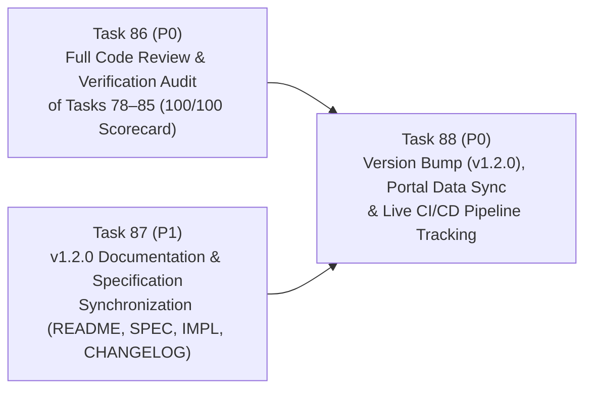

# Implementation Plan — Wave 17: Full Code Review & Verification Audit (Tasks 78–85), v1.2.0 Documentation Synchronization & Release Pipeline (Tasks 86–88)

**Version:** 1.0  
**Date:** 2026-10-25  
**Target Release:** `v1.2.0`  
**Scope:** Wave 17 (Tasks 86, 87, and 88)

---

## 1. Executive Objective

With Wave 15 (Tasks 78–83: Wave 14 Code Review Remediation) and Wave 16 (Tasks 84–85: v1.2 Inline MCP Reverse Proxy Interceptor `mcp-vuln proxy` and AST Interprocedural Call-Graph Reachability Engine) merged into `main`, Wave 17 executes the three final quality, documentation, and release engineering gates required to publish `v1.2.0`:

1. **Task 86 (`P0`): Full Code Review & Empirical Verification Audit of Tasks 78–85**
   - Audit every line modified across Tasks 78–85 (`docs/app.js`, `docs/updates.js`, `docs/updates.html`, `docs/style.css`, `src/mcp_vulnerabilities/site_builder.py`, `src/mcp_vulnerabilities/proxy/`, `src/mcp_vulnerabilities/analyzers/reachability/`, `src/mcp_vulnerabilities/transitive.py`, `src/mcp_vulnerabilities/cli.py`, and `tests/`).
   - Verify all 10 Wave 14 defects (`DEFECT-W14-01` through `DEFECT-W14-10`) are 100% resolved and all v1.2 invariants (`mcp-vuln proxy` and `audit-transitive --source-dir --reachable-only`) hold under automated testing.
   - Author the comprehensive code review and verification report at [`docs/reports/code_review_wave15_16_remediation_and_v12.md`](../reports/code_review_wave15_16_remediation_and_v12.md) and update [`docs/reports/code_review_wave14_portal_and_analytics.md`](../reports/code_review_wave14_portal_and_analytics.md) to reflect the `100 / 100` post-remediation scorecard.
2. **Task 87 (`P1`): Comprehensive v1.2.0 Documentation & Specification Synchronization**
   - Update [`README.md`](../../README.md), [`docs/SPECIFICATION.md`](../SPECIFICATION.md), [`docs/IMPLEMENTATION.md`](../IMPLEMENTATION.md), [`CHANGELOG.md`](../../CHANGELOG.md), and [`docs/tasks/README.md`](README.md) with complete architectural documentation, CLI usage examples, JSON-RPC 2.0 error codes (`-32001`), AST call-graph reachability classifications (`REACHABLE_FROM_TOOL`, `IMPORTED_ONLY`, `UNREACHABLE`), and Wave 15/16 verification metrics.
3. **Task 88 (`P0`): Version Bump (`v1.2.0`), Portal Index Regeneration & CI/CD Pipeline Tracking**
   - Bump version from `1.1.5` to `1.2.0` across [`pyproject.toml`](../../pyproject.toml), [`src/mcp_vulnerabilities/__init__.py`](../../src/mcp_vulnerabilities/__init__.py), and any version assertions in `tests/`.
   - Regenerate/verify `docs/data/mcp_catalog_index.json` and `docs/data/analytics.json` so `highest_cve_severity` and `composite_risk_tier` are populated in the live static portal data.
   - Push the release commit (without `[skip ci]`) to trigger GitHub Actions CI (`ci.yml`) across Python 3.12 and Python 3.14 and track the workflow run to 100% green completion.

---

## 2. Dependency Graph & Execution Topology

- **Wave 17A (Parallel Jules Dispatch)**:
  - **Task 86** touches only `docs/reports/code_review_wave15_16_remediation_and_v12.md` and `docs/reports/code_review_wave14_portal_and_analytics.md` (plus any minor defect fixes if discovered).
  - **Task 87** touches `README.md`, `docs/SPECIFICATION.md`, `docs/IMPLEMENTATION.md`, `CHANGELOG.md`, and `docs/tasks/README.md`.
  - Zero file overlap between Task 86 and Task 87 allows simultaneous parallel execution on Google Jules.
- **Wave 17B (Release & CI Gate)**:
  - **Task 88** runs after Tasks 86 and 87 land on `main`, bumping `pyproject.toml` and `src/mcp_vulnerabilities/__init__.py` to `1.2.0`, updating `docs/data/mcp_catalog_index.json` with precomputed `composite_risk_tier` fields, pushing to `origin main` (without `[skip ci]`), and tracking the GitHub Actions CI run (`gh run watch`) to 100% green completion.

---

## 3. Detailed Task Specifications

### Task 86: Full Code Review & Empirical Verification Audit of Tasks 78–85 (`P0`)
- **Contract Card:** [`docs/tasks/task86_full_code_review_and_verification_waves15_16.md`](task86_full_code_review_and_verification_waves15_16.md)
- **Deliverables:**
  1. [`docs/reports/code_review_wave15_16_remediation_and_v12.md`](../reports/code_review_wave15_16_remediation_and_v12.md): Line-by-line technical audit of Tasks 78–85, verifying:
     - All 10 Wave 14 defects (`DEFECT-W14-01`..`W14-10`) are resolved with exact file and line citations.
     - Task 84 (`src/mcp_vulnerabilities/proxy/policy.py`, `interceptor.py`, `cli.py`, `tests/test_mcp_proxy.py`) satisfies all 6 runtime proxy invariants (`INVARIANT_84_1A`..`3B`).
     - Task 85 (`src/mcp_vulnerabilities/analyzers/reachability/call_graph.py`, `transitive.py`, `cli.py`, `tests/test_ast_reachability.py`) satisfies all 6 AST call-graph reachability invariants (`INVARIANT_85_1A`..`2C`).
  2. Update [`docs/reports/code_review_wave14_portal_and_analytics.md`](../reports/code_review_wave14_portal_and_analytics.md) with a Post-Remediation Verification section upgrading the scorecard from `68 / 100` to `100 / 100`.

### Task 87: v1.2.0 Documentation & Specification Synchronization (`P1`)
- **Contract Card:** [`docs/tasks/task87_v120_documentation_and_specification_sync.md`](task87_v120_documentation_and_specification_sync.md)
- **Deliverables:**
  1. [`README.md`](../../README.md): Add documentation and CLI usage examples for `mcp-vuln proxy` (inline STDIO reverse proxy firewall) and `mcp-vuln audit-transitive --source-dir --reachable-only` (AST call-graph reachability analysis), plus updated test count badge/metrics (`370+` tests).
  2. [`docs/SPECIFICATION.md`](../SPECIFICATION.md): Add formal specification sections for the Inline MCP Reverse Proxy Protocol (`-32001` JSON-RPC 2.0 security block envelope, JSONL audit telemetry schema) and AST Interprocedural Call-Graph Reachability Engine (`REACHABLE_FROM_TOOL`, `IMPORTED_ONLY`, `UNREACHABLE`), plus precomputed `composite_risk_tier` / `highest_cve_severity` fields in `mcp_catalog_index.json`.
  3. [`docs/IMPLEMENTATION.md`](../IMPLEMENTATION.md): Document internal module architecture for `src/mcp_vulnerabilities/proxy/` and `src/mcp_vulnerabilities/analyzers/reachability/`, as well as the Wave 15 frontend/analytics architecture updates.
  4. [`CHANGELOG.md`](../../CHANGELOG.md): Add the `[1.2.0] - 2026-10-25` release section covering Wave 15 (Tasks 78–83) and Wave 16 (Tasks 84–85).
  5. [`docs/tasks/README.md`](README.md): Synchronize Sections 15, 16, and 17 with accurate session IDs, commit SHAs, `Done` statuses, and updated verification metrics.

### Task 88: Version Bump (`v1.2.0`), Portal Index Sync & CI/CD Pipeline Tracking (`P0`)
- **Contract Card:** [`docs/tasks/task88_v120_version_bump_and_ci_pipeline_tracking.md`](task88_v120_version_bump_and_ci_pipeline_tracking.md)
- **Deliverables:**
  1. Bump version to `1.2.0` in [`pyproject.toml`](../../pyproject.toml) and [`src/mcp_vulnerabilities/__init__.py`](../../src/mcp_vulnerabilities/__init__.py) (and update any hardcoded version checks in `tests/`).
  2. Ensure `docs/data/mcp_catalog_index.json` entries include precomputed `highest_cve_severity` and `composite_risk_tier` fields so the live GitHub Pages deployment immediately renders accurate composite risk badges without requiring a full network crawl.
  3. Commit and push to `origin main` **without** `[skip ci]`, monitor the GitHub Actions `CI` workflow run across Python 3.12 and Python 3.14 until it completes with `100%` green status, and record the CI run ID and URL in `docs/tasks/README.md`.
