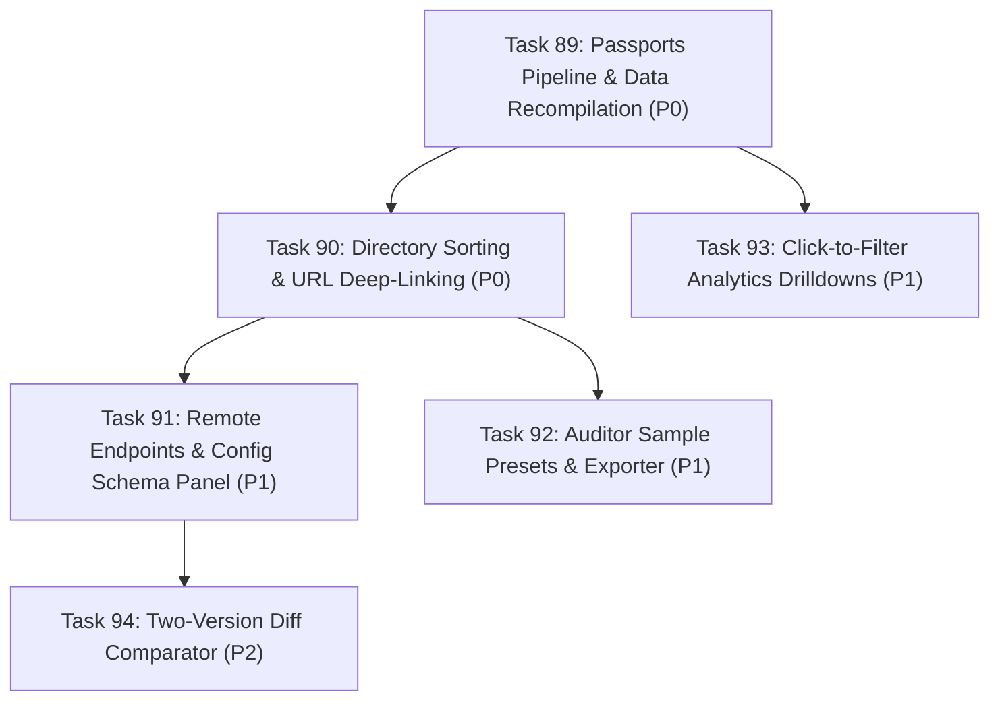

# Implementation Plan: Wave 18 — Web View & Security Intelligence Portal Enhancements (Tasks 89–94)

## 1. Context & Technical Rationale
Following the successful completion of Waves 14–17, live verification of the public GitHub Pages portals (`docs/index.html`, `docs/updates.html`, `docs/analytics.html`) identified key opportunities to advance the user experience, surface rich connection and credential metadata, and make security analysis fully interactive:
1. **Live Static Data Recompilation & Passports Pipeline Fix**: Static JSON artifacts (`docs/data/mcp_catalog_index.json`, `docs/data/analytics.json`) lack precomputed `composite_risk_tier` and report empty secrets/transports because `site_builder.py` defaults `--passports` to None and ignores `connections[*].configSchema.properties`.
2. **Explorer & Search Navigation**: The 6,289-server catalog lacks multi-criteria sorting (e.g. by Composite Risk, Vulnerable Versions, Tool Count) and URL deep-linking/shareable state (`?q=`, `?server=`, `?tab=`, `?sort=`).
3. **Endpoint & Connection Schemas in Server Modal**: 1,377 server connection definitions (`streamable-http`, `sse`, `stdio`) and deployment URLs from `passports.json.gz` are not rendered to users.
4. **Interactive In-Browser Auditing Presets & Export**: Visitors on Tab 3 ("Audit My MCP Setup") must supply their own file; 1-click sample vulnerable configs and downloadable remediation diffs (`.json` / `.md`) provide immediate value.
5. **Cross-Page Analytics Drilldown**: Charts on `analytics.html` are static; clicking a tool or OWASP category should navigate to `index.html` filtered by that criteria.
6. **Two-Version Diff Comparator**: Server modals only compare against immediate predecessors; selecting any arbitrary baseline version enables precise upgrade risk assessments.

---

## 2. Work Breakdown Structure (Tasks 89–94)

| Task ID | Task Title | Tier & Priority | Key Subsystems & Deliverables |
| :---: | :--- | :---: | :--- |
| **Task 89** | **Passports Pipeline Fix & Static Data Recompilation** | `Tier 1` (`P0`) | `src/mcp_vulnerabilities/site_builder.py`, `docs/data/` |
| **Task 90** | **Directory Multi-Criteria Sorting & URL Deep-Linking** | `Tier 2` (`P0`) | `docs/index.html`, `docs/app.js`, `docs/style.css` |
| **Task 91** | **Server Modal Remote Endpoints & Config Schema Panel** | `Tier 2` (`P1`) | `docs/index.html`, `docs/app.js`, `docs/updates.js`, `docs/style.css` |
| **Task 92** | **In-Browser Config Auditor Sample Presets & Report Exporter** | `Tier 3` (`P1`) | `docs/index.html`, `docs/app.js`, `docs/style.css` |
| **Task 93** | **Interactive Click-to-Filter Drilldowns on Analytics Portal** | `Tier 3` (`P1`) | `docs/analytics.html` |
| **Task 94** | **Interactive Arbitrary Two-Version Diff Comparator in Modal** | `Tier 3` (`P2`) | `docs/app.js`, `docs/updates.js`, `docs/style.css` |

---

## 3. Execution Graph & Wave Staging

- **Wave A (Core Data & Navigation):** Tasks 89 & 90 dispatched in parallel to ensure recompiled data and sorting/deep-linking base are active.
- **Wave B (Modal & Auditor Features):** Tasks 91, 92, and 93 dispatched in parallel.
- **Wave C (Advanced Comparison):** Task 94 finalized and verified.

---

## 4. Verification & Validation Protocol
1. **Automated Test Suite:** Zero regressions across `.venv/bin/pytest -q` (enforcing baseline `361+` passing tests).
2. **Syntax Integrity:** Clean validation via `node -c docs/app.js && node -c docs/updates.js`.
3. **Data Verification:** Confirm `mcp_catalog_index.json` has `composite_risk_tier` populated and `analytics.json` has populated `transports` and `top_secrets`.
4. **Live Chrome DevTools Check:** Verify clean rendering, no uncaught exceptions, and responsive UI on desktop and mobile viewports.
