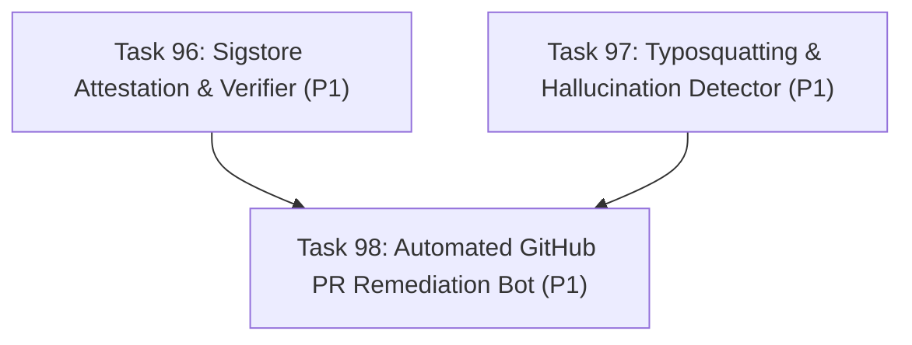

# Implementation Plan: Wave 19 — Supply Chain Integrity, Attestation & Automated Remediation (Tasks 96–98)

## 1. Context & Technical Rationale

Following the completion of Waves 14–18 (culminating in the v1.2 release and interactive portal enhancements), the strategic roadmap in [`docs/audit/CUMULATIVE_COMPETITIVE_GAP_ANALYSIS_AND_ROADMAP.md`](../audit/CUMULATIVE_COMPETITIVE_GAP_ANALYSIS_AND_ROADMAP.md) establishes three essential enterprise capabilities:
1. **Cryptographic Provenance & Tamper-Proof Feeds**: Downstream scanners and enterprise CI/CD environments must verify that vulnerability feeds (`vulnerabilities.json.gz`) and catalog index artifacts originate authentically from this repository without tampering (via Sigstore Cosign keyless signatures and Rekor transparency logs).
2. **AI Package Hallucination & Typosquatting Defense**: LLMs recommending MCP client configurations frequently generate misspelled or hallucinated packages (e.g. `mcp-server-filesytem`). Automated detection using Levenshtein distance, homoglyph analysis, and brand corpus matching is necessary to prevent prompt-driven supply chain compromise.
3. **Automated Repository Remediation Bot**: Enterprises require automated, hands-off remediation that discovers vulnerable MCP configurations across repositories and automatically generates pull requests with side-by-side diff previews and CVE posture tables (similar to Dependabot/Renovate).

---

## 2. Work Breakdown Structure (Tasks 96–98)

| Task ID | Task Title | Priority | Subsystem & Deliverables | Contract File |
| :---: | :--- | :---: | :--- | :--- |
| **Task 96** | **Sigstore Cosign Keyless Attestation & Verifiable Feed Pipeline** | `P1` | `src/mcp_vulnerabilities/attestation/`, `cli.py`, `tests/test_attestation_verifier.py` | [`task96_sigstore_keyless_attestation_pipeline.md`](task96_sigstore_keyless_attestation_pipeline.md) |
| **Task 97** | **Typosquatting & LLM Hallucinated Package Detector (`audit-typosquat`)** | `P1` | `src/mcp_vulnerabilities/analyzers/typosquat/`, `cli.py`, `tests/test_typosquat_detector.py` | [`task97_typosquatting_and_hallucination_detector.md`](task97_typosquatting_and_hallucination_detector.md) |
| **Task 98** | **Automated GitHub PR Remediation Bot (`remediate-pr`)** | `P1` | `src/mcp_vulnerabilities/bot/`, `cli.py`, `tests/test_remediation_bot.py` | [`task98_automated_github_pr_remediation_bot.md`](task98_automated_github_pr_remediation_bot.md) |

---

## 3. Execution Graph & Wave Staging

- **Phase 1 (Parallel Engine Execution):** Tasks 96 and 97 can be dispatched concurrently as they operate in completely distinct subsystems (`attestation` vs `analyzers/typosquat`).
- **Phase 2 (Integration & Automation):** Task 98 consumes catalog data and remediation logic to generate automated PR workflows.

---

## 4. Verification & Validation Protocol

1. **Automated Test Suites**:
   - `tests/test_attestation_verifier.py` (checksums, bundle validation, tamper detection)
   - `tests/test_typosquat_detector.py` (Levenshtein, homoglyphs, authentic corpus matching)
   - `tests/test_remediation_bot.py` (config discovery, diff generation, PR body formatting)
2. **CLI Contract Verification**:
   - `mcp-vuln verify-feed --help`
   - `mcp-vuln audit-typosquat --help`
   - `mcp-vuln remediate-pr --help`
3. **Full Regression Guard**:
   - Maintain 100% pass rate across `.venv/bin/pytest -q` (370+ runnable tests).
