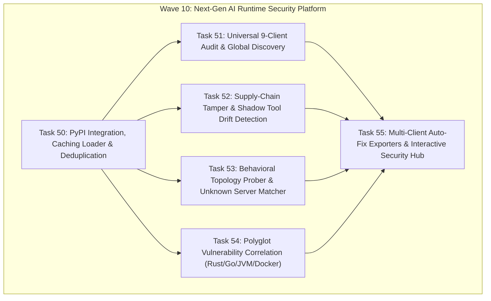

# Implementation Plan: Wave 10 — Next-Gen AI Runtime Security & Fingerprint Synergy

## 1. Executive Summary & Architectural Vision

Wave 10 elevates **`mcp-vulnerabilities`** from a static OSV advisory lookup utility into an **active, full-spectrum AI Runtime Security & Vulnerability Intelligence Platform**.

By integrating **`mcp-fingerprints`** as an authoritative dependency via PyPI, `mcp-vulnerabilities` eliminates hundreds of lines of duplicated models and algorithms while unlocking 6 foundational security capabilities:
1. **Universal 9-Client & Global Package Discovery**
2. **Supply-Chain Tampering & "Shadow Tool" Detection (Zero-Day Drift)**
3. **Unknown / Custom Server Identification via Behavioral Topology**
4. **Polyglot Vulnerability Correlation (Rust, Go, Maven, Docker)**
5. **Multi-Client Auto-Fix & Remediation Exporters**
6. **Interactive Security Terminal Hub (`mcp-vuln hub`)**

---

## 2. Wave 10 Task Board Summary

| Task # | Subsystem | Strategic Purpose | Deliverables | Contract File |
| :---: | :--- | :--- | :--- | :--- |
| **50** | **PyPI Integration & Core Deduplication** | Single Source of Truth | Multi-tier cache loader in `mcp-fingerprints`, release v1.0.14, add PyPI dependency, eliminate redundant models/canonicalizer in `mcp-vulnerabilities`. | [task50_pypi_integration_caching_loader_and_model_deduplication.md](task50_pypi_integration_caching_loader_and_model_deduplication.md) |
| **51** | **Universal 9-Client Audit & Global Discovery** | Universal Client Auditing | Wire `ConfigScanner` and `NpmGlobalScanner` into `mcp-vuln audit`, auditing 9 AI clients + global npm/npx packages with SARIF annotations. | [task51_universal_9client_audit_and_global_package_discovery.md](task51_universal_9client_audit_and_global_package_discovery.md) |
| **52** | **Supply-Chain Tamper & Shadow Tool Drift Detection** | Zero-Day Supply Chain Security | Runtime tool signature verification against baseline passport hashes; detect unadvertised/injected shadow tools and unbumped tampering. | [task52_supply_chain_tamper_and_shadow_tool_drift_detector.md](task52_supply_chain_tamper_and_shadow_tool_drift_detector.md) |
| **53** | **Behavioral Topology Prober & Unknown Server Matcher** | Behavioral Identification | Probes custom/wrapped processes over stdio/SSE; matches runtime tools against 5,533 passports using topological similarity to unmask hidden CVEs. | [task53_behavioral_topology_prober_unknown_server_identification.md](task53_behavioral_topology_prober_unknown_server_identification.md) |
| **54** | **Polyglot Vulnerability Correlation (Rust, Go, Maven, Docker)** | Multi-Ecosystem Coverage | Ingests Rust (Cargo), Go, Java/Kotlin (Maven), and Docker Hub passports; correlates `RUSTSEC`, `GO-*`, `GHSA-java`, and container CVEs. | [task54_polyglot_vulnerability_correlation_rust_go_maven_docker.md](task54_polyglot_vulnerability_correlation_rust_go_maven_docker.md) |
| **55** | **Multi-Client Auto-Fix Exporters & Interactive Security Hub** | Remediation & Developer Experience | One-click auto-patching across all 9 clients in native formats; interactive emoji-driven terminal management hub (`mcp-vuln hub`). | [task55_multiclient_autofix_exporters_and_interactive_security_hub.md](task55_multiclient_autofix_exporters_and_interactive_security_hub.md) |

---

## 3. Dependency Graph & Execution Sequence

1. **Step 1: Task 50 (Foundation)**:
   - Must land first. Provides the PyPI package loader and deduplicates models so that downstream tasks use canonical classes (`ServerPackageSpec`, `VersionFingerprint`, `ConfigScanner`, etc.).
2. **Step 2: Parallel Wave (Tasks 51, 52, 53, 54)**:
   - Can proceed concurrently:
     - Task 51 focuses on client configuration parsing.
     - Task 52 focuses on cryptographic toolset hashing and tamper alerting.
     - Task 53 focuses on live process probing and similarity scoring.
     - Task 54 focuses on polyglot SemVer parsing and OSV advisory mapping.
3. **Step 3: Task 55 (Cap-Stone Integration)**:
   - Consolidates all discoveries, drift alerts, and correlations into unified multi-client remediation and the interactive `mcp-vuln hub` console.

---

## 4. Verification & Global Acceptance Criteria

- **Zero Regression**: All existing 268 unit and integration tests in `mcp-vulnerabilities` must pass without modifications to expected test behavior.
- **Full Invariant Coverage**: Every task specifies explicit positive, negative, and edge-case invariants (such as airgapped operation, malformed configs, process deadlocks, and corrupted schemas).
- **Format Integrity**: SARIF v2.1.0, JSON, and Markdown outputs must conform strictly to enterprise specifications.
