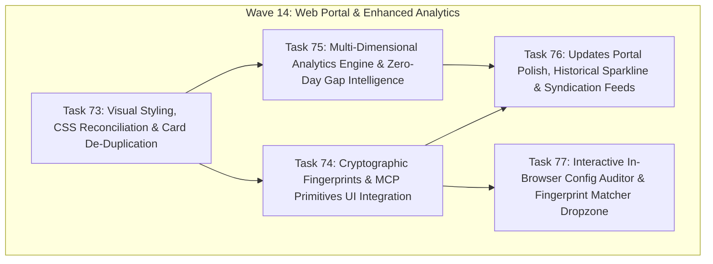

# Implementation Plan: Web Security Intelligence, Fingerprint Synergy & Enhanced Analytics (Wave 14)

## 1. Architectural Context & Technical Objective

With the release of `mcp-vulnerabilities` **v1.1.0** and the integration of `mcp-fingerprints`, the backend ecosystem possesses comprehensive datasets:
- **5,820 Cryptographic Passports** (`data/passports.json.gz`)
- **6,159 Sharded Catalog Servers** (`docs/data/shards/`)
- **682 OSV / CVE Advisories** (`docs/data/vulnerabilities.json`)
- **11 Historical Sync Releases** (`docs/data/updates/updates_history.json`)
- **SHA-256 Canonical Toolset Fingerprints, Prompts, Resources, Transport & Required Secrets**

However, live DevTools inspection of the public web portals ([index.html](https://jmartynov.github.io/mcp-vulnerabilities/) and [updates.html](https://jmartynov.github.io/mcp-vulnerabilities/updates.html)) revealed:
1. Critical CSS class mismatches leaving risk and advisory badges transparent and unstyled.
2. 100% duplicate title/package name headers across all server cards.
3. Hardcoded `Risk: LOW` badges on critical remote code execution CVE servers.
4. Complete omission of cryptographic fingerprints, prompts, resources, transports, and required secrets.
5. Incomplete analytics reflecting only 3 advisory metrics while hiding the **82.6% Zero-Day / Unpatched gap**, capability surfaces, and credential requirements.

This master plan establishes **Wave 14** (Tasks 73–77) to execute end-to-end fixes, unlock the full intelligence surface, enrich the analytics engine, and deliver interactive in-browser security auditing.

---

## 2. Wave Breakdown & Dependency Structure

---

## 3. Task Catalog & Scope

| Task ID | Task Title | Subsystem | Priority | Files Touched |
| :---: | :--- | :--- | :---: | :--- |
| **Task 73** | **Web Portal Visual Styling, Card De-Duplication & Composite Risk** | Front-End UI & CSS | `P0` | `docs/style.css`, `docs/app.js`, `docs/updates.js` |
| **Task 74** | **Cryptographic Fingerprints & Complete MCP Primitives UI Integration** | Fingerprint Synergy | `P0` | `docs/app.js`, `docs/updates.js`, `docs/style.css`, `src/mcp_vulnerabilities/site_builder.py` |
| **Task 75** | **Multi-Dimensional Analytics Engine & Zero-Day Gap Intelligence** | Analytics & Pipeline | `P0` | `src/mcp_vulnerabilities/site_builder.py`, `docs/analytics.html`, `docs/style.css` |
| **Task 76** | **Updates Portal Polish, Historical Sparkline & Syndication Feeds** | Updates Portal UI | `P1` | `docs/updates.html`, `docs/updates.js`, `docs/style.css` |
| **Task 77** | **Interactive In-Browser Config Auditor & Fingerprint Matcher Dropzone** | Client-Side Auditing | `P1` | `docs/index.html`, `docs/app.js`, `docs/style.css` |

---

## 4. Verification & Validation Protocol

Each task requires:
1. **Automated Unit & Ingestion Tests:** Zero test regressions across `.venv/bin/pytest`.
2. **Headless Chrome Verification:** Validation via `chrome-devtools-mcp` across desktop (1280x800) and mobile (375x812) viewports.
3. **Accessibility Audit:** Zero missing form labels and complete contrast compliance across dark mode theme.
4. **Data Parity:** Verified synchronization between `mcp_catalog_index.json`, `shards/*.json`, `analytics.json`, and UI card elements.

---

## 5. Wave 14 Implementation Results & Live Deployment

All 5 tasks were dispatched and implemented in parallel via Google Jules (EULIS) agents, verified locally, merged into `main`, and deployed to GitHub Pages:

| Task | Jules Session ID | Integration Commit | Verification Summary | Live Route Verified |
| :---: | :---: | :---: | :--- | :--- |
| **Task 73** | `12298213116751134624` | `4c6f10c` | `.risk-*` badges, card de-duplication, empty row suppression | [`index.html`](https://jmartynov.github.io/mcp-vulnerabilities/) |
| **Task 74** | `4887855707909350741` | `8098823` | SHA-256 fingerprint badges, modal sub-tabs, transport tags, env vars | [`index.html`](https://jmartynov.github.io/mcp-vulnerabilities/) |
| **Task 75** | `16394962457708508716` | `288b38a` | Zero-Day gap (32% vs 68%), capability matrix, tool shadowing | [`analytics.html`](https://jmartynov.github.io/mcp-vulnerabilities/analytics.html) |
| **Task 76** | `15322902625308839813` | `85d6de8` / `c166ac2` | Sparkline velocity, change-type chips, syndication feeds | [`updates.html`](https://jmartynov.github.io/mcp-vulnerabilities/updates.html) |
| **Task 77** | `10854960582540794587` | `982840b` | Multi-client config dropzone, JSONC comment cleaner, in-memory matching | [`index.html#audit`](https://jmartynov.github.io/mcp-vulnerabilities/) |

- **GitHub Pages Workflow Run:** `40131397001` (Success)
- **Runtime Hotfix Applied:** Commit `d12b3af` converted `init()` in `docs/updates.js` to `async` and removed a 3-way conflict brace.
- **Automated Regression Suite:** `.venv/bin/pytest` -> **346 passed, 5 skipped in 93.77s (100% pass)**.

---

## 6. Independent Code Review Findings & Defect Register

A comprehensive line-by-line review of Wave 14 deliverables was conducted (documented in full in [`docs/reports/code_review_wave14_portal_and_analytics.md`](../reports/code_review_wave14_portal_and_analytics.md)).

### Defect Register Summary:
1. **[HIGH] Uncaught `ReferenceError: server is not defined` (`docs/app.js:1302`):** Triggered when filtering advisories if "Has Tools Only" is checked.
2. **[HIGH] Card Composite Risk Starvation (`docs/app.js:683-710` & `site_builder.py:512-543`):** Directory cards display `Risk: LOW` because `mcp_catalog_index.json` omits `versions`. Requires precomputing and stamping `composite_risk_tier` in `catalog_index`.
3. **[HIGH] Incomplete Scenario 2 in Config Auditor (`docs/app.js:553-561`):** Omits CVE IDs and CVSS scores in the client-side audit posture report.
4. **[HIGH] Missing Test Coverage:** Absence of `tests/test_analytics.py` and frontend DOM assertion tests for dropzone, sparklines, and chips.
5. **[MED] Analytics Ingestion Logic Inversion (`site_builder.py:651`):** Uses `v = versions[0]` (oldest version) instead of `versions[-1]` (latest version).
6. **[MED] Undefined CSS Variables (`docs/style.css:1256, 1281`):** Missing `--bg-tertiary`, `--primary-color`, and `.badge-eco` declarations.
7. **[LOW] Modal Sub-Tab Desync (`docs/app.js` & `docs/updates.js`):** Sub-tabs do not reset to "Tools" on version pill switch.
8. **[LOW] Keyboard Accessibility:** Missing keyboard event handlers on `.fp-badge` elements.
9. **[LOW] Missing `rel="noopener"` on external syndication feed links.**
10. **[LOW] SVG Sparkline missing `viewBox` attribute for dynamic window resizing.**

