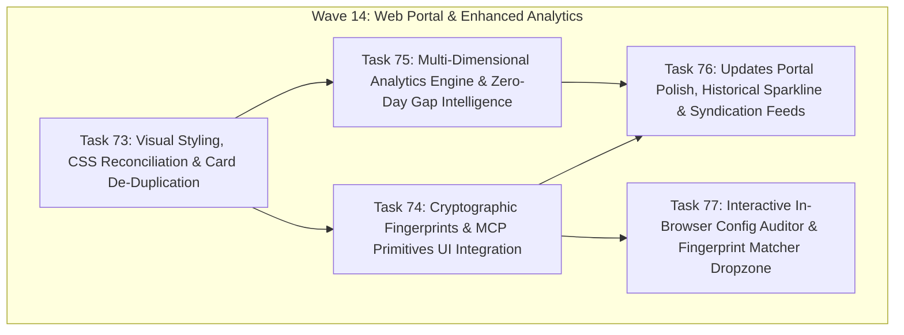

# Implementation Plan: Web Security Intelligence, Fingerprint Synergy & Enhanced Analytics (Wave 14)

## 1. Architectural Context & Technical Objective

With the release of `mcp-vulnerabilities` **v1.1.0** and the integration of `mcp-fingerprints`, the backend ecosystem possesses comprehensive datasets:
- **5,820 Cryptographic Passports** (`data/passports.json.gz`)
- **6,159 Sharded Catalog Servers** (`docs/data/shards/`)
- **682 OSV / CVE Advisories** (`docs/data/vulnerabilities.json`)
- **11 Historical Sync Releases** (`docs/data/updates/updates_history.json`)
- **SHA-256 Canonical Toolset Fingerprints, Prompts, Resources, Transport & Required Secrets**

However, live DevTools inspection of the public web portals ([index.html](https://jmartynov.github.io/mcp-vulnerabilities/) and [updates.html](https://jmartynov.github.io/mcp-vulnerabilities/updates.html)) revealed:
1. Critical CSS class mismatches leaving risk and advisory badges transparent and unstyled.
2. 100% duplicate title/package name headers across all server cards.
3. Hardcoded `Risk: LOW` badges on critical remote code execution CVE servers.
4. Complete omission of cryptographic fingerprints, prompts, resources, transports, and required secrets.
5. Incomplete analytics reflecting only 3 advisory metrics while hiding the **82.6% Zero-Day / Unpatched gap**, capability surfaces, and credential requirements.

This master plan establishes **Wave 14** (Tasks 73–77) to execute end-to-end fixes, unlock the full intelligence surface, enrich the analytics engine, and deliver interactive in-browser security auditing.

---

## 2. Wave Breakdown & Dependency Structure

---

## 3. Task Catalog & Scope

| Task ID | Task Title | Subsystem | Priority | Files Touched |
| :---: | :--- | :--- | :---: | :--- |
| **Task 73** | **Web Portal Visual Styling, Card De-Duplication & Composite Risk** | Front-End UI & CSS | `P0` | `docs/style.css`, `docs/app.js`, `docs/updates.js` |
| **Task 74** | **Cryptographic Fingerprints & Complete MCP Primitives UI Integration** | Fingerprint Synergy | `P0` | `docs/app.js`, `docs/updates.js`, `docs/style.css`, `src/mcp_vulnerabilities/site_builder.py` |
| **Task 75** | **Multi-Dimensional Analytics Engine & Zero-Day Gap Intelligence** | Analytics & Pipeline | `P0` | `src/mcp_vulnerabilities/site_builder.py`, `docs/analytics.html`, `docs/style.css` |
| **Task 76** | **Updates Portal Polish, Historical Sparkline & Syndication Feeds** | Updates Portal UI | `P1` | `docs/updates.html`, `docs/updates.js`, `docs/style.css` |
| **Task 77** | **Interactive In-Browser Config Auditor & Fingerprint Matcher Dropzone** | Client-Side Auditing | `P1` | `docs/index.html`, `docs/app.js`, `docs/style.css` |

---

## 4. Verification & Validation Protocol

Each task requires:
1. **Automated Unit & Ingestion Tests:** Zero test regressions across `.venv/bin/pytest`.
2. **Headless Chrome Verification:** Validation via `chrome-devtools-mcp` across desktop (1280x800) and mobile (375x812) viewports.
3. **Accessibility Audit:** Zero missing form labels and complete contrast compliance across dark mode theme.
4. **Data Parity:** Verified synchronization between `mcp_catalog_index.json`, `shards/*.json`, `analytics.json`, and UI card elements.
