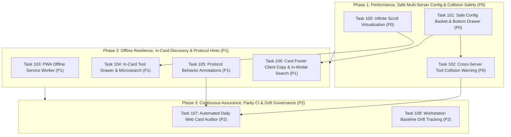

# Master Implementation Plan: Wave 20 — MCP-Fingerprints Full Capability Adoption & Enterprise Portal Experience (Tasks 100–108)

## 1. Executive Summary & Architectural Vision

Following the successful completion of Waves 14 through 19 (which introduced the multi-client auditing engine, keyless attestation, hallucination detection, and automated remediation bots), **Wave 20** delivers the comprehensive adoption of **`mcp-fingerprints`** capabilities into the **`mcp-vulnerabilities`** ecosystem.

With over 6,280+ indexed MCP servers and 15,000+ individual tools, enterprise users require a blazing-fast, resilient web portal, seamless multi-server configuration generation, pre-flight safety warnings against namespace collisions, protocol-level behavior transparency, offline capability, and rigorous CI/CD drift tracking.

Wave 20 is structured across three execution phases:
1. **Phase 1: High-Performance Browsing, Safe Multi-Server Configuration & Collision Prevention (P0)**
   - Resolves DOM scalability bottlenecks via virtualized sentinel batching (48 cards/chunk).
   - Introduces the Multi-Server Safe Config Basket with sliding bottom drawer and 6-client unified exporter.
   - Deploys real-time cross-server tool collision detection to prevent dangerous runtime tool shadowing.
2. **Phase 2: Offline Resilience, In-Card Tool Exploration & Protocol Behavior Annotations (P1)**
   - Equips the portal with Progressive Web App (PWA) offline capabilities and intelligent cache-first service worker routing.
   - Upgrades directory cards with inline tool exploration and instant microsearch with match counts.
   - Surfaces AST protocol hints (`readOnlyHint`, `destructiveHint`, `idempotentHint`, `openWorldHint`) extracted directly from server passports.
   - Adds 1-click card footer client snippets and in-modal toolset search for 40+ tool environments.
3. **Phase 3: Continuous Assurance, Daily CI Parity Auditing & Workstation Baseline Drift Tracking (P2)**
   - Establishes automated daily CI card-to-shard and card-to-advisory parity auditing (`scripts/audit_web_cards.py`).
   - Implements baseline snapshotting (`--save-baseline`) and workstation drift detection (`--diff --fail-on-drift`) within the `mcp-vuln audit` CLI to prevent shadow tool injection in enterprise environments.

---

## 2. Work Breakdown Structure & Specification Matrix

| Task ID | Task Title | Phase & Priority | Subsystem & Target Files | Contract File |
| :---: | :--- | :---: | :--- | :--- |
| **Task 100** | **Directory Infinite Scroll & DOM Virtualization** | `Phase 1` (`P0`) | Front-End Explorer (`docs/app.js`, `docs/index.html`, `docs/style.css`) | [`task100_directory_infinite_scroll_virtualization.md`](task100_directory_infinite_scroll_virtualization.md) |
| **Task 101** | **Multi-Server Safe Config Basket & Floating Drawer** | `Phase 1` (`P0`) | Config Hub (`docs/index.html`, `docs/updates.html`, `docs/app.js`, `docs/updates.js`, `docs/style.css`) | [`task101_multiserver_safe_config_basket_and_drawer.md`](task101_multiserver_safe_config_basket_and_drawer.md) |
| **Task 102** | **Web Cross-Server Tool Collision Warning Banner** | `Phase 1` (`P0`) | Safety Analyzer (`docs/app.js`, `docs/updates.js`, `docs/index.html`, `docs/style.css`) | [`task102_web_cross_server_tool_collision_warning.md`](task102_web_cross_server_tool_collision_warning.md) |
| **Task 103** | **PWA Offline Service Worker & Cache-First Strategy** | `Phase 2` (`P1`) | Web App Infrastructure (`docs/manifest.json`, `docs/sw.js`, `docs/*.html`) | [`task103_pwa_offline_service_worker.md`](task103_pwa_offline_service_worker.md) |
| **Task 104** | **In-Card Tool Drawer with Real-Time Microsearch** | `Phase 2` (`P1`) | Card Explorer (`docs/app.js`, `docs/style.css`, `docs/index.html`) | [`task104_incard_tool_drawer_with_microsearch.md`](task104_incard_tool_drawer_with_microsearch.md) |
| **Task 105** | **AST Protocol Behavior Annotations & Safety Badges** | `Phase 2` (`P1`) | Data Pipeline & UI (`src/mcp_vulnerabilities/site_builder.py`, `docs/app.js`, `docs/style.css`) | [`task105_protocol_behavior_annotations.md`](task105_protocol_behavior_annotations.md) |
| **Task 106** | **Card Footer 1-Click Client Copy & In-Modal Search** | `Phase 2` (`P1`) | Card & Modal UX (`docs/app.js`, `docs/style.css`, `docs/index.html`) | [`task106_card_footer_client_copy_and_inmodal_search.md`](task106_card_footer_client_copy_and_inmodal_search.md) |
| **Task 107** | **Automated Daily Web Card & Advisory Parity Auditor** | `Phase 3` (`P2`) | CI/CD Quality Pipeline (`scripts/audit_web_cards.py`, `.github/workflows/daily_web_audit.yml`) | [`task107_automated_daily_web_card_and_advisory_auditor.md`](task107_automated_daily_web_card_and_advisory_auditor.md) |
| **Task 108** | **Workstation Baseline Drift Tracking & CI Enforcement** | `Phase 3` (`P2`) | CLI Audit Subsystem (`src/mcp_vulnerabilities/cli.py`, `src/mcp_vulnerabilities/audit/drift.py`) | [`task108_workstation_baseline_drift_tracking.md`](task108_workstation_baseline_drift_tracking.md) |

---

## 3. Execution Graph & Wave Staging

### Staging Rules & Critical Paths:
1. **Phase 1 Decoupling**: Tasks 100 and 101 can be developed in parallel; Task 102 depends on the selection basket infrastructure from Task 101.
2. **Phase 2 Expansion**: Task 103 (PWA) operates on static service worker files independently of UI components. Tasks 104 and 106 build upon the virtualized DOM container from Task 100. Task 105 enhances the data pipeline (`site_builder.py`) and modal views.
3. **Phase 3 Hardening**: Task 107 runs full integrity assertions over all cards, shards, and advisories produced by Phases 1 and 2. Task 108 connects `mcp-fingerprints.snapshot_diff` to the CLI audit command, locking down enterprise workstation configurations against stealth tool mutations.

---

## 4. Verification & Validation Protocol

Each task must meet strict automated and manual quality gates before merging:
1. **Static Analysis & Linting**:
   - `node -c docs/app.js && node -c docs/updates.js && node -c docs/sw.js` must execute with zero syntax errors.
   - `ruff check src/ scripts/ tests/` and `mypy --strict src/ scripts/` pass cleanly.
2. **Automated Test Suites**:
   - Existing pytest baseline (`370+` passing tests) must remain green with zero regressions.
   - Dedicated unit and integration tests added for new modules (`tests/test_drift_tracker.py`, `tests/test_audit_web_cards.py`).
3. **Browser Performance & Memory Invariants**:
   - Scrolling 5,000+ cards must maintain 60 FPS without layout jank or DOM bloat.
   - Memory footprint must remain stable when dynamically appending cards.
4. **Accessibility & Cross-Browser Verification**:
   - Semantic HTML5 with complete ARIA attributes (`aria-expanded`, `aria-controls`, `aria-label`).
   - Clean keyboard navigation (Tab, Enter, Space, Escape).
   - Fully responsive design across desktop (1920x1080), tablet (768x1024), and mobile (375x667).
