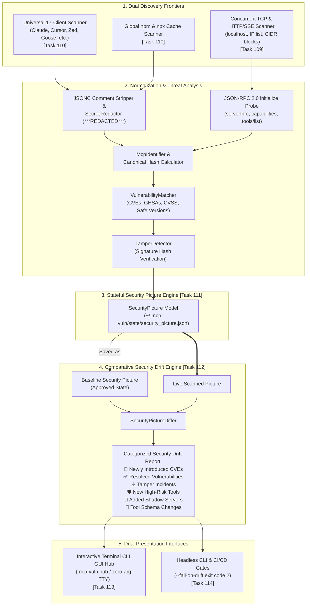
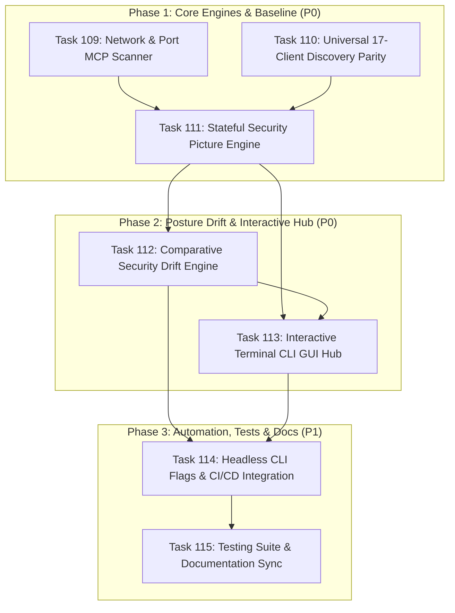

# Master Implementation Plan: Wave 21 — Local & Network MCP Inspection, Stateful Security Picture & Interactive CLI Hub (Tasks 109–115)

## 1. Executive Summary & Architectural Vision

Following the successful execution of Wave 20 (which delivered the enterprise web portal experience, multi-server configuration basket, cross-server tool collision warnings, and offline PWA capabilities), **Wave 21** expands the **`mcp-vulnerabilities`** platform into a comprehensive, multi-environment inspection, continuous posture tracking, and interactive terminal orchestration ecosystem.

Modern enterprise Model Context Protocol (MCP) deployments are no longer confined to isolated local stdio subprocesses defined in a single desktop client. Development workflows increasingly incorporate:
1. **Heterogeneous AI Tooling (17+ Clients)**: Developers configure diverse AI tools across local machines—spanning Claude Desktop, Claude Code CLI, Cursor, Windsurf, Zed, Cline, Roo Code, Goose, Continue.dev, JetBrains Junie, VS Code / Copilot, Antigravity, OpenHands, Trae, LM Studio, LibreChat, and OpenWebUI.
2. **Network-Accessible & Remote Endpoints**: MCP servers are deployed over Server-Sent Events (SSE) and HTTP JSON-RPC across localhost microservices, Docker containers, remote staging servers, and internal team networks—frequently running without authentication or access controls.
3. **Stateful Security Drift & Stealth Tampering**: Tool definitions, parameter schemas, and package versions change dynamically. Without point-in-time baseline state capture, security teams cannot detect newly introduced CVEs, stealth parameter schema mutations, rogue "shadow" MCP servers, or newly exposed high-risk capabilities (e.g., arbitrary command execution or file writes).
4. **Unified Interactive Orchestration**: While headless CLI tools are essential for CI/CD, developers and security auditors require an intuitive, emoji-anchored, visual interactive command hub matching the aesthetic of `mcp-fingerprints` to scan, probe, diff, and remediate in real time.

Wave 21 resolves these challenges across three structured phases:
- **Phase 1: Deep Discovery Parity & Stateful Security Baseline (P0)** (Tasks 109, 110, 111):
  - High-speed concurrent TCP and JSON-RPC network scanner for `localhost`, IP lists, and CIDR subnets.
  - Full local discovery parity across all 17 AI clients + global npm/npx cache with lossless JSONC comment-stripping and automated secret token redaction (`***REDACTED***`).
  - Unified `SecurityPicture` state engine capturing point-in-time security postures (`~/.mcp-vuln/state/security_picture.json`).
- **Phase 2: Comparative Security Drift & Interactive Command Hub (P0)** (Tasks 112, 113):
  - Fine-grained comparative security drift engine highlighting newly introduced vulnerabilities, resolved CVEs, tool signature tamper incidents, and newly exposed high-risk capabilities.
  - Interactive terminal CLI GUI Hub featuring dynamic status header telemetry, 6-category workflow menus, and ANSI-safe alternate buffer management.
- **Phase 3: Headless Automation, Integration Testing & Global Documentation (P1)** (Tasks 114, 115):
  - Non-interactive CLI flags (`mcp-vuln network-scan`, `--save-picture`, `--compare-picture`, `--fail-on-drift`, `--network`) for CI/CD gates.
  - Full automated test suites across all components and comprehensive `README.md` documentation.

---

## 2. Work Breakdown Structure & Specification Matrix

| Task ID | Task Title | Phase & Priority | Subsystem & Target Files | Contract Specification |
| :---: | :--- | :---: | :--- | :--- |
| **Task 109** | **Network & Port MCP Scanner** | `Phase 1` (`P0`) | Network Discovery & Probing (`src/mcp_vulnerabilities/probe/network_scanner.py`, `tests/test_network_scanner.py`) | [`task109_network_and_port_mcp_scanner.md`](task109_network_and_port_mcp_scanner.md) |
| **Task 110** | **Universal 17-Client Local Discovery Parity** | `Phase 1` (`P0`) | Local Client Discovery Engine (`src/mcp_vulnerabilities/audit/parsers.py`, `tests/test_17_client_discovery.py`) | [`task110_universal_17_client_local_discovery_parity.md`](task110_universal_17_client_local_discovery_parity.md) |
| **Task 111** | **Stateful Security Picture Baseline Engine** | `Phase 1` (`P0`) | Stateful Posture & Inventory Storage (`src/mcp_vulnerabilities/audit/picture.py`, `tests/test_security_picture.py`) | [`task111_stateful_security_picture_baseline.md`](task111_stateful_security_picture_baseline.md) |
| **Task 112** | **Comparative Security Drift Engine** | `Phase 2` (`P0`) | Posture Differential Analysis (`src/mcp_vulnerabilities/audit/picture_diff.py`, `tests/test_security_picture_diff.py`) | [`task112_comparative_security_drift_engine.md`](task112_comparative_security_drift_engine.md) |
| **Task 113** | **Interactive Terminal CLI GUI Hub** | `Phase 2` (`P0`) | Interactive Terminal Experience (`src/mcp_vulnerabilities/audit/hub.py`, `src/mcp_vulnerabilities/cli.py`, `tests/test_interactive_hub.py`) | [`task113_interactive_terminal_cli_gui_hub.md`](task113_interactive_terminal_cli_gui_hub.md) |
| **Task 114** | **Headless CLI Flags & CI/CD Integration** | `Phase 3` (`P1`) | Headless Automation CLI (`src/mcp_vulnerabilities/cli.py`, `tests/test_cli_flags.py`) | [`task114_cli_flags_subcommands_integration.md`](task114_cli_flags_subcommands_integration.md) |
| **Task 115** | **Testing Suite & Documentation Sync** | `Phase 3` (`P1`) | Quality Assurance & Documentation (`README.md`, `tests/`) | [`task115_network_picture_hub_testing_and_docs.md`](task115_network_picture_hub_testing_and_docs.md) |

---

## 3. Architectural Blueprint & Data Flow



---

## 4. CLI Visual Mockups & Terminal Layouts

### 4.1 Interactive Command Hub Header & Main Menu (`mcp-vuln hub`)

```text
================================================================================
                     🛡️  MCP SECURITY COMMAND HUB  🛡️
================================================================================
 OS: macOS 15.3 (arm64)
 Local Clients Scanned: 14 / 17 detected
 Network Hosts Probed: localhost (12 ports active)
 Total Discovered Servers: 28 (22 Local Stdio, 6 Network SSE/HTTP)
 Baseline Picture Status: Saved (2026-10-31 10:00:15)
 Security Posture: ⚠️ WARNING (2 High CVEs, 1 Shadow Server)
================================================================================

  [1] 🖥️  Local Workstation Audit & Shadow MCP Discovery
  [2] 🌐 Network & Port MCP Scanner
  [3] 📸 Baseline Picture & Security Drift Analysis
  [4] 🛡️  Vulnerability Audit, Fingerprinting & Remediation
  [5] 📦 Export Reports & Compliance (SARIF / CycloneDX / JSON)
  [0] 🚪 Exit

================================================================================
> 
```

### 4.2 Security Drift Report Mockup (`mcp-vuln audit --compare-picture`)

```text
================================================================================
                    🚨 MCP SECURITY POSTURE DRIFT REPORT 🚨
================================================================================
Baseline: ~/.mcp-vuln/state/security_picture.json (Captured: 2026-10-30 14:00)
Live Scan: 28 Servers Evaluated | Drift Severity: HIGH | Exit Code: 2
================================================================================

🚨 NEWLY INTRODUCED VULNERABILITIES (1)
  * Server: local:cursor:git-server (1.0.4 -> 1.1.0)
    CVE-2026-3841 (CVSS 8.8 HIGH) — Command injection via unsanitized branch argument
    Recommended Safe Version: >= 1.1.2

⚠️ SUPPLY CHAIN TAMPER INCIDENTS (1)
  * Server: network:localhost:8000:filesystem
    Tool 'write_file': Canonical hash changed!
    Expected: a8f0... (Passport spec) | Actual: f3b1... (Live endpoint)
    Discrepancy: Extra parameter 'execute_after_write' added to input schema

🛡️ NEW HIGH-RISK CAPABILITIES EXPOSED (1)
  * Server: local:windsurf:docker-mcp
    Tool 'exec_in_container': Exposes arbitrary container command execution

👥 ADDED SHADOW MCP SERVERS (1)
  * Server: network:127.0.0.1:8765:unregistered-proxy (SSE)
    Path: /sse | 4 tools exposed | Origin: Unauthenticated network listener

✅ RESOLVED VULNERABILITIES (2)
  * Server: local:claude-desktop:memory (1.0.0 -> 1.0.2)
    Resolved: CVE-2025-2490 (Arbitrary state overwrite)

================================================================================
Result: DRIFT DETECTED — 4 critical security shifts require approval
================================================================================
```

---

## 5. Wave Schedule, Staging & Invariant Verification Gates



### Staging Rules & Critical Paths:
1. **Parallel Pre-requisites**: Tasks 109 (Network Scanner) and 110 (17-Client Discovery) can proceed concurrently; both feed into Task 111 to build the unified `SecurityPicture`.
2. **Drift & Hub Coupling**: Task 112 consumes the `SecurityPicture` data structures created in Task 111. Task 113 surfaces both Task 109 network scans and Task 112 drift reports in the interactive terminal.
3. **CI/CD Hardening**: Task 114 wires all subcommands and parameters (`--fail-on-drift`, `network-scan`) into `src/mcp_vulnerabilities/cli.py`. Task 115 locks in automated tests and documentation.

---

## 6. Verification & Quality Gates

1. **Static Analysis & Typing**:
   - `ruff check src/ tests/` executes with zero warnings.
   - `mypy --strict src/mcp_vulnerabilities/probe/network_scanner.py src/mcp_vulnerabilities/audit/picture.py src/mcp_vulnerabilities/audit/picture_diff.py` passes cleanly.
2. **Automated Test Suites**:
   - Existing 370+ pytest baseline tests pass without regressions.
   - New dedicated test suites:
     - `tests/test_network_scanner.py` (TCP pre-check, JSON-RPC initialize probe, SSE parsing, timeout handling).
     - `tests/test_17_client_discovery.py` (17 client configs, JSONC comments, env-var expansion, secret token redaction).
     - `tests/test_security_picture_diff.py` (Round-trip persistence, newly introduced CVEs, tamper detection, new high-risk tools).
     - `tests/test_interactive_hub.py` (Hub status header, menu actions, non-interactive TTY fallback, SIGINT cleanup).
3. **Enterprise Security & Privacy Invariants**:
   - In-memory and persisted configs never leak secret tokens (`***REDACTED***`).
   - Network scanning strictly adheres to timeout bounds (150–300ms) with concurrency control to prevent socket exhaustion.
   - Zero modifications to uninspected local client configurations unless explicit user confirmation is provided.
