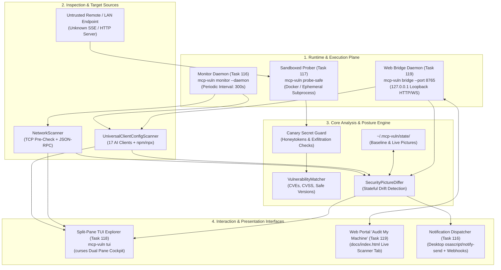
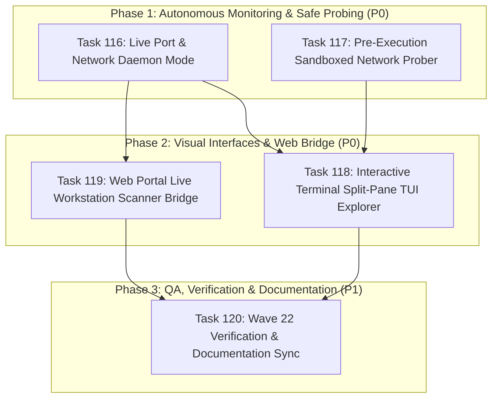

# Master Implementation Plan: Wave 22 — Daemon Monitoring, Sandboxed Probing, Split-Pane TUI Explorer, and Web Bridge (Tasks 116–120)

## 1. Executive Summary & Architectural Vision

Building upon the foundation of Wave 21 (which introduced asynchronous network and port scanning, universal 17-client discovery parity, stateful security pictures, and comparative drift tracking), **Wave 22** transitions the **`mcp-vulnerabilities`** ecosystem from static, point-in-time assessments into an active, continuous runtime defense, safe untrusted evaluation, visual terminal cockpit, and seamless browser-to-workstation integration framework.

Modern Model Context Protocol (MCP) environments face rapid operational shifts:
1. **Dynamic Runtime Exposure & Rogue Listeners**: Developers and AI tools frequently spin up ephemeral local microservices, Docker sidecars, or test servers listening on localhost or LAN ports. Unmonitored ports can expose sensitive system utilities, file access, and database connectors without developer awareness.
2. **Untrusted Third-Party & Network Server Risks**: Evaluating newly discovered network MCP servers directly on a workstation risks credential exfiltration (e.g., servers querying `~/.aws/credentials`, `~/.ssh/id_rsa`, or environment variables) or prompt injection driving arbitrary code execution.
3. **Information Density & Remediation Ergonomics**: As workstations run dozens of local and network MCP servers across multiple AI clients (Claude, Cursor, Windsurf, Zed, Cline, etc.), simple CLI text dumps become unwieldy. Auditors need an interactive, keyboard-driven terminal user interface (TUI) with split-pane inspection, search filtering, and one-key remediation.
4. **Frictionless Browser-to-Host Auditing**: While the static GitHub Pages portal (`docs/index.html`) offers interactive client-side auditing, requiring users to locate and drag-and-drop config files introduces friction. A lightweight, secure loopback bridge daemon enables instant, zero-upload live workstation audits directly in the browser.

Wave 22 addresses these challenges through four strategic pillars:
- **Pillar 1: Continuous Background Observation (`mcp-vuln monitor`)** (Task 116 - P0):
  A scheduled daemon running periodic network scans and stateful drift evaluations, dispatching native desktop alerts (macOS/Linux) and webhooks (Slack/Discord) when rogue servers or new CVEs appear.
- **Pillar 2: Zero-Trust Sandboxed Probing (`mcp-vuln probe-safe`)** (Task 117 - P0):
  Pre-execution sandboxing (Docker containers or scrubbed subprocesses) with synthetic canary secret injection and egress control to evaluate untrusted MCP endpoints without host risk.
- **Pillar 3: Interactive Split-Pane Terminal Cockpit (`mcp-vuln tui`)** (Task 118 - P0):
  A responsive curses-based split-pane TUI explorer matching `mcp-fingerprints`'s `tui.py`, featuring severity color badges, live tool schema inspection, and hotkeys (`f`, `c`, `p`, `r`, `q`).
- **Pillar 4: Localhost Web Portal Bridge Daemon (`mcp-vuln bridge`)** (Task 119 - P0):
  A secure loopback HTTP & WebSocket bridge (`127.0.0.1:8765`) enabling the static web portal to audit live workstation clients and visualize real-time drift with strict origin and token controls.
- **Pillar 5: Comprehensive Verification & Ecosystem Sync** (Task 120 - P1):
  Automated test suites across all new subsystems, full documentation synchronization, and changelog updates.

---

## 2. Work Breakdown Structure & Specification Matrix

| Task ID | Task Title | Phase & Priority | Subsystem & Target Files | Contract Specification |
| :---: | :--- | :---: | :--- | :--- |
| **Task 116** | **Live Port & Network Daemon Mode** | `Phase 1` (`P0`) | Background Daemon & Alerts (`src/mcp_vulnerabilities/daemon/monitor.py`, `src/mcp_vulnerabilities/cli.py`, `tests/daemon/test_monitor.py`) | [`task116_live_port_and_network_daemon_mode.md`](task116_live_port_and_network_daemon_mode.md) |
| **Task 117** | **Pre-Execution Sandboxed Network Prober** | `Phase 1` (`P0`) | Isolated Dynamic Probing (`src/mcp_vulnerabilities/probe/sandbox_prober.py`, `src/mcp_vulnerabilities/cli.py`, `tests/probe/test_sandbox_prober.py`) | [`task117_preexecution_sandboxed_network_prober.md`](task117_preexecution_sandboxed_network_prober.md) |
| **Task 118** | **Interactive Terminal Split-Pane TUI Explorer** | `Phase 2` (`P0`) | Split-Pane Terminal Cockpit (`src/mcp_vulnerabilities/audit/tui.py`, `src/mcp_vulnerabilities/cli.py`, `tests/audit/test_tui.py`) | [`task118_interactive_terminal_split_pane_tui_explorer.md`](task118_interactive_terminal_split_pane_tui_explorer.md) |
| **Task 119** | **Web Portal Live Workstation Scanner Bridge** | `Phase 2` (`P0`) | Localhost Web Bridge Daemon (`src/mcp_vulnerabilities/daemon/bridge.py`, `docs/index.html`, `docs/app.js`, `tests/daemon/test_bridge.py`) | [`task119_web_portal_live_workstation_scanner_bridge.md`](task119_web_portal_live_workstation_scanner_bridge.md) |
| **Task 120** | **Wave 22 Verification & Documentation Sync** | `Phase 3` (`P1`) | QA, Integration & Docs (`tests/`, `README.md`, `CHANGELOG.md`, `docs/tasks/README.md`) | [`task120_wave22_verification_and_documentation_sync.md`](task120_wave22_verification_and_documentation_sync.md) |

---

## 3. Architectural Blueprint & Data Flow



---

## 4. Visual Mockups & Interaction Specifications

### 4.1 Split-Pane Terminal TUI Cockpit (`mcp-vuln tui`)

```text
┌── MCP Security Explorer v1.22.0 ──────────────────────────────────────────────────────────────┐
│ Host: macOS 15.3 (arm64)  │ Servers: 24  │ Status: ⚠️ 2 HIGH, 1 CRITICAL  │ Baseline: Synced │
├──────────────────────────────────────┬────────────────────────────────────────────────────────┤
│ DISCOVERED SERVERS (24)              │ SERVER INSPECTION & THREAT DETAILS                     │
├──────────────────────────────────────┼────────────────────────────────────────────────────────┤
│ ▶ [CRIT] local:cursor:git-server     │ Target: local:cursor:git-server                        │
│   [HIGH] network:127.0.0.1:8000 (sse)│ Client: Cursor AI (~/.cursor/mcp.json)                 │
│   [CLEAN] local:claude:filesystem    │ Transport: stdio (npx -y @modelcontextprotocol/server) │
│   [CLEAN] local:zed:fetch            │ Canonical Tool Hash: 8f4a1c02e5b9d3...                 │
│   [CLEAN] local:windsurf:sqlite      │ Package: @modelcontextprotocol/server-git @ 1.0.4      │
│   [MED]  network:127.0.0.1:3000 (mcp)│                                                        │
│   [CLEAN] local:cline:postgres       │ 🚨 DETECTED VULNERABILITIES (1)                        │
│   [CLEAN] local:continue:brave-search│ ------------------------------------------------------ │
│   [CLEAN] local:junie:docker         │ • CVE-2026-3841 (CVSS 8.8 HIGH)                        │
│   [CLEAN] local:openhands:terminal   │   Vulnerable range: < 1.1.2                            │
│   [CLEAN] local:trae:memory          │   Issue: Command injection via unquoted branch param   │
│   [CLEAN] local:antigravity:fs       │   Safe Upgrade Version: >= 1.1.2                       │
│                                      │                                                        │
│                                      │ 🛠️ EXPOSED TOOLS & CAPABILITIES (3)                    │
│                                      │ ------------------------------------------------------ │
│                                      │ • git_status: Read working tree status                 │
│                                      │ • git_log: View commit history                         │
│                                      │ • git_checkout: [DANGEROUS SINK] Arbitrary branch exec │
├──────────────────────────────────────┴────────────────────────────────────────────────────────┤
│ [f] Auto-Fix Config  [c] Copy Config  [p] Save Picture  [r] Re-Probe  [/] Search  [q] Quit     │
└───────────────────────────────────────────────────────────────────────────────────────────────┘
```

### 4.2 Web Portal "Audit My Machine" Live Scanner Tab (`docs/index.html`)

```text
+-----------------------------------------------------------------------------------------------+
|  📦 MCP Directory (5,050+)  |  🚨 Advisories Feed  |  🛡️ Audit My MCP Setup                   |
+-----------------------------------------------------------------------------------------------+
|                                                                                               |
|  🟢 Localhost Bridge Connected (v1.22.0 at 127.0.0.1:8765)                                    |
|  [ ⚡ Run Instant Live Workstation Audit ]   [ 🔄 Refresh Baseline ]                          |
|                                                                                               |
|  Workstation Summary:                                                                         |
|  • Detected Clients: 14 installed (Claude Desktop, Cursor, Zed, Windsurf, Cline, Goose...)   |
|  • Total Configured Servers: 28 (22 Stdio, 6 Network HTTP/SSE)                                |
|  • Live Security Posture: ⚠️ 2 High Vulnerabilities Detected                                  |
|                                                                                               |
|  Live Discovered AI Clients:                                                                  |
|  ┌─────────────────────────┬──────────────────────────┬──────────────┬──────────────────────┐ │
|  │ Client                  │ Server Name              │ Version / URI│ Security Status      │ │
|  ├─────────────────────────┼──────────────────────────┼──────────────┼──────────────────────┤ │
|  │ Claude Desktop          │ @modelcontextprotocol/fs │ 1.0.2        │ ✅ Clean             │ │
|  │ Cursor AI               │ server-git               │ 1.0.4        │ 🚨 CVE-2026-3841 (H) │ │
|  │ Windsurf                │ docker-mcp               │ 0.4.1        │ ⚠️ Privileged Exec   │ │
|  │ Network (127.0.0.1:8000)│ unauthenticated-proxy    │ /sse         │ 👥 Shadow Listener   │ │
|  └─────────────────────────┴──────────────────────────┴──────────────┴──────────────────────┘ │
|                                                                                               |
|  [ 🛠️ 1-Click Auto-Fix All Vulnerable Configs ]   [ 📥 Export SARIF Report ]                 |
+-----------------------------------------------------------------------------------------------+
```

---

## 5. Wave Schedule, Staging & Invariant Verification Gates



### Staging Rules & Critical Paths:
1. **Parallel Execution in Phase 1**: Task 116 (Daemon Mode) and Task 117 (Sandboxed Prober) operate independently. Both enhance backend inspection capabilities.
2. **Interface Aggregation in Phase 2**: Task 118 (TUI) leverages data models from both network scans and safe probe verdicts. Task 119 (Web Bridge) exposes the local scanning engine to the web frontend over localhost.
3. **Unified Verification in Phase 3**: Task 120 validates all end-to-end integration flows, enforces code style and typing compliance, and updates documentation.

---

## 6. Verification & Quality Gates

1. **Static Analysis & Typing**:
   - `ruff check src/ tests/` passes with zero lint or style violations.
   - `mypy --strict src/mcp_vulnerabilities/daemon/ src/mcp_vulnerabilities/probe/sandbox_prober.py src/mcp_vulnerabilities/audit/tui.py` passes cleanly.
2. **Automated Test Coverage**:
   - Zero regressions across existing test baseline.
   - New dedicated test suites:
     - `tests/daemon/test_monitor.py`: Daemon scheduling, PID locking, drift alerting, desktop notifications, Slack/Discord webhook mocking.
     - `tests/probe/test_sandbox_prober.py`: Isolated container/subprocess probing, canary injection, exfiltration detection, timeout enforcement.
     - `tests/audit/test_tui.py`: Headless curses screen simulation, split-pane layout, hotkeys (`f`, `c`, `p`, `r`, `q`), search filtering, resize handling.
     - `tests/daemon/test_bridge.py`: Localhost loopback binding (`127.0.0.1`), CORS origin validation, session token authentication, API endpoints, WebSocket streaming.
3. **Security Invariants**:
   - **Localhost Confinement**: Bridge daemon strictly binds to `127.0.0.1`, rejecting public/external interfaces.
   - **Secret Scrubbing**: Sensitive keys (`OPENAI_API_KEY`, tokens) are scrubbed before serialization in web bridge responses or TUI display.
   - **Canary Isolation**: Pre-execution sandbox strips host credentials and detects unauthorized extraction attempts.
