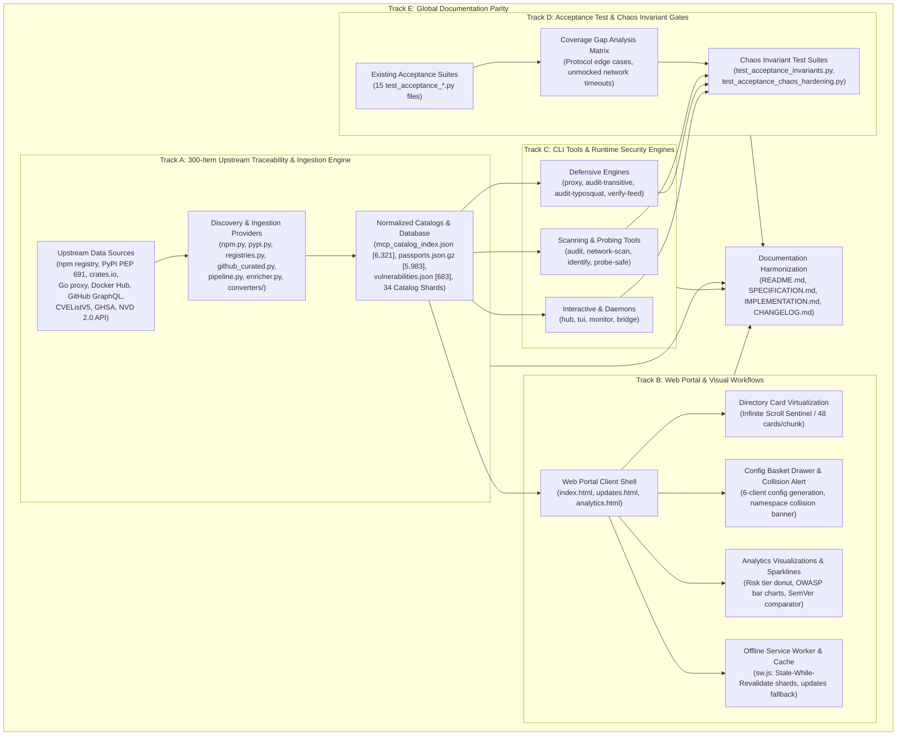
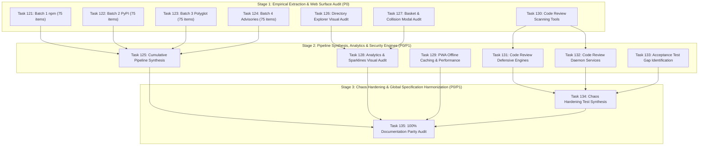

# Master Implementation Plan: Wave 23 — Deep Empirical Audit, 300-Item Traceability, Full-Surface Visual Web Testing, Tool Code Review & Acceptance Test Gap Analysis (Tasks 121–135)

## 1. Executive Summary & Audit Mandate

Following the operational hardening, network discovery parity, background monitoring, sandboxed probing, split-pane TUI cockpit, and localhost web bridge introduced across Waves 20, 21, and 22, **Wave 23** establishes the definitive, high-rigor **Empirical Quality, Upstream Traceability, Visual Interface, Tool Resilience, and Test Completeness Audit** for the entire `mcp-vulnerabilities` platform.

As the Model Context Protocol (MCP) ecosystem scales beyond 6,300+ servers and 680+ published security advisories, automated ingestion pipelines, static dashboards, and CLI security engines risk silent drift, schema divergence, visual interface regressions, protocol edge-case vulnerabilities, and unverified documentation claims.

Wave 23 is structured into **five synchronized, high-depth tracks** comprising **15 granular task cards (Tasks 121–135)**:

1. **Track A: 300-Item Source Traceability & Extraction Audit (Tasks 121–125)**:
   - An exhaustive empirical investigation of the data ingestion and normalization pipeline.
   - 300 diverse items selected across real database artifacts (`docs/data/mcp_catalog_index.json`, `data/passports.json.gz`, `docs/data/vulnerabilities.json`):
     - **Batch 1 (Task 121)**: 75 npm & JavaScript MCP servers.
     - **Batch 2 (Task 122)**: 75 Python & PyPI FastMCP servers.
     - **Batch 3 (Task 123)**: 75 Go (25), Rust (20), Docker (15), and GitHub Raw (15) servers.
     - **Batch 4 (Task 124)**: 75 CVE (40), GHSA (20), and NVD/VERITY (15) vulnerability advisory mappings.
   - Each item is traced back to its raw upstream origin (npm Registry API, PyPI JSON PEP 691, crates.io API, Go proxy, Docker Hub API, GitHub GraphQL/REST, CVEListV5 JSON 5.0, GHSA payload) to determine extraction accuracy, completeness, version freshness, and update latency.
   - **Task 125** consolidates these empirical findings into a cumulative data pipeline synthesis report with concrete algorithmic remediations.

2. **Track B: Full-Surface Web Portal & Visual Workflow Audit (Tasks 126–129)**:
   - Deep structural and visual validation of all static web portal applications (`docs/index.html`, `docs/updates.html`, `docs/analytics.html`, `docs/app.js`, `docs/sw.js`, `docs/style.css`).
   - Audit of high-interaction frontend workflows:
     - Infinite scrolling virtualization across 6,321+ server cards (DOM node pruning, memory footprints, scroll-jacking avoidance).
     - Multi-server safe configuration basket drawer, cross-server collision warning banners (including root cause isolation of the `selectedServers` scope bug), and in-modal two-version diff comparators.
     - Analytics distribution visualizations, release velocity sparklines, syndication feeds, and click-to-filter query deep links.
     - Progressive Web App (PWA) offline Service Worker caching policies, quota budgets, cache invalidation across 34 catalog shards, and network-fallback resilience.
   - Authors automated headless browser visual and DOM invariant test suites verifying rendered layout states, color contrast, and CSS variables across desktop, tablet, and mobile breakpoints.

3. **Track C: Exhaustive Tool Code Review & Failure Mode Hardening (Tasks 130–132)**:
   - Line-by-line architectural and operational code review of all 12 CLI tools and security engines:
     - **Scanning & Probing Tools (Task 130)**: `mcp-vuln audit`, `mcp-vuln network-scan`, `mcp-vuln identify`, `mcp-vuln probe-safe`.
     - **Defensive Security Engines (Task 131)**: `mcp-vuln proxy`, `mcp-vuln audit-transitive`, `mcp-vuln audit-typosquat`, `mcp-vuln verify-feed`.
     - **Interactive & Daemon Services (Task 132)**: `mcp-vuln hub`, `mcp-vuln tui`, `mcp-vuln monitor`, `mcp-vuln bridge`.
   - Analyzes supported protocols (stdio, SSE, Streamable HTTP), parser failure modes, missing timeout traps, unbuffered pipe deadlocks, socket pool exhaustion, concurrency race conditions, and error-handling resilience.

4. **Track D: Acceptance Test Gap Analysis & Scenario Synthesis (Tasks 133–134)**:
   - Exhaustive gap analysis comparing claimed capabilities against existing test suites (`tests/test_acceptance_*.py`).
   - Identifies critical unmocked domains: network scanner socket drops, reverse proxy malformed HTTP/SSE frames, typosquat corpus cache corruption, bridge daemon CORS bypass attempts, and CLI terminal resizing crashes.
   - Implements comprehensive invariant harnesses and chaos-engineering test suites covering malformed JSON-RPC payloads, state file concurrency conflicts, corrupted snapshot recovery, and degraded network conditions.

5. **Track E: 100% Documentation Coverage & Specification Alignment (Task 135)**:
   - Complete surface audit ensuring `README.md`, `CHANGELOG.md`, `SPECIFICATION.md`, and `IMPLEMENTATION.md` accurately document 100% of CLI flags, subcommands, environment variables, exit codes, JSON schemas, and operational constraints.

---

## 2. Work Breakdown Structure & Specification Matrix

| Track | Task ID | Task Title | Phase & Priority | Subsystem & Target Files | Contract Specification |
| :---: | :---: | :--- | :---: | :--- | :--- |
| **A** | **Task 121** | **Batch 1: npm & JavaScript Traceability Audit** | `Phase 1` (`P0`) | Ingestion Traceability (`docs/data/`, `src/mcp_vulnerabilities/discovery/npm.py`, `docs/reports/audit_batch1_npm.md`) | [`task121_traceability_audit_batch1_npm_javascript.md`](task121_traceability_audit_batch1_npm_javascript.md) |
| **A** | **Task 122** | **Batch 2: Python & PyPI FastMCP Traceability Audit** | `Phase 1` (`P0`) | Ingestion Traceability (`docs/data/`, `src/mcp_vulnerabilities/discovery/pypi.py`, `docs/reports/audit_batch2_pypi.md`) | [`task122_traceability_audit_batch2_pypi_fastmcp.md`](task122_traceability_audit_batch2_pypi_fastmcp.md) |
| **A** | **Task 123** | **Batch 3: Polyglot Go, Rust, Docker & GitHub Audit** | `Phase 1` (`P0`) | Polyglot Ingestion (`docs/data/`, `src/mcp_vulnerabilities/discovery/registries.py`, `docs/reports/audit_batch3_polyglot.md`) | [`task123_traceability_audit_batch3_go_rust_docker_github.md`](task123_traceability_audit_batch3_go_rust_docker_github.md) |
| **A** | **Task 124** | **Batch 4: CVE, GHSA & NVD Vulnerability Advisory Mappings** | `Phase 1` (`P0`) | Advisory Normalization (`data/vulnerabilities/`, `converters/`, `docs/reports/audit_batch4_advisories.md`) | [`task124_traceability_audit_batch4_cve_ghsa_nvd.md`](task124_traceability_audit_batch4_cve_ghsa_nvd.md) |
| **A** | **Task 125** | **Cumulative Data Extraction & Ingestion Pipeline Synthesis** | `Phase 2` (`P0`) | Ingestion Architecture (`pipeline.py`, `enricher.py`, `docs/reports/cumulative_data_extraction_synthesis.md`) | [`task125_cumulative_data_extraction_ingestion_synthesis.md`](task125_cumulative_data_extraction_ingestion_synthesis.md) |
| **B** | **Task 126** | **Directory Explorer & Infinite Scroll Virtualization Visual Audit** | `Phase 1` (`P0`) | Web Explorer (`docs/index.html`, `docs/app.js`, `docs/style.css`, `tests/test_web_visual_directory.py`) | [`task126_web_directory_infinite_scroll_visual_audit.md`](task126_web_directory_infinite_scroll_visual_audit.md) |
| **B** | **Task 127** | **Multi-Server Basket, Collision Warnings & Config Modal Audit** | `Phase 1` (`P0`) | Interactive Config Hub (`docs/index.html`, `docs/app.js`, `tests/test_web_basket_collision.py`) | [`task127_web_basket_collision_config_modal_audit.md`](task127_web_basket_collision_config_modal_audit.md) |
| **B** | **Task 128** | **Analytics Portal, Velocity Sparklines & Updates Feed Visual Audit** | `Phase 2` (`P1`) | Analytics & Feeds (`docs/analytics.html`, `docs/updates.html`, `tests/test_web_analytics_updates.py`) | [`task128_web_analytics_sparklines_updates_feed_audit.md`](task128_web_analytics_sparklines_updates_feed_audit.md) |
| **B** | **Task 129** | **PWA Offline Service Worker, Caching & Performance Audit** | `Phase 2` (`P1`) | Progressive Web App (`docs/sw.js`, `docs/manifest.json`, `tests/test_web_pwa_offline.py`) | [`task129_web_pwa_offline_service_worker_audit.md`](task129_web_pwa_offline_service_worker_audit.md) |
| **C** | **Task 130** | **Code Review: Scanning & Probing Tools (`audit`, `network-scan`, `identify`, `probe-safe`)** | `Phase 1` (`P0`) | Tool Resilience (`src/mcp_vulnerabilities/probe/`, `audit/`, `docs/reports/code_review_scanning_tools.md`) | [`task130_code_review_scanning_probing_tools.md`](task130_code_review_scanning_probing_tools.md) |
| **C** | **Task 131** | **Code Review: Defensive Security Engines (`proxy`, `audit-transitive`, `audit-typosquat`, `verify-feed`)** | `Phase 2` (`P0`) | Tool Resilience (`src/mcp_vulnerabilities/proxy/`, `transitive.py`, `docs/reports/code_review_defensive_engines.md`) | [`task131_code_review_defensive_security_engines.md`](task131_code_review_defensive_security_engines.md) |
| **C** | **Task 132** | **Code Review: Interactive & Daemon Services (`hub`, `tui`, `monitor`, `bridge`)** | `Phase 2` (`P0`) | Tool Resilience (`src/mcp_vulnerabilities/daemon/`, `hub.py`, `docs/reports/code_review_daemon_services.md`) | [`task132_code_review_interactive_daemon_services.md`](task132_code_review_interactive_daemon_services.md) |
| **D** | **Task 133** | **Acceptance Test Suite Gap Identification & Comprehensive Invariant Harness** | `Phase 2` (`P0`) | Acceptance QA (`tests/`, `tests/test_acceptance_invariants.py`, `docs/reports/acceptance_gap_matrix.md`) | [`task133_acceptance_test_gap_analysis_and_invariants.md`](task133_acceptance_test_gap_analysis_and_invariants.md) |
| **D** | **Task 134** | **Edge-Case & Chaos Hardening Test Synthesis (Malicious RPC, Corrupt Snapshots, Dropouts)** | `Phase 3` (`P0`) | Chaos Engineering (`tests/test_acceptance_chaos_hardening.py`, `tests/fixtures/malformed/`) | [`task134_edge_case_chaos_hardening_test_synthesis.md`](task134_edge_case_chaos_hardening_test_synthesis.md) |
| **E** | **Task 135** | **Full-Surface Documentation Parity Audit & Specification Harmonization** | `Phase 3` (`P1`) | Technical Documentation (`README.md`, `CHANGELOG.md`, `SPECIFICATION.md`, `IMPLEMENTATION.md`) | [`task135_full_surface_documentation_parity_harmonization.md`](task135_full_surface_documentation_parity_harmonization.md) |

---

## 3. System Architecture & End-to-End Traceability Flow



---

## 4. Methodological Framework: 300-Item Upstream Traceability Protocol

To guarantee empirical rigor, each of the 300 audited records is tested across a 7-point verification protocol:

```text
┌───────────────────────────────────────────────────────────────────────────────────────────────┐
│                           7-POINT UPSTREAM TRACEABILITY AUDIT PROTOCOL                         │
├───────────────────────────────────────────────────────────────────────────────────────────────┤
│ 1. Upstream Resolution : HTTP GET to canonical registry API (registry.npmjs.org, pypi.org)   │
│ 2. Schema Fidelity     : Verification that raw JSON maps losslessly to McpServer/Passport     │
│ 3. Version Alignment   : Latest published upstream version vs. catalog latest_version         │
│ 4. Tool Signature Hash : Extraction of tool list, schemas, and SHA-256 canonical tool hash    │
│ 5. Security Posture    : Affected range evaluation, CVE/GHSA linkage, safe version recommendation │
│ 6. Metadata Integrity  : License, repository URL, author attribution, transport hints        │
│ 7. Latency & Drift     : Time elapsed between upstream publication and catalog synchronization │
└───────────────────────────────────────────────────────────────────────────────────────────────┘
```

### Traceability Sample Distribution:
- **npm & JavaScript (Task 121)**: 75 packages sampled from 1,657 npm catalog records across official `@modelcontextprotocol/*`, popular community tools, and long-tail packages.
- **Python & PyPI (Task 122)**: 75 packages sampled from 681 PyPI catalog records covering FastMCP servers, LangChain/LlamaIndex bridges, and data connectors.
- **Polyglot Registries (Task 123)**: 25 Go modules (`proxy.golang.org`), 20 Rust crates (`crates.io`), 15 Docker containers (`hub.docker.com`), and 15 GitHub raw repository implementations.
- **Advisory Mappings (Task 124)**: 40 CVE JSON 5.0 records, 20 GHSA advisories, and 15 NVD/VERITY entries validated for OSV 1.6 range integrity and PURL correctness.

---

## 5. Visual Web Testing & DOM Invariants Framework

Track B executes an automated visual and interactive audit of the web portal:

```text
+-----------------------------------------------------------------------------------------------+
|                       WEB PORTAL FULL-SURFACE AUDIT COVERAGE MATRIX                           |
+-----------------------------------------------------------------------------------------------+
| Surface              | Interactive Workflow Audited            | Key Invariant Verified       |
+----------------------+-----------------------------------------+------------------------------+
| docs/index.html      | 6,321-server directory virtualization   | Render < 100 DOM nodes initial|
| docs/index.html      | Multi-server selection & basket drawer  | Persistent basket count & sync|
| docs/index.html      | Cross-server tool collision banner      | No ReferenceError on scope   |
| docs/index.html      | In-card tool microsearch                | Instant regex filtering      |
| docs/index.html      | Modal version diff comparator           | Accurate additions/removals  |
| docs/analytics.html  | Click-to-filter drilldowns              | Query param deep link routing|
| docs/updates.html    | Release velocity sparklines & feeds     | Proper temporal delta sorting|
| docs/sw.js           | PWA Offline Service Worker              | 100% offline cache hit on nav|
+-----------------------------------------------------------------------------------------------+
```

---

## 6. Execution Waves, Staging & Invariant Verification Gates



---

## 7. Verification & Quality Gates

Every task in Wave 23 must satisfy rigorous quality invariants before being certified:
1. **Empirical Traceability Gate**: All 300 items in Track A must have completed verification logs recorded in `docs/reports/` with verified upstream HTTP status, version correlation, and discrepancy notes.
2. **Visual Invariant Gate**: Web portal automated tests (`tests/test_web_*.py`) must pass in headless environment, verifying zero uncaught JS console errors, zero layout overflow, and complete CSS custom property compliance.
3. **Resilience & Safe Recovery Gate**: All reviewed tools in Track C must demonstrate explicit handling of broken pipes, unexpected EOF, network timeouts, invalid JSON-RPC schemas, and permission denied traps.
4. **Acceptance Test Coverage Gate**: No capability claimed in CLI help or documentation may lack an automated acceptance test in `tests/test_acceptance_*.py`.
5. **Documentation Parity Gate**: 100% of CLI subcommands, flags, exit codes, and configuration environment variables must be documented across `README.md`, `SPECIFICATION.md`, and `IMPLEMENTATION.md`.
