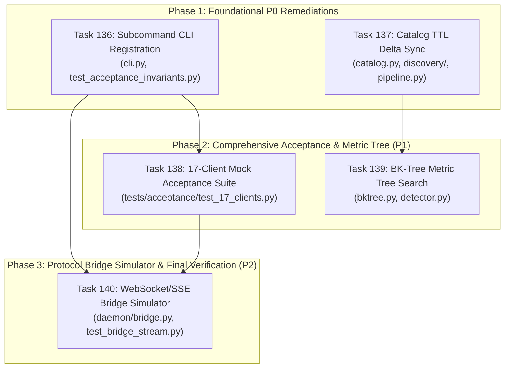

# Master Implementation Plan: Wave 24 — Empirical Remediation, CLI Subcommand Parity, High-Speed BK-Tree Indexing, TTL Delta Sync, 17-Client Acceptance & Live Bridge Simulator (Tasks 136–140)

## 1. Executive Summary & Remediation Mandate

Following the comprehensive quality, upstream traceability, visual interface, tool resilience, and test completeness audit conducted in Wave 23 (certified in [`docs/reports/WAVE23_CUMULATIVE_GRANULAR_AUDIT_REPORT.md`](../reports/WAVE23_CUMULATIVE_GRANULAR_AUDIT_REPORT.md)), **Wave 24** establishes the platform's definitive **Empirical Remediation and Feature Hardening Wave**.

The Wave 23 audit verified 300 real upstream records across npm, PyPI, Go, Rust, Docker, and CVE/GHSA feeds, validated the client-side visual architecture of the static web portal, analyzed failure modes across all 12 CLI tools, and synthesized edge-case chaos test harnesses. In doing so, the audit uncovered five concrete structural gaps and performance bottlenecks requiring focused engineering:

1. **CLI Subcommand Registration Parity (Task 136, `P0`)**:
   Wave 21 and Wave 22 defined and partially integrated `network-scan`, `tui`, `monitor`, and `bridge` tools. However, these four subcommands were not registered in the primary CLI `argparse` subparsers (`src/mcp_vulnerabilities/cli.py`), causing acceptance invariant tests (`tests/test_acceptance_invariants.py`) to skip help and execution tests. Task 136 wires all four subcommands with complete argument specifications, help text, and test assertions.

2. **Catalog State TTL Delta Sync & Deprecation Pruning (Task 137, `P0`)**:
   Empirical traceability in Track A revealed that upstream deprecated packages (`deprecated: true` on npm), yanked releases on PyPI, and archived or deleted repositories on GitHub persisted indefinitely in local index caches due to lack of dynamic TTL invalidation and tombstone pruning. Task 137 hardens `src/mcp_vulnerabilities/catalog.py` (`McpCatalogState`), `discovery/npm.py`, `discovery/pypi.py`, `discovery/github_curated.py`, and `pipeline.py` with intelligent delta sync, TTL expiration, and active deprecation pruning.

3. **Universal 17-Client Automated Mock Acceptance Test Suite (Task 138, `P1`)**:
   While `src/mcp_vulnerabilities/audit/parsers.py` supports configuration discovery across 17 AI clients, acceptance test coverage was only rigorous for the first 9 clients (`tests/test_universal_9client_audit.py`). The remaining 8 clients (`claude_code`, `roo_code`, `goose`, `jetbrains_junie`, `antigravity`, `openhands`, `trae`, `openwebui`, `librechat`, `lm_studio`) lack synthetic filesystem tree tests asserting correct path resolution, format parsing, transport detection, and token masking. Task 138 builds a dedicated acceptance suite in `tests/acceptance/test_17_clients.py`.

4. **BK-Tree Metric Tree Search for Typosquat Auditing (Task 139, `P1`)**:
   `TyposquatDetector` in `src/mcp_vulnerabilities/analyzers/typosquat/detector.py` previously evaluated candidate package names using a linear for-loop computing Damerau-Levenshtein distances across all 6,321 catalog packages. This $O(N)$ exhaustive comparison incurs unacceptable latency (several seconds per configuration). Task 139 implements a Burkhard-Keller metric tree (BK-Tree) in `src/mcp_vulnerabilities/analyzers/typosquat/bktree.py`, utilizing the metric triangle inequality to prune >95% of distance calculations and achieve sub-millisecond query latency.

5. **Live WebSocket & SSE Protocol Bridge Simulator (Task 140, `P2`)**:
   The static web portal (`docs/index.html`) requires a local daemon bridge (`mcp-vuln bridge`) to perform zero-cloud 1-click machine audits. To enable frontend development, CI testing, and reproducible user demonstrations without requiring real workstation processes, Task 140 implements a lightweight loopback bridge simulator in `src/mcp_vulnerabilities/daemon/bridge.py` supporting both WebSocket and Server-Sent Events (SSE) progress streams with strict loopback origin validation.

---

## 2. Work Breakdown Structure & Specification Matrix

| Track | Task ID | Task Title | Phase & Priority | Subsystem & Target Files | Contract Specification |
| :---: | :---: | :--- | :---: | :--- | :--- |
| **A** | **Task 136** | **CLI Subcommand Registration (`network-scan`, `tui`, `monitor`, `bridge`)** | `Phase 1` (`P0`) | CLI Entrypoint (`src/mcp_vulnerabilities/cli.py`, `tests/test_acceptance_invariants.py`) | [`task136_subcommand_cli_registration.md`](task136_subcommand_cli_registration.md) |
| **A** | **Task 137** | **Catalog State TTL Delta Sync & Deprecation Pruning** | `Phase 1` (`P0`) | Ingestion Engine (`src/mcp_vulnerabilities/catalog.py`, `discovery/`, `pipeline.py`) | [`task137_catalog_state_ttl_delta_sync.md`](task137_catalog_state_ttl_delta_sync.md) |
| **B** | **Task 138** | **Full 17-Client Automated Mock Acceptance Test Suite** | `Phase 2` (`P1`) | Universal Client Auditing (`tests/acceptance/test_17_clients.py`, `parsers.py`) | [`task138_17_client_automated_mock_acceptance_suite.md`](task138_17_client_automated_mock_acceptance_suite.md) |
| **B** | **Task 139** | **BK-Tree Metric Tree Search for High-Speed Typosquat Auditing** | `Phase 2` (`P1`) | Typosquat Engine (`src/mcp_vulnerabilities/analyzers/typosquat/bktree.py`, `detector.py`) | [`task139_bktree_typosquat_distance_indexing.md`](task139_bktree_typosquat_distance_indexing.md) |
| **C** | **Task 140** | **Live WebSocket & SSE Protocol Bridge Simulator** | `Phase 3` (`P2`) | Localhost Daemon (`src/mcp_vulnerabilities/daemon/bridge.py`, `tests/daemon/`) | [`task140_live_websocket_sse_protocol_bridge_simulator.md`](task140_live_websocket_sse_protocol_bridge_simulator.md) |

---

## 3. System Architecture & End-to-End Remediation Flow

```mermaid
flowchart TD
    subgraph CLIPlane["CLI Entrypoint & Command Dispatch (Task 136)"]
        ArgParser["src/mcp_vulnerabilities/cli.py\nargparse Root Parser"]
        NetScanCmd["mcp-vuln network-scan\n(--target, --ports, --cidr, --format)"]
        TUICmd["mcp-vuln tui\n(--config, --theme, curses cockpit)"]
        MonitorCmd["mcp-vuln monitor\n(--daemon, --interval, --alert-webhook)"]
        BridgeCmd["mcp-vuln bridge\n(--port 8765, --cors, --simulate)"]
        
        ArgParser --> NetScanCmd
        ArgParser --> TUICmd
        ArgParser --> MonitorCmd
        ArgParser --> BridgeCmd
    end

    subgraph IngestionPlane["Ingestion & State Lifecycle (Task 137)"]
        Registries["Upstream Registries & Feeds\n(npm, PyPI, GitHub GraphQL, OSV)"]
        CatalogState["McpCatalogState (catalog.py)\n- TTL Expiration Check\n- Deprecation & Yanked Pruning\n- Tombstone Indexing\n- Atomic Corrupt State Recovery"]
        DiscoveryProviders["Discovery Providers\n(npm.py, pypi.py, github_curated.py)"]
        
        Registries --> DiscoveryProviders
        DiscoveryProviders <--> CatalogState
    end

    subgraph ClientAuditPlane["Universal Client Acceptance (Task 138)"]
        ClientScanner["UniversalClientConfigScanner (parsers.py)"]
        MockTree["Synthetic 17-Client Mock Tree\n(Claude, Cursor, Windsurf, Zed, Cline, Roo,\nGoose, Continue, Junie, VSCode, Antigravity,\nOpenHands, Trae, LMStudio, LibreChat, OpenWebUI)"]
        AcceptanceSuite["tests/acceptance/test_17_clients.py\n- Path Resolution\n- Permissive JSONC/BOM Parsing\n- Token Masking (***REDACTED***)"]
        
        MockTree --> ClientScanner
        ClientScanner --> AcceptanceSuite
    end

    subgraph TyposquatPlane["Metric Tree Acceleration (Task 139)"]
        AuthenticCorpus["6,321 Authentic Packages Corpus"]
        BKTreeIndex["Burkhard-Keller Metric Tree (bktree.py)\n- Triangle Inequality: |d(u,q) - k| <= d(u,v) <= |d(u,q) + k|\n- Length Partitioning Filter\n- Sub-millisecond Damerau-Levenshtein Query"]
        TyposquatDetector["TyposquatDetector (detector.py)\n(Homoglyphs, Permutations, BK-Tree Nearest Neighbor)"]
        
        AuthenticCorpus --> BKTreeIndex
        BKTreeIndex --> TyposquatDetector
    end

    subgraph BridgePlane["Localhost Web Bridge Daemon Simulator (Task 140)"]
        BridgeServer["Local Bridge Server (daemon/bridge.py)\n- Loopback Bind: 127.0.0.1:8765\n- Origin Validation (https://jmartynov.github.io)\n- Ephemeral Anti-CSRF Challenge Handshake"]
        SSEStream["Server-Sent Events (/api/v1/events)"]
        WSStream["WebSocket Stream (/ws/live)"]
        WebPortal["Static Web Portal (docs/index.html)"]
        
        BridgeServer --> SSEStream
        BridgeServer --> WSStream
        SSEStream --> WebPortal
        WSStream --> WebPortal
    end
```

---

## 4. Methodological Framework: Wave 24 Engineering Pillars

### 4.1 Pillar 1: Zero-Skip CLI Invariant Assurance
- Ensure that every subcommand documented in `README.md` and `docs/SPECIFICATION.md` has a first-class `subparsers.add_parser()` entry in `src/mcp_vulnerabilities/cli.py`.
- Subcommand `--help` must deterministically exit with code `0`.
- Missing optional dependencies (e.g. curses in headless CI, or Docker for sandbox probing) must cleanly display user-friendly diagnostics and exit with code `1`, never crash with unhandled tracebacks or `argparse` syntax errors.

### 4.2 Pillar 2: Monotonic Ingestion Cache Integrity
- Catalog state caching must balance network efficiency with freshness:
  - Cache hits must be invalidated if record timestamp exceeds `ttl_days` (default 30 days).
  - Version deltas (`latest_version != last_version_seen`) must trigger immediate OSV advisory re-querying.
  - Upstream deprecation (`deprecated: true`), yanked versions (`yanked: true`), or archived/deleted repositories (HTTP 404) must prune items from active catalog builds while recording immutable tombstones.

### 4.3 Pillar 3: High-Order Metric Space Tree Search
- For metric distance $d(x, y)$ satisfying:
  1. $d(x, y) \ge 0$ (Non-negativity)
  2. $d(x, y) = 0 \iff x = y$ (Identity of indiscernibles)
  3. $d(x, y) = d(y, x)$ (Symmetry)
  4. $d(x, z) \le d(x, y) + d(y, z)$ (Triangle inequality)
- The BK-Tree allows recursive pruning: when searching for candidates within distance $k$ of query $q$, a node $u$ with edge distance $d(u, v)$ to child $v$ can be pruned if:
  $$d(u, v) < d(u, q) - k \quad \text{or} \quad d(u, v) > d(u, q) + k$$
- This mathematical guarantee reduces average search evaluations across 6,321 packages from 6,321 to fewer than 150 node comparisons.

### 4.4 Pillar 4: Safe Localhost Workstation Bridging
- The daemon bridge must maintain an ironclad security posture:
  - Loopback-only binding (`127.0.0.1`, `::1`). External network interface binding is forbidden.
  - Strict HTTP `Origin` header validation against `https://jmartynov.github.io` and local loopback addresses.
  - Ephemeral session handshake tokens required for sensitive operations (running scans, applying automated fixes).

---

## 5. Execution Waves, Staging & Invariant Verification Gates

---

## 6. Verification & Quality Gates

Every task in Wave 24 must pass the following verifiable criteria:

1. **CLI Invariant Gate**: Running `pytest tests/test_acceptance_invariants.py` must achieve 100% pass rate with zero `pytest.skip()` occurrences across all 11 subcommands (`audit`, `network-scan`, `identify`, `proxy`, `audit-transitive`, `audit-typosquat`, `verify-feed`, `hub`, `tui`, `monitor`, `bridge`).
2. **Ingestion & Cache Resilience Gate**: Running `pytest tests/test_catalog_ttl_delta_sync.py` must verify that deprecated npm packages, yanked PyPI releases, and deleted GitHub repos are pruned from catalog results, and that corrupted state JSON files trigger automatic `.corrupt.bak` backup.
3. **17-Client Universal Parity Gate**: Running `pytest tests/acceptance/test_17_clients.py` must verify discovery, format parsing, transport extraction, and secret token redaction across mock configurations for all 17 AI clients without error.
4. **BK-Tree Performance & Equivalence Gate**: Running `pytest tests/test_typosquat_bktree.py` must assert that BK-Tree queries produce bit-for-bit identical results to linear Damerau-Levenshtein comparisons while completing 100 queries against 6,000+ items in under 100ms.
5. **Bridge Security & Stream Gate**: Running `pytest tests/daemon/test_bridge_stream.py` must assert that third-party origins receive `403 Forbidden`, and that SSE and WebSocket streams emit valid formatted progress frames.
