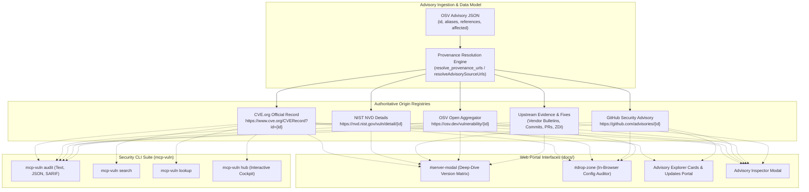

# Master Implementation Plan: Wave 25 — Authoritative CVE Source Provenance, Upstream Evidence Traceability & Cross-Platform Linking (Task 141)

## 1. Executive Summary & Provenance Mandate

The **Wave 25 Architecture** focuses on **Authoritative Upstream Traceability & Source Provenance**.

In previous waves (Waves 1–24), `mcp-vulnerabilities` built extensive discovery pipelines, dynamic risk tiers, AST reachability analysis, reverse proxy interceptors, and 17-client workstation auditors. However, when vulnerabilities were presented to end users and automated consumers (across `docs/app.js`, `docs/updates.js`, and the CLI suite), the link between an advisory and its authoritative upstream source of truth remained fragile or incomplete:

1. **Aggregator Single-Hop Fallback**: Most components previously displayed plain text badges or routed exclusively through `osv.dev` as a generic aggregator, omitting direct clickable access to the primary **CVE Numbering Authority (CVE.org)**, the **National Vulnerability Database (NVD / NIST)**, or the **GitHub Advisory Database (GHSA)**.
2. **Upstream Evidence Discard**: Rich advisory metadata—including vendor advisories, bug reports, pull requests, commit diffs, and Zero Day Initiative (ZDI) bulletins—were dropped or truncated (e.g. `f.references[0]` in CLI).
3. **Multi-Surface Inconsistency**: Modals, dropzones, update feeds, and CLI commands provided inconsistent levels of provenance detail.

**Wave 25** establishes absolute provenance parity across the entire ecosystem:
- **Task 141 (`P0`)**: CVE Source Provenance URLs in Web Portal and CLI.

---

## 2. Work Breakdown Structure & Specification Matrix

| Task ID | Task Title | Priority | Subsystem & Target Files | Contract Specification |
| :---: | :--- | :---: | :--- | :--- |
| **Task 141** | **CVE Source Provenance URLs in Web Portal and CLI** | `P0` | Web Portal & Security CLI (`docs/app.js`, `docs/updates.js`, `docs/index.html`, `docs/updates.html`, `src/mcp_vulnerabilities/`) | [`task141_cve_source_provenance_urls_web_and_cli.md`](task141_cve_source_provenance_urls_web_and_cli.md) |

---

## 3. System Architecture & End-to-End Provenance Flow

---

## 4. Verification & Quality Gates

Wave 25 enforces five invariants (`INVARIANT_141_1` through `INVARIANT_141_5`):
1. **Deterministic URL Resolution**: Direct mappings to CVE.org, NVD, GHSA, and OSV.
2. **Web Surface Parity**: Clickable links on all five web surfaces.
3. **Exhaustive Upstream Reference Preservation**: Zero truncation of reference lists.
4. **CLI Terminal Usability**: Terminal formatting with copyable/clickable URLs.
5. **Safe DOM Sanitization**: Strict protocol allowlist (`https://`, `http://`) and `escapeHtml()`.
