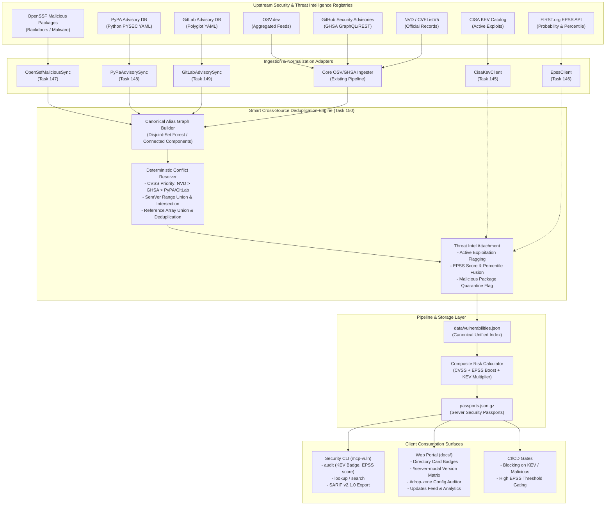

# Master Implementation Plan: Wave 27 — Threat Intelligence, Exploit Prediction & Multi-Source Deduplication (Tasks 145–150)

## 1. Executive Summary & Strategic Rationale

As the Model Context Protocol (MCP) ecosystem matures into enterprise mission-critical deployments, AI agents (e.g., Claude Desktop, Cursor, Cline, Windsurf, Continue, Goose, Zed) interact directly with developer workstations, cloud environments, and internal toolchains. Vulnerabilities in MCP servers present an immediate, high-impact vector for remote code execution (RCE), token exfiltration, sandbox escapes, and prompt injection attacks.

In previous waves (Waves 1–26), `mcp-vulnerabilities` built foundational package discovery, static web visualization, AST reachability analysis, 17-client workstation configuration auditing, and authoritative source provenance linking (CVE.org, NVD, GHSA, OSV). However, vulnerability triage and prioritization in modern enterprise security environments cannot rely solely on CVSS base scores and reactive aggregator feeds:

1. **Absence of Real-World Exploitability Intelligence**:
   - CVSS base metrics represent theoretical severity, not real-world exploitation. Security teams are overwhelmed by high-severity alerts that have no known exploit weaponization.
   - Without integrating the **CISA Known Exploited Vulnerabilities (KEV)** catalog, zero-day and active wild exploits targeting MCP server components fail to trigger immediate, high-priority remediation alerts.
2. **Lack of Exploit Probability Forecasting**:
   - The **FIRST.org Exploit Prediction Scoring System (EPSS)** models the probability that a vulnerability will be exploited in the wild within 30 days. Integrating EPSS enables proactive defense, allowing teams to remediate high-probability vulnerabilities before weaponized exploit kits emerge.
3. **Supply Chain Backdoor & Poisoning Blindspots**:
   - Aggregators primarily track accidental software bugs, missing deliberate open-source malware, token stealer implants, typosquatting packages, and malicious releases tracked by the **OpenSSF Malicious Packages** repository.
4. **Ecosystem Depth Deficits in Python & Multi-Language Repositories**:
   - Python is the primary lingua franca of AI/MCP servers (FastMCP, MCP Python SDK, LangChain, LlamaIndex), yet subtle PEP 440 version specifications and PyPA-curated disclosures in the **PyPA Advisory Database** are frequently missed or simplified by generic aggregators.
   - Similarly, enterprise deployments relying on Go, Rust, and polyglot microservices require coverage from the **GitLab Advisory Database**.
5. **Cross-Source Advisory Fragmentation & Conflict**:
   - Ingesting data from 8 upstream sources (OSV, GHSA, NVD, CVEListV5, CISA KEV, EPSS, OpenSSF, PyPA, GitLab) inevitably introduces duplicate records, conflicting CVSS scores, diverging affected version ranges, and fragmented reference lists.
   - Without an intelligent, canonical alias graph deduplicator, identical vulnerabilities appear as multiple conflicting entries, corrupting catalog statistics and confusing users.

**Wave 27** addresses these challenges holistically by implementing a production-grade **Threat Intelligence, Exploit Prediction, and Smart Cross-Source Deduplication Engine**.

---

## 2. Work Breakdown Structure & Specification Matrix

| Track | Task ID | Task Title | Priority | Subsystem & Target Modules | Contract Specification |
| :---: | :---: | :--- | :---: | :--- | :--- |
| **A** | **Task 145** | **CISA KEV Active Exploitation Ingestion & UI Enrichment** | `P0` | Threat Intel (`threat_intel/cisa_kev.py`, `pipeline.py`, `docs/app.js`, `cli.py`) | [`task145_cisa_kev_active_exploitation_enrichment.md`](task145_cisa_kev_active_exploitation_enrichment.md) |
| **A** | **Task 146** | **FIRST.org EPSS Exploit Prediction Integration & Risk Boosting** | `P0` | Risk Scoring (`threat_intel/epss.py`, `scoring.py`, `site_builder.py`, `cli.py`) | [`task146_epss_exploit_prediction_scoring_integration.md`](task146_epss_exploit_prediction_scoring_integration.md) |
| **B** | **Task 147** | **OpenSSF Malicious Packages Repository Sync & Backdoor Quarantining** | `P0` | Supply Chain Defense (`threat_intel/openssf_malicious.py`, `converters/openssf.py`) | [`task147_openssf_malicious_packages_ingestion.md`](task147_openssf_malicious_packages_ingestion.md) |
| **B** | **Task 148** | **PyPA Python Advisory Database Ingestion & PEP 440 Normalization** | `P1` | Ecosystem Ingestion (`discovery/pypa.py`, `converters/pypa.py`, `pipeline.py`) | [`task148_pypa_advisory_database_sync.md`](task148_pypa_advisory_database_sync.md) |
| **B** | **Task 149** | **GitLab Advisory Database Sync & Multi-Ecosystem Ingestion** | `P1` | Ecosystem Ingestion (`discovery/gitlab.py`, `converters/gitlab.py`, `pipeline.py`) | [`task149_gitlab_advisory_database_sync.md`](task149_gitlab_advisory_database_sync.md) |
| **C** | **Task 150** | **Smart Cross-Source Advisory Deduplicator & Canonical Alias Graph** | `P0` | Graph & Ingestion Core (`dedup/`, `graph/alias_graph.py`, `pipeline.py`) | [`task150_smart_cross_source_deduplicator.md`](task150_smart_cross_source_deduplicator.md) |

---

## 3. End-to-End System Architecture

---

## 4. Threat Intelligence Integration & Risk Scoring Formulation

Wave 27 enhances the `mcp-vulnerabilities` composite risk engine with empirical threat intelligence metrics. Rather than treating CVSS score in isolation, the enhanced risk formula incorporates real-world weaponization probability and confirmed active exploitation.

### 4.1 Threat Score Formulation

$$S_{\text{composite}} = \min\left(10.0, \, \left(S_{\text{CVSS}} \times W_{\text{base}} + S_{\text{EPSS}} \times 10.0 \times W_{\text{EPSS}}\right) \times M_{\text{KEV}}\right)$$

Where:
- $S_{\text{CVSS}} \in [0.0, 10.0]$: Authoritative CVSS v3.1 base score (or CVSS v4.0 when available).
- $S_{\text{EPSS}} \in [0.0, 1.0]$: FIRST.org EPSS exploit prediction probability.
- $W_{\text{base}} = 0.70$: Baseline vulnerability intrinsic severity weight.
- $W_{\text{EPSS}} = 0.30$: Empirical weaponization probability weight.
- $M_{\text{KEV}}$: CISA KEV exploitation multiplier:
  - $M_{\text{KEV}} = 1.35$ if vulnerability is listed in CISA KEV (`known_exploited == True`), capped at $10.0$.
  - Additionally, any vulnerability listed on CISA KEV is guaranteed a minimum composite score of $9.0$ (`CRITICAL`), irrespective of nominal CVSS base score.
- **Malicious Package Override**: Any package identified by OpenSSF Malicious Packages receives an unconditional composite score of $10.0$ (`MALICIOUS / QUARANTINED`), overriding all other scores.

### 4.2 Risk Tier Mapping

| Composite Score ($S$) | Risk Tier | SLA Remediation Guidance | UI Visual Indicator |
| :---: | :---: | :--- | :--- |
| **Malicious Override** | `MALICIOUS` | **Immediate Quarantine**: Package is malware. Revoke all credentials. | ☠️ Dark Crimson Skull Badge |
| **$9.0 \le S \le 10.0$** | `CRITICAL` | **P0 Emergency**: Active KEV exploit or critical RCE with high EPSS. | 🚨 Solid Red Badge + KEV Pulsing Pill |
| **$7.0 \le S < 9.0$** | `HIGH` | **P1 Urgent**: Remediate within 7 days. High weaponization risk. | 🔶 Amber Badge + EPSS Meter |
| **$4.0 \le S < 7.0$** | `MEDIUM` | **P2 Standard**: Remediate in standard release cycle (30 days). | 🟡 Yellow Badge |
| **$0.0 \le S < 4.0$** | `LOW` | **P3 Informational**: Low priority or theoretical flaw. | 🟢 Green / Slate Badge |

---

## 5. Canonical Alias Graph & Deduplication Strategy (Task 150)

With 8 diverse data sources, deduplication is the critical architectural glue:

1. **Bidirectional Equivalence Graph**:
   - Nodes represent unique vulnerability identifiers across namespaces (`CVE-`, `GHSA-`, `PYSEC-`, `MAL-`, `GLAD-`).
   - Edges represent declared alias relationships (`aliases` list in OSV/GHSA, `identifiers` in GitLab, CVE references in OpenSSF).
   - The engine computes Connected Components via Disjoint-Set Union (DSU with path compression and union-by-rank), collapsing all related identifiers into a single equivalence cluster.
2. **Canonical Primary ID Selection Hierarchy**:
   1. `CVE-*` (Authoritative global standard)
   2. `GHSA-*` (GitHub advisory standard)
   3. `MAL-*` (OpenSSF malicious standard for unassigned malware)
   4. `PYSEC-*` (PyPA specific)
   5. `GLAD-*` (GitLab advisory specific)
3. **Deterministic Conflict Resolution Matrix**:
   - **Severity**: Prefer NVD official CVSS vector > GHSA CVSS > PyPA/GitLab > Heuristic calculation.
   - **Affected Ranges**: Parse all SemVer, PEP 440, and ecosystem constraints; compute the union of affected version intervals; eliminate redundant sub-ranges while retaining boundary conditions.
   - **References**: Aggregate all reference URLs across source records; deduplicate by normalized URL (lowercased protocol and host, stripped trailing slashes and tracking params); categorize into vendor bulletins, patches, and advisories.
   - **Provenance Preservation**: Retain pointers to every originating source record to ensure complete bidirectional auditability (as established in Wave 25).

---

## 6. Verification & Quality Gates

Wave 27 enforces six overarching invariants across all tasks:

- [ ] **INVARIANT_W27_1 (No Data Loss in Deduplication)**: Every alias, reference URL, and affected package ecosystem present in any of the 8 upstream sources must be preserved in the unified catalog entry.
- [ ] **INVARIANT_W27_2 (CISA KEV Deterministic Flagging)**: Any CVE present in `data/cisa_kev.json` must be flagged with `known_exploited = True`, display the KEV badge in both CLI and Web Portal, and receive a minimum composite score of 9.0.
- [ ] **INVARIANT_W27_3 (EPSS Score Freshness & Caching)**: EPSS API requests must utilize bulk querying with local TTL caching (`data/epss_cache.json`), ensuring offline air-gap execution and zero CI network flakiness.
- [ ] **INVARIANT_W27_4 (Malicious Package Absolute Isolation)**: OpenSSF malicious package records must trigger an unbypassable `MALICIOUS` warning, blocking automated configuration generation and stamping warnings in SARIF output.
- [ ] **INVARIANT_W27_5 (PEP 440 SemVer Integrity)**: PyPA advisories using complex PEP 440 clauses (e.g. `~=`, `!=`, `.dev`, `.post`) must parse without crashing and normalize cleanly into standard OSV ranges.
- [ ] **INVARIANT_W27_6 (Deterministic Graph Convergence)**: The canonical alias graph must produce identical canonical IDs, score mappings, and merged version ranges regardless of the order in which data sources are ingested.

---

## 7. Deliverables & Documentation Synchronization

1. `docs/tasks/master_plan_wave27_threat_intel_exploit_prediction_and_deduplication.md` (This document)
2. `docs/tasks/task145_cisa_kev_active_exploitation_enrichment.md`
3. `docs/tasks/task146_epss_exploit_prediction_scoring_integration.md`
4. `docs/tasks/task147_openssf_malicious_packages_ingestion.md`
5. `docs/tasks/task148_pypa_advisory_database_sync.md`
6. `docs/tasks/task149_gitlab_advisory_database_sync.md`
7. `docs/tasks/task150_smart_cross_source_deduplicator.md`
8. Updates to `docs/tasks/README.md` registering Wave 27 and all associated task specifications.
