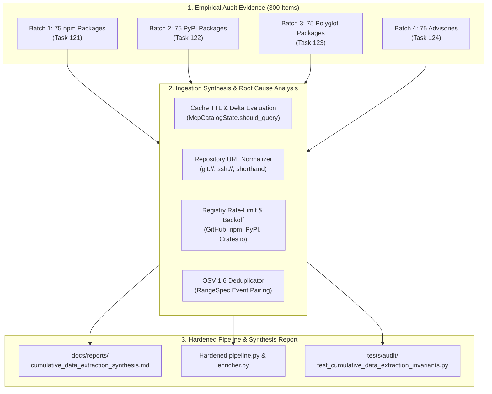

# Task 125: Track A — Cumulative Data Extraction & Ingestion Pipeline Synthesis Report (P0)

**Subsystem:** Ingestion Architecture & Pipeline Synthesis (`src/mcp_vulnerabilities/pipeline.py`, `src/mcp_vulnerabilities/discovery/enricher.py`, `docs/reports/cumulative_data_extraction_synthesis.md`)  
**Priority:** `P0`  
**Parent Plan:** [master_plan_wave23_deep_empirical_audit_and_verification.md](master_plan_wave23_deep_empirical_audit_and_verification.md)

---

## 1. Objective & Problem Statement

Across Tasks 121, 122, 123, and 124, **300 diverse items** (75 npm, 75 PyPI, 75 polyglot Go/Rust/Docker/GitHub, and 75 vulnerability advisories) were empirically audited against upstream registries and repositories. 

While individual audits identify point-in-time discrepancies for specific packages, systemic extraction health requires a **cumulative synthesis**:
1. **Systemic Ingestion Hazards**: Recurring patterns such as repository URL format divergence, cache invalidation lag, yanked release promotion, or unhandled registry rate limits.
2. **Pipeline Architecture & Resiliency**: How `McpVulnerabilityPipeline` (`pipeline.py`), `CatalogVersionEnricher` (`discovery/enricher.py`), and `McpCatalogState` handle partial network failures, malformed upstream JSON, and atomic checkpoint persistence.
3. **Monotonicity & Non-Destructive Ingestion**: Verifying that incremental runs never drop historical records, alter unmodified timestamps, or introduce invalid SemVer ranges.

This task synthesizes the empirical evidence from Tasks 121–124 into a comprehensive master report (`docs/reports/cumulative_data_extraction_synthesis.md`) and designs concrete algorithmic hardening patches for the ingestion pipeline.

---

## 2. Technical Synthesis Domains & Invariant Analysis



### 2.1 Core Invariant Domains Analyzed

1. **Discovery Coverage & Query Sensitivity**:
   - Evaluate whether existing search terms (`keywords:mcp-server`, `keywords:modelcontextprotocol`, `text=@modelcontextprotocol`) capture emerging MCP naming conventions.
   - Propose dynamic keyword expansions based on ecosystem trends (e.g. `fastmcp`, `mcp-bridge`).
2. **Version Resolution & Cache Expiration**:
   - Analyze empirical version lag statistics across npm and PyPI.
   - Refine `McpCatalogState.should_query()` heuristics: re-audit packages when release tags change or after 14 days rather than 30 days for high-risk components.
3. **Repository URL Sanitization**:
   - Implement universal URL normalizer converting `git://`, `git+https://`, `ssh://git@github.com:`, and shorthand `github:org/repo` into canonical `https://github.com/org/repo`.
4. **OSV Range Merging & RangeSpec Deduplication**:
   - Validate deduplication logic in `OsvDeduplicator.merge_ranges()` against the 75 audited advisories. Enforce strict monotonic `introduced` -> `fixed` ordering.
5. **Atomic State Checkpointing & Error Isolation**:
   - Ensure exceptions during single-package enrichment do not terminate the entire batch or leave corrupted state in `mcp_catalog_state.json`.

---

## 3. Detailed Deliverables & Report Architecture

The cumulative synthesis report will be committed to `docs/reports/cumulative_data_extraction_synthesis.md` with the following formal structure:

1. **Executive Summary & Scope**: Overview of the 300 audited items, coverage percentages, and key metrics.
2. **Upstream Extraction Scorecard**:
   | Ecosystem | Items Audited | 100% Upstream Match | Version Lag Detected | Discrepancies Noted |
   | :--- | :---: | :---: | :---: | :---: |
   | npm / JavaScript | 75 | TBD | TBD | TBD |
   | Python / PyPI | 75 | TBD | TBD | TBD |
   | Go / Native | 25 | TBD | TBD | TBD |
   | Rust / Cargo | 20 | TBD | TBD | TBD |
   | Docker Hub | 15 | TBD | TBD | TBD |
   | GitHub Raw | 15 | TBD | TBD | TBD |
   | CVE / GHSA / NVD | 75 | TBD | TBD | TBD |
   | **Total / Average** | **300** | **TBD%** | **TBD%** | **TBD** |
3. **Deep Failure Mode Analysis**: Detailed exploration of anomalies discovered across Batches 1–4.
4. **Algorithmic Pipeline Remediations**: Specific patches for `pipeline.py`, `enricher.py`, `registries.py`, and `cve_json5.py`.
5. **Empirical Invariant Test Suite Execution**: Verification results from `tests/audit/test_cumulative_data_extraction_invariants.py`.

---

## 4. Automated Invariant Test Harness

An automated invariant test suite verifying systemic ingestion integrity will be created at `tests/audit/test_cumulative_data_extraction_invariants.py`:

```python
"""Cumulative Invariant Test Suite for Data Extraction and Ingestion."""

import json
from pathlib import Path
import pytest

CATALOG_PATH = Path("docs/data/mcp_catalog_index.json")
VULNS_PATH = Path("docs/data/vulnerabilities.json")

@pytest.fixture(scope="module")
def dataset():
    with open(CATALOG_PATH, "r", encoding="utf-8") as f:
        catalog = json.load(f)
    with open(VULNS_PATH, "r", encoding="utf-8") as f:
        vulns = json.load(f)
    return {"catalog": catalog, "vulns": vulns}

def test_repository_urls_are_canonical_https(dataset):
    """Verify that all non-null repository URLs start with https://."""
    for s in dataset["catalog"]:
        repo = s.get("repository_url")
        if repo:
            assert repo.startswith("https://"), f"Non-canonical repo URL: {repo} in {s.get('package_name')}"

def test_vulnerability_ranges_strictly_ordered(dataset):
    """Verify all OSV ranges have introduced preceding fixed."""
    for v in dataset["vulns"]:
        for aff in v.get("affected", []):
            for rng in aff.get("ranges", []):
                events = rng.get("events", [])
                introduced_seen = False
                for ev in events:
                    if "introduced" in ev:
                        introduced_seen = True
                    if "fixed" in ev:
                        assert introduced_seen, f"Fixed event before introduced in {v['id']}"
```

---

## 5. Integration Checklist

- [ ] Consolidate empirical findings from Tasks 121, 122, 123, and 124.
- [ ] Author and commit `docs/reports/cumulative_data_extraction_synthesis.md`.
- [ ] Author and verify `tests/audit/test_cumulative_data_extraction_invariants.py`.
- [ ] Implement required pipeline hardening patches in `src/mcp_vulnerabilities/`.
- [ ] Verify test suite pass rate across all ingestion invariant tests.
