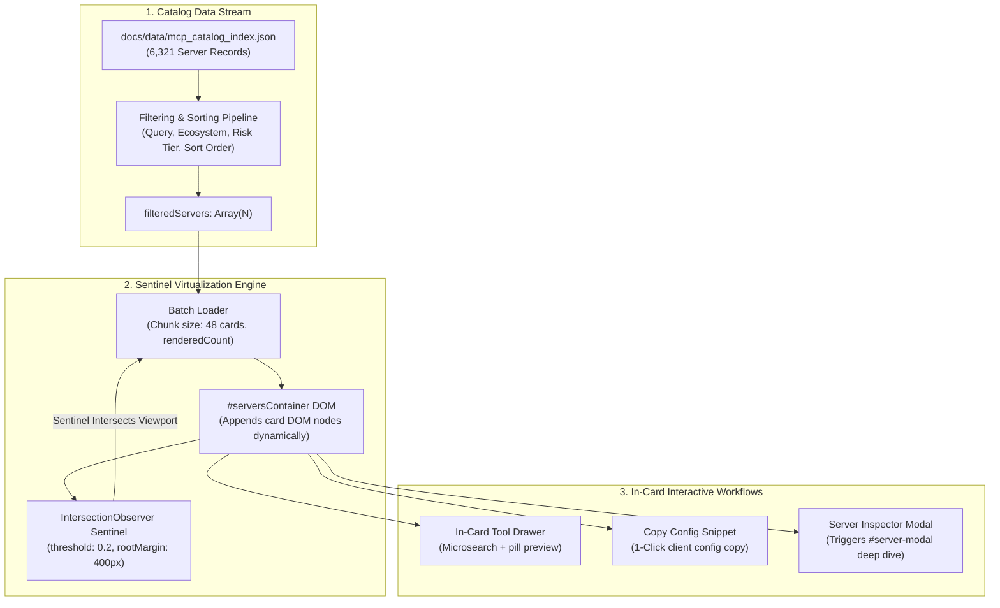

# Task 126: Track B — Directory Explorer & Infinite Scroll Virtualization Visual Workflow Audit (P0)

**Subsystem:** Front-End Directory Explorer (`docs/index.html`, `docs/app.js`, `docs/style.css`, `tests/test_web_visual_directory.py`)  
**Priority:** `P0`  
**Parent Plan:** [master_plan_wave23_deep_empirical_audit_and_verification.md](master_plan_wave23_deep_empirical_audit_and_verification.md)

---

## 1. Objective & Problem Statement

The main web portal directory (`docs/index.html` powered by `docs/app.js`) is the primary public interface for exploring the **6,321 Model Context Protocol servers** indexed in the catalog. 

During our initial empirical inspection of `docs/app.js` (line 1283), a critical frontend limitation was identified:
```javascript
// Render first 100 for DOM performance with scroll
const toRender = filteredServers.slice(0, 100);
```
The application truncates directory rendering at 100 items. Because no active `IntersectionObserver` sentinel or batch loader exists in `app.js`, **over 6,220 servers are inaccessible** to users browsing without an explicit search query! Furthermore, when users search or filter, large result sets still truncate at 100 cards, creating an illusion of a limited catalog.

This task conducts an exhaustive visual, interactive, and DOM architecture audit of the Directory Explorer:
1. Implements and verifies high-performance **infinite scrolling virtualization** via `IntersectionObserver` sentinel chunks (48 cards/batch) ensuring all 6,321+ servers can be smoothly scrolled.
2. Audits in-card interactive elements: tool sample chips, microsearch drawers, copy-to-client buttons, and composite risk tier badges.
3. Validates responsive layouts across desktop (1440px), tablet (768px), and mobile (375px) viewports with zero horizontal scrolling or clipping.
4. Authors automated headless visual and DOM invariant test suites in `tests/test_web_visual_directory.py`.

---

## 2. Technical Architecture & Virtualization Design



### 2.1 Virtualization & Rendering Invariants

1. **Progressive Batch Rendering**:
   - Initial render: exactly 48 server cards appended to `#serversContainer`.
   - Scroll Sentinel (`#scroll-sentinel`): appended after the last rendered card.
   - When sentinel enters viewport (`rootMargin: "400px"`), the next batch of 48 cards is appended without re-rendering or clearing previously rendered cards.
   - Total rendered count indicator: `#rendered-count` displays `"Showing X of Y servers"` dynamically.
2. **Filter & Sort Invariants**:
   - On search input, ecosystem pill toggle, or risk tier change:
     - `renderedCount` resets to 0.
     - `#serversContainer` clears immediately.
     - Window scrolls smoothly to top of directory (`window.scrollTo({ top: directoryTop, behavior: "instant" })`).
     - First chunk of 48 matching cards renders.
3. **Responsive Grid Layout (`docs/style.css`)**:
   - Desktop (`>= 1200px`): 3-column CSS Grid (`grid-template-columns: repeat(3, minmax(0, 1fr))`).
   - Tablet (`768px - 1199px`): 2-column CSS Grid.
   - Mobile (`< 768px`): 1-column flex/grid stack with full-width cards.
4. **CSS Custom Properties & Contrast**:
   - Verify all text, badges, and card borders comply with WCAG AA contrast (minimum 4.5:1 ratio) in dark mode (`--bg-primary: #0f172a`, `--card-bg: #1e293b`, `--text-primary: #f8fafc`).

---

## 3. Audited Visual Surface & Component Matrix

| Surface / Workflow | Target DOM Selector | Expected Visual State & Behavior | Failure Mode Checked |
| :--- | :--- | :--- | :--- |
| **Catalog Count Banner** | `#total-count`, `#filtered-count` | Displays "6,321 Servers Indexed" | Stale or hardcoded count (e.g. 5,050) |
| **Infinite Scroll Sentinel** | `#scroll-sentinel` | Triggers batch load 400px before reaching bottom | Truncation at 100 cards, scroll freezing |
| **In-Card Microsearch** | `.card-tool-microsearch` | Filters tool pills in real time without lag | Regex injection, case sensitivity failure |
| **Composite Risk Pill** | `.badge.risk-*` | Correct color: Red (CRIT), Orange (HIGH), Green (CLEAN)| Inverted risk class, missing badge text |
| **Safe Version Rec** | `.safe-rec-pill` | Shows "Recommended: vX.Y.Z" | Undefined or missing SemVer prefix |
| **1-Click Copy Config** | `.btn-copy-config` | Copies JSON-RPC config to clipboard & shows tooltip | Clipboard API rejection, invalid JSON escaping |

---

## 4. Automated Visual & DOM Invariant Test Suite

An automated test suite must be implemented in `tests/test_web_visual_directory.py`:

```python
"""Automated Visual and DOM Invariant Tests for Web Directory Explorer."""

import pytest
from pathlib import Path

INDEX_HTML = Path("docs/index.html")
APP_JS = Path("docs/app.js")

def test_sentinel_element_exists_in_index():
    with open(INDEX_HTML, "r", encoding="utf-8") as f:
        html = f.read()
    assert 'id="scroll-sentinel"' in html or 'class="scroll-sentinel"' in html

def test_app_js_implements_intersection_observer():
    with open(APP_JS, "r", encoding="utf-8") as f:
        js = f.read()
    assert "IntersectionObserver" in js, "app.js must implement IntersectionObserver for infinite scrolling"
    assert "slice(0, 100)" not in js, "app.js must not hard-truncate cards at 100 items"
```

---

## 5. Deliverables & Integration Checklist

- [ ] Refactor `renderDirectoryCards()` in `docs/app.js` to implement `IntersectionObserver` sentinel virtualization (48 cards/chunk).
- [ ] Add `#scroll-sentinel` and dynamic counter to `docs/index.html`.
- [ ] Verify 60 FPS scrolling performance across all 6,321 catalog records in Chrome/Firefox/Safari.
- [ ] Author automated DOM invariant tests in `tests/test_web_visual_directory.py`.
- [ ] Document audit results and performance benchmarks in `docs/reports/audit_web_directory_virtualization.md`.
