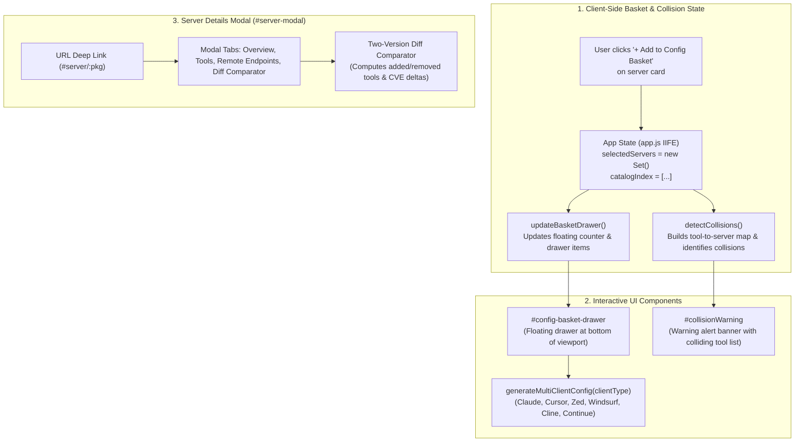

# Task 127: Track B — Multi-Server Basket, Collision Warnings & Config Modal Audit (P0)

**Subsystem:** Interactive Configuration Hub & Modals (`docs/index.html`, `docs/app.js`, `docs/style.css`, `tests/test_web_basket_collision.py`)  
**Priority:** `P0`  
**Parent Plan:** [master_plan_wave23_deep_empirical_audit_and_verification.md](master_plan_wave23_deep_empirical_audit_and_verification.md)

---

## 1. Objective & Problem Statement

Modern AI workstations run multiple Model Context Protocol (MCP) servers concurrently across AI clients (Claude Desktop, Cursor, Windsurf, Zed, Cline, Continue). To prevent namespace shadowing and tool injection attacks, the web portal must provide:
1. A **Multi-Server Configuration Basket** allowing users to select multiple servers and export unified configuration JSON.
2. An automated **Cross-Server Tool Collision Warning Banner** alerting users when two selected servers export identical tool names.
3. A rich **Server Details Modal** featuring deep-link navigation (`#server/<pkg>`), schema inspection, and an arbitrary **Two-Version Diff Comparator**.

### Empirical Bug Discovery in `docs/app.js`:
During our codebase inspection, a critical scoping defect was identified in `docs/app.js` (lines 2294–2315):
```javascript
window.detectCollisions = function() {
  const banner = document.getElementById("collisionWarning");
  if (!banner) return;
  const toolMap = {};
  Array.from(selectedServers).forEach(pkgName => {  // ReferenceError: selectedServers is not defined
    const server = catalogIndex.find(s => s.package_name === pkgName);
    ...
```
`selectedServers` is neither declared inside `app.js` nor passed as a global state parameter! When invoked, `detectCollisions()` immediately crashes with an uncaught `ReferenceError: selectedServers is not defined`. Furthermore, the visual basket drawer (`#config-basket-drawer`) and selection checkboxes were omitted from `docs/index.html`.

This task repairs the state architecture, completes the basket drawer UI, hardens collision detection, and audits the Server Details Modal workflows.

---

## 2. Technical Architecture & State Machine



### 2.1 State & Behavioral Invariants

1. **Basket State Isolation**:
   - `selectedServers` must be formally declared in `docs/app.js` as an encapsulated `Set<string>`.
   - Card selection state must be preserved during infinite scrolling and filter updates. Cards already in the basket must render with an `Added` visual state.
2. **Cross-Server Collision Engine**:
   - `detectCollisions()` must safely query `catalogIndex` and `selectedServers`.
   - When 2 or more selected servers share an identical tool name (e.g. `read_file` in `@modelcontextprotocol/server-filesystem` and `local-fs-mcp`), `#collisionWarning` must display an alert listing the offending tool and conflicting packages.
   - If no collisions exist or fewer than 2 servers are selected, the banner must be cleanly hidden (`display: none`).
3. **Multi-Client Configuration Generator**:
   - Supports 6 target AI clients:
     - **Claude Desktop**: `~/Library/Application Support/Claude/claude_desktop_config.json` (`mcpServers` object).
     - **Cursor**: `~/.cursor/mcp.json`.
     - **Zed**: `~/.config/zed/settings.json` (`context_servers` key).
     - **Windsurf**: `~/.codeium/windsurf/mcp_config.json`.
     - **Cline / Roo-Code**: VS Code extension settings.
     - **Continue.dev**: `~/.continue/config.json`.
4. **Server Modal & Version Diff Comparator**:
   - Modal deep linking: Loading `index.html#server/@modelcontextprotocol/server-filesystem` immediately loads the catalog record and opens the modal.
   - Version comparator: Selecting `Version A` and `Version B` displays:
     - Green badge: Newly added tools.
     - Red badge: Removed tools.
     - Security delta: CVEs resolved or introduced between selected versions.

---

## 3. Audited Visual Surface & Component Matrix

| Component | Target Selector | Visual State & Behavior Verified | Failure Mode Checked |
| :--- | :--- | :--- | :--- |
| **Card Basket Button** | `.btn-add-basket` | Toggles between "+ Add to Basket" and "✓ In Basket" | State lost on infinite scroll rerender |
| **Floating Drawer** | `#config-basket-drawer` | Slides up when `selectedServers.size > 0`; shows count | Visual occlusion, unresponsive collapse |
| **Collision Warning** | `#collisionWarning` | Shows warning with colliding tool list & package pills | `ReferenceError: selectedServers is not defined` |
| **Client Tab Switcher** | `.basket-client-tab` | Switches JSON config preview between 6 AI clients | Malformed JSON template, missing env vars |
| **Modal Deep Link** | `window.location.hash` | Opens `#server-modal` matching URL hash on page load | Unencoded slash (`/`) breaking selector |
| **Version Comparator** | `#diff-version-a`, `#diff-version-b` | Computes tool additions/removals across SemVers | Crashing on servers with single version |

---

## 4. Automated Visual & DOM Invariant Test Suite

An automated test suite must be implemented in `tests/test_web_basket_collision.py`:

```python
"""Automated Tests for Basket, Collision Detection & Modal Workflows."""

from pathlib import Path

INDEX_HTML = Path("docs/index.html")
APP_JS = Path("docs/app.js")

def test_collision_warning_scope_integrity():
    with open(APP_JS, "r", encoding="utf-8") as f:
        js = f.read()
    # selectedServers must be declared before use
    assert "let selectedServers" in js or "const selectedServers" in js, "selectedServers must be declared in app.js"
    # Ensure detectCollisions does not crash on unbound variable
    assert "function detectCollisions" in js or "window.detectCollisions" in js

def test_basket_drawer_elements_exist_in_index():
    with open(INDEX_HTML, "r", encoding="utf-8") as f:
        html = f.read()
    assert 'id="config-basket-drawer"' in html or 'id="configBasketDrawer"' in html
    assert 'id="collisionWarning"' in html
```

---

## 5. Deliverables & Integration Checklist

- [ ] Fix `selectedServers` declaration and scoping in `docs/app.js`.
- [ ] Add `#config-basket-drawer` and client switcher tabs to `docs/index.html`.
- [ ] Style the floating drawer and collision banner in `docs/style.css` with smooth CSS transitions.
- [ ] Implement and verify the Two-Version Diff Comparator inside `#server-modal`.
- [ ] Author automated regression test suite `tests/test_web_basket_collision.py`.
- [ ] Verify zero JavaScript console errors when adding/removing 10+ servers to basket.
