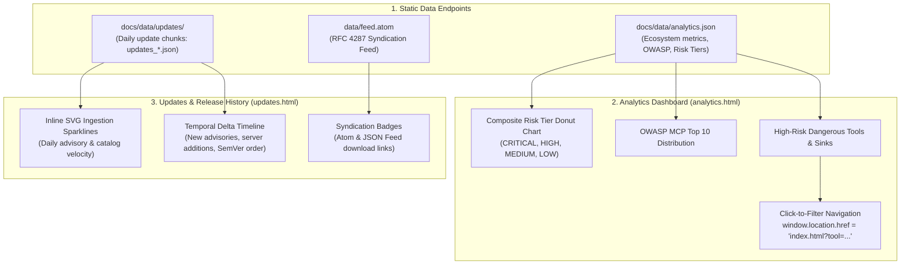

# Task 128: Track B — Analytics Portal, Velocity Sparklines & Updates Feed Visual Audit (P1)

**Subsystem:** Analytics & Updates Portal (`docs/analytics.html`, `docs/analytics.js`, `docs/updates.html`, `docs/updates.js`, `docs/style.css`, `tests/test_web_analytics_updates.py`)  
**Priority:** `P1`  
**Parent Plan:** [master_plan_wave23_deep_empirical_audit_and_verification.md](master_plan_wave23_deep_empirical_audit_and_verification.md)

---

## 1. Objective & Problem Statement

In addition to the primary Directory Explorer, the `mcp-vulnerabilities` static platform exposes two key analytical surfaces:
1. **Analytics Dashboard (`docs/analytics.html` & `docs/analytics.js`)**: Visualizes ecosystem-wide security metrics across 6,321+ servers, including Composite Risk Tier distribution, OWASP MCP Top 10 breakdown, high-risk tool counts, and Zero-Day unpatched gap tracking. All metrics must feature **Click-to-Filter Drilldowns** linking back to `index.html`.
2. **Updates & Syndication Feed (`docs/updates.html` & `docs/updates.js`)**: Renders daily vulnerability and catalog release updates, release-over-release deltas, SVG velocity sparklines, and Atom syndication feeds (`data/feed.atom`).

Empirical issues observed across these pages include:
- **Lexicographical SemVer Sorting**: In past versions, string sorting placed `v1.10.0` before `v1.2.0`. Client-side numerical SemVer ordering must be strictly preserved.
- **Sparkline SVG Scaling**: SVG sparklines risk distortion or overflow when daily ingestion volumes spike.
- **Drilldown Query Param Encoding**: Clicking special characters (e.g. `@modelcontextprotocol/*` or `CWE-79`) in analytics cards must properly URL-encode parameters to prevent query truncation.

This task conducts a visual, interaction, and data-fidelity audit across `analytics.html` and `updates.html`.

---

## 2. Technical Architecture & Data Ingestion



### 2.1 Visual & Data Invariants

1. **Click-to-Filter Query Linking**:
   - Every metric card, OWASP category bar, and tool ranking chip on `analytics.html` must be interactive (`cursor: pointer`).
   - Clicking an element must navigate to `index.html?q=<encoded_query>` or `index.html?risk=<tier>` and pre-populate the directory filter on arrival.
2. **Numerical Semantic Version Sorting**:
   - `updates.js` must parse versions using numeric segment comparisons `[major, minor, patch]` rather than lexicographical string comparison.
3. **Responsive SVG Velocity Sparklines**:
   - Sparkline SVG elements must utilize `viewBox="0 0 120 24"` with `preserveAspectRatio="none"` and `vector-effect="non-scaling-stroke"`, ensuring crisp 1.5px stroke rendering across all screen densities.
4. **Dark Mode UI Harmony**:
   - Charts, sparklines, and timeline markers must share identical CSS variables with `docs/style.css` (`--chart-accent`, `--chart-grid`, `--chart-bar-hover`).

---

## 3. Audited Visual Surface & Component Matrix

| Surface | Target Selector | Visual State & Behavior Verified | Failure Mode Checked |
| :--- | :--- | :--- | :--- |
| **Risk Tier Donut** | `#risk-donut-chart` | Renders SVG pie slices matching `analytics.json` counts | NaN percentages on zero criticals |
| **OWASP Bar Chart** | `#owasp-distribution` | Horizontal bars sized proportionately to frequency | Bar overflow past container width |
| **Tool Drilldown** | `.metric-clickable-pill` | Hover elevation; navigates to `index.html?tool=X` | URL encoding failure on spaces/special chars |
| **Velocity Sparkline** | `.sparkline-svg` | Smooth path line with dot on most recent day | SVG stroke clipping at 0px / max baseline |
| **Update History** | `.update-entry-card` | Strict chronological order with date badge | Out-of-order dates, duplicated cards |
| **Atom Feed Link** | `a[href*="feed.atom"]` | Valid link to raw Atom syndication XML | 404 dead link, missing XML MIME type |

---

## 4. Automated Visual & DOM Invariant Test Suite

An automated test suite must be implemented in `tests/test_web_analytics_updates.py`:

```python
"""Automated Tests for Analytics Dashboard and Updates Portal."""

from pathlib import Path

ANALYTICS_HTML = Path("docs/analytics.html")
ANALYTICS_JS = Path("docs/analytics.js")
UPDATES_HTML = Path("docs/updates.html")
UPDATES_JS = Path("docs/updates.js")

def test_analytics_drilldowns_use_url_encoding():
    with open(ANALYTICS_JS, "r", encoding="utf-8") as f:
        js = f.read()
    assert "encodeURIComponent" in js, "Drilldown links must encode query parameters"

def test_updates_uses_numeric_semver_sorting():
    with open(UPDATES_JS, "r", encoding="utf-8") as f:
        js = f.read()
    assert "split('.')" in js or "localeCompare" in js, "Must parse version numbers for sorting"
```

---

## 5. Deliverables & Integration Checklist

- [ ] Audit `analytics.html` and verify all chart drilldowns navigate cleanly to `index.html`.
- [ ] Inspect SVG sparklines on `updates.html` across Chrome, Firefox, and Safari on desktop and mobile.
- [ ] Verify SemVer version sorting in update history timelines.
- [ ] Author automated regression test suite `tests/test_web_analytics_updates.py`.
- [ ] Document audit observations in `docs/reports/audit_web_analytics_updates.md`.
