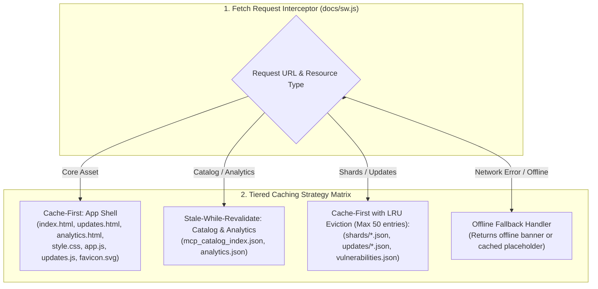

# Task 129: Track B — PWA Offline Service Worker, Caching & Performance Audit (P1)

**Subsystem:** Progressive Web App & Offline Caching (`docs/sw.js`, `docs/manifest.json`, `docs/index.html`, `tests/test_web_pwa_offline.py`)  
**Priority:** `P1`  
**Parent Plan:** [master_plan_wave23_deep_empirical_audit_and_verification.md](master_plan_wave23_deep_empirical_audit_and_verification.md)

---

## 1. Objective & Problem Statement

To provide reliable access for developers in low-connectivity or air-gapped environments, the `mcp-vulnerabilities` web portal implements Progressive Web App (PWA) capabilities (`docs/sw.js` and `docs/manifest.json`).

Our inspection of `docs/sw.js` revealed several critical caching and lifecycle gaps:
1. **Uncached Dynamic Updates**: While `docs/sw.js` specifies `Stale-While-Revalidate` for `mcp_catalog_index.json` and `Cache-First` for `shards/*.json`, it contains **no caching rule for `docs/data/updates/updates_*.json` or `docs/data/vulnerabilities.json`**! Visiting `updates.html` while offline fails with unhandled fetch rejections.
2. **Cache Quota & Unbounded Shard Growth**: The catalog index is 10.2 MB uncompressed and is divided into 34 shard files. As shards mutate, stale versions accumulate in Cache Storage without an LRU eviction or quota cap, risking mobile browser cache evictions.
3. **Missing Offline Fallback UI**: When an uncached network asset is requested while offline, `sw.js` allows fetch to reject, presenting the user with a broken image or blank state instead of an offline toast notification.
4. **Service Worker Update Notification**: When a new service worker version activates (`skipWaiting()`), the user is not prompted to refresh, leading to split-state cache anomalies where HTML expects new shard IDs that older JS has not fetched.

This task conducts an exhaustive PWA offline audit, closes caching coverage gaps, implements LRU cache management, and verifies Lighthouse performance benchmarks.

---

## 2. Technical Architecture & Cache Hierarchy



### 2.1 Caching Policy Specifications

1. **App Shell (Cache-First)**:
   - Core HTML, CSS, JavaScript, and SVG icons are cached upon Service Worker `install`. Served immediately from Cache Storage with background update check.
2. **Catalog Index & Analytics (Stale-While-Revalidate)**:
   - Responds instantly with cached JSON to guarantee sub-100ms page load times.
   - Dispatches a background `fetch()` to update the cache for the next session.
3. **Catalog Shards & Updates Chunks (Cache-First with LRU)**:
   - Shards (`shards/*.json`) and daily updates (`updates/*.json`) are cached on demand.
   - Implements an LRU cap (maximum 50 shard/update files) to keep total storage under 25 MB.
4. **PWA Manifest Compliance (`docs/manifest.json`)**:
   - `display: "standalone"`, `start_url: "./"`, valid SVG/PNG icons (192x192, 512x512), theme color `#0f172a`, and descriptive shortcuts (`Directory`, `Advisories`, `Analytics`).

---

## 3. Audited PWA Surfaces & Invariants

| Surface | Target Resource | Required Offline Behavior | Failure Mode Checked |
| :--- | :--- | :--- | :--- |
| **Directory Offline** | `index.html` + `mcp_catalog_index.json` | Loads immediately offline with cached search | Blank white screen on airplane mode |
| **Updates Offline** | `updates.html` + `updates/*.json` | Renders cached update history & timeline | Unhandled `TypeError: Failed to fetch` |
| **Analytics Offline** | `analytics.html` + `analytics.json` | Visualizes cached metrics & charts | Missing chart canvas elements |
| **PWA Install Banner** | `beforeinstallprompt` event | Prompt displayed on desktop/mobile Chrome | Manifest validation errors, missing icons |
| **Storage Quota** | `navigator.storage.estimate()` | Stays strictly under 25 MB total footprint | Unbounded cache accumulation |

---

## 4. Automated PWA & Offline Test Suite

An automated test suite must be implemented in `tests/test_web_pwa_offline.py`:

```python
"""Automated Tests for PWA Offline Caching and Service Worker Invariants."""

from pathlib import Path

SW_JS = Path("docs/sw.js")
MANIFEST_JSON = Path("docs/manifest.json")

def test_service_worker_caches_updates_and_shards():
    with open(SW_JS, "r", encoding="utf-8") as f:
        js = f.read()
    assert "updates/" in js or "updates.json" in js, "sw.js must contain a caching rule for updates"
    assert "shards/" in js, "sw.js must cache catalog shards"

def test_manifest_pwa_spec_compliance():
    import json
    with open(MANIFEST_JSON, "r", encoding="utf-8") as f:
        manifest = json.load(f)
    assert manifest.get("display") == "standalone"
    assert manifest.get("start_url") is not None
    assert len(manifest.get("icons", [])) > 0
```

---

## 5. Deliverables & Integration Checklist

- [ ] Update `docs/sw.js` to add caching rules for `updates/*.json` and `vulnerabilities.json`.
- [ ] Implement LRU cache eviction logic in `docs/sw.js` to cap stored shards at 50 files.
- [ ] Add an offline banner / toast in `docs/app.js` when `navigator.onLine === false`.
- [ ] Author automated regression test suite `tests/test_web_pwa_offline.py`.
- [ ] Run Lighthouse PWA audit in headless Chrome, ensuring PWA score >= 90.
