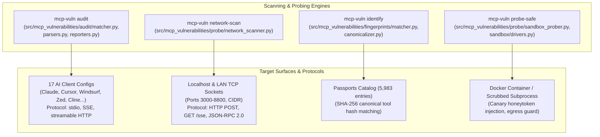

# Task 130: Track C — Code Review & Resilience Audit of Scanning & Probing Tools (P0)

**Subsystem:** Scanning & Probing Tool Engines (`src/mcp_vulnerabilities/audit/`, `src/mcp_vulnerabilities/probe/`, `src/mcp_vulnerabilities/fingerprints/`, `docs/reports/code_review_scanning_tools.md`)  
**Priority:** `P0`  
**Parent Plan:** [master_plan_wave23_deep_empirical_audit_and_verification.md](master_plan_wave23_deep_empirical_audit_and_verification.md)

---

## 1. Objective & Problem Statement

The detection and dynamic discovery capabilities of `mcp-vulnerabilities` rely on four core CLI inspection tools:
1. **`mcp-vuln audit` (and `audit-config`)**: Scans universal local AI client configuration files (17 AI clients) and project manifests against the OSV database.
2. **`mcp-vuln network-scan`**: Probes local and LAN TCP ports to identify active, unauthenticated, or rogue MCP servers listening on network sockets.
3. **`mcp-vuln identify`**: Takes live tool schemas and matches them against the 5,983 server passports in `data/passports.json.gz` using canonical tool hashing.
4. **`mcp-vuln probe-safe`**: Executes untrusted MCP servers in an isolated sandbox with canary secret injection to detect exfiltration attempts before configuration.

Because these tools directly interact with untrusted networks, arbitrary user configuration files, third-party executables, and external process pipes, subtle bugs can lead to security bypasses, OS file descriptor leaks, hanging processes, or host compromise.

This task conducts an exhaustive, line-by-line code review of these four scanning and probing engines, cataloging all protocols, failure modes, error-handling gaps, and timeout traps, and delivering hardened code fixes.

---

## 2. Tool Architecture & Scope Analysis

---

## 3. Detailed Code Review Checklist & Failure Mode Matrix

### 3.1 `mcp-vuln audit` / `audit-config`
- **Protocols & Ecosystems**: Stdio processes (`npx`, `uvx`, `python`, `node`, `docker run`), SSE endpoints, Streamable HTTP. 17 AI clients supported.
- **Identified Failure Modes & Edge Cases**:
  - *Malformed Configuration Files*: Trailing commas, unquoted keys, or comments in `json` configs. (Needs robust JSON5 / relaxed parser fallback).
  - *Environment Variable Recursion*: `${API_KEY}` and `${HOME}` substitution can crash if unescaped or if cyclic references occur.
  - *Symlink Loops*: Traversing configuration directories with circular symlinks causes recursion limits.
  - *Exit Code Ambiguity*: Must return standardized exit codes (`0` clean, `1` vulnerabilities detected, `2` error).

### 3.2 `mcp-vuln network-scan`
- **Protocols & Ecosystems**: Raw TCP pre-flight, HTTP GET `/sse`, HTTP POST `/` with JSON-RPC `{"method": "tools/list"}`.
- **Identified Failure Modes & Edge Cases**:
  - *Socket Descriptor Exhaustion*: Scanning a `/24` subnet across 5,000 ports concurrently can exceed `ulimit -n` (1,024 on macOS), causing `OSError: [Errno 24] Too many open files`. Requires bounded semaphore (`asyncio.Semaphore(64)`).
  - *Slowloris / Hung Socket Traps*: Non-MCP services (e.g. database servers, print daemons) accept TCP but never respond to HTTP POST, hanging until timeout. Strict connect and read timeouts (e.g. 500ms connect, 1,000ms read) must be enforced.
  - *IPv6 vs IPv4 Mismatch*: Binding to `localhost` on macOS resolves to `::1` first, which fails if the target server listens only on `127.0.0.1`. Must probe dual-stack explicitly.

### 3.3 `mcp-vuln identify`
- **Protocols & Ecosystems**: JSON-RPC schema inspection, canonical tool hashing (`tools/list` -> JSON sort -> SHA-256).
- **Identified Failure Modes & Edge Cases**:
  - *Tool Schema Mutation*: If parameter descriptions or required fields are omitted or ordered differently between versions, canonical hash diverges. Requires fuzzy parameter matching.
  - *Passport Memory Footprint*: Repeatedly decompressing `passports.json.gz` (5,983 records) in memory introduces 80 MB heap allocations per run. Requires module-level LRU caching.

### 3.4 `mcp-vuln probe-safe`
- **Protocols & Ecosystems**: Docker containers (`--network none`, `--cap-drop ALL`), POSIX subprocesses with scrubbed environment variables.
- **Identified Failure Modes & Edge Cases**:
  - *Missing Container Runtime*: When Docker is not installed or running, fallback to subprocess must scrub sensitive host variables (`OPENAI_API_KEY`, `AWS_SECRET_ACCESS_KEY`, `SSH_AUTH_SOCK`).
  - *Canary Secret False Positives*: Checking for canaries in output must account for server echoing arguments vs true exfiltration.
  - *Subprocess Pipe Deadlocks*: Stdio probing without non-blocking stderr drain threads can hang on long debug logs.

---

## 4. Verification & Hardening Plan

1. **Static Analysis & Linting**:
   - `ruff check src/mcp_vulnerabilities/probe/ src/mcp_vulnerabilities/audit/`
   - `mypy --strict src/mcp_vulnerabilities/probe/network_scanner.py src/mcp_vulnerabilities/fingerprints/`
2. **Automated Stress & Boundary Testing**:
   - Create mock TCP servers simulating slowloris hangs, connection resets, and socket leaks.
   - Test `audit` against corrupted JSON fixtures across all 17 AI client formats.
   - Verify canary exfiltration traps in `tests/audit/test_sandbox_prober_hardening.py`.

---

## 5. Deliverables & Integration Checklist

- [ ] Complete line-by-line review of `matcher.py`, `network_scanner.py`, `fingerprinter.py`, and `sandbox_prober.py`.
- [ ] Author and commit `docs/reports/code_review_scanning_tools.md`.
- [ ] Implement socket pool bounding (`asyncio.Semaphore`) and dual-stack IPv4/IPv6 support in `network_scanner.py`.
- [ ] Add relaxed JSON parsing fallback for AI client configs in `parsers.py`.
- [ ] Author regression unit tests in `tests/test_network_scanner_resilience.py`.
