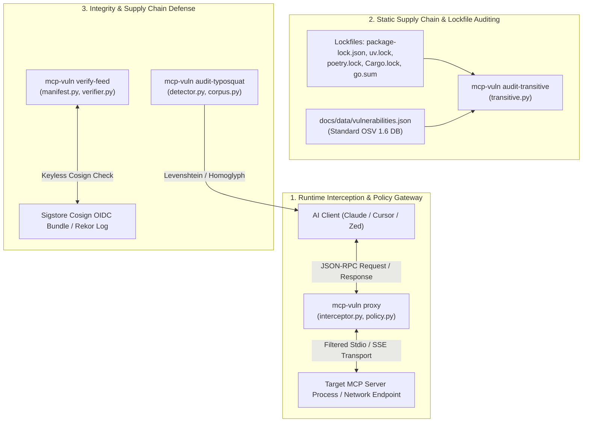

# Task 131: Track C — Code Review & Resilience Audit of Defensive Security Engines (P0)

**Subsystem:** Defensive Security Engines (`src/mcp_vulnerabilities/proxy/`, `src/mcp_vulnerabilities/transitive.py`, `src/mcp_vulnerabilities/analyzers/typosquat/`, `src/mcp_vulnerabilities/attestation/`, `docs/reports/code_review_defensive_engines.md`)  
**Priority:** `P0`  
**Parent Plan:** [master_plan_wave23_deep_empirical_audit_and_verification.md](master_plan_wave23_deep_empirical_audit_and_verification.md)

---

## 1. Objective & Problem Statement

To defend workstations and production environments against malicious or compromised Model Context Protocol servers, `mcp-vulnerabilities` implements four dedicated defensive engines:
1. **`mcp-vuln proxy`**: An inline JSON-RPC reverse proxy interceptor sitting between an AI client and target MCP servers, filtering dangerous tool calls, blocking prompt injections, and auditing live payloads.
2. **`mcp-vuln audit-transitive`**: A deep supply-chain analyzer parsing dependency lockfiles (`package-lock.json`, `pnpm-lock.yaml`, `uv.lock`, `poetry.lock`, `Cargo.lock`, `go.sum`) to detect unpatched transitive vulnerabilities.
3. **`mcp-vuln audit-typosquat`**: A supply-chain defense engine detecting typosquatted, homoglyph-spoofed, or LLM-hallucinated packages against the 6,321 authentic catalog corpus.
4. **`mcp-vuln verify-feed`**: A cryptographic attestation engine verifying Sigstore Cosign keyless signatures and SHA-256 checksums on downloaded vulnerability feeds.

If any of these defensive components crash or encounter unhandled edge cases, the protective boundary fails—either exposing developers to runtime exploits or halting CI/CD pipelines with false positives.

This task conducts an architectural and operational code review of these four defensive engines, hardening their error recovery, performance characteristics, and edge-case handling.

---

## 2. Engine Architecture & Interception Data Flow

---

## 3. Detailed Code Review Checklist & Failure Mode Matrix

### 3.1 `mcp-vuln proxy` (Reverse Proxy Interceptor)
- **Protocols Supported**: Stdio bidirectional pipe passthrough, SSE HTTP proxying.
- **Identified Failure Modes & Edge Cases**:
  - *Large Payload Buffering*: Streaming multi-megabyte tool responses (e.g. file dumps, images) through line-buffered parsers can cause memory spikes or chunking corruption.
  - *Zombie Child Processes*: If the AI client terminates unexpectedly, the proxy must ensure spawned target server child processes receive `SIGTERM` and are not orphaned.
  - *JSON-RPC Malformation*: Non-standard JSON-RPC frames (e.g. missing `id`, non-JSON log lines on stdout) must not terminate the proxy stream.
  - *Latency Overhead*: Enforce sub-5ms policy evaluation budget to maintain responsive AI chat streaming.

### 3.2 `mcp-vuln audit-transitive` (Dependency Tree Scanner)
- **Protocols & Ecosystems**: npm, pnpm, yarn (v1/berry), uv, poetry, pipenv, cargo, go modules.
- **Identified Failure Modes & Edge Cases**:
  - *Monorepo Lockfile Scale*: Monorepos with 10,000+ dependencies can lead to quadratic time complexity during recursive dependency graph resolution.
  - *Circular References*: Dependencies with circular peer relationships must be tracked with cycle detection (`visited_set`).
  - *Multi-Spec Divergence*: `pnpm-lock.yaml` v6 vs v9 schema differences must be handled without parser exceptions.

### 3.3 `mcp-vuln audit-typosquat` (Typosquatting & Hallucination Detector)
- **Protocols & Ecosystems**: Package names across npm, PyPI, and crates.io.
- **Identified Failure Modes & Edge Cases**:
  - *Performance Bottleneck*: Computing Levenshtein distance against 6,321 catalog records sequentially for every package in a 500-dependency project takes seconds. Requires length-partitioned trie or BK-tree indexing.
  - *False Positive Tuning*: Legitimate scoped packages (e.g. `@org/mcp-server` vs `mcp-server`) must not be flagged as typosquats if they originate from approved namespaces.
  - *Homoglyph / Punycode Confusion*: Unicode lookalike characters (e.g. Cyrillic `а` vs Latin `a`) must be normalized before comparison.

### 3.4 `mcp-vuln verify-feed` (Cryptographic Attestation)
- **Protocols & Ecosystems**: Sigstore Cosign bundles, SHA-256 manifest verification.
- **Identified Failure Modes & Edge Cases**:
  - *Airgap / Offline Graceful Degradation*: When network access to Rekor/Fulcio is blocked, `--offline-manifest` mode must verify SHA-256 sums without network timeouts.
  - *Clock Skew Handling*: Short-lived Sigstore certificates require tolerance for minor clock drift (e.g. 5 minutes).

---

## 4. Verification & Hardening Plan

1. **Static Analysis & Linting**:
   - `ruff check src/mcp_vulnerabilities/proxy/ src/mcp_vulnerabilities/analyzers/typosquat/ src/mcp_vulnerabilities/attestation/`
   - `mypy --strict src/mcp_vulnerabilities/proxy/interceptor.py src/mcp_vulnerabilities/transitive.py`
2. **Automated Stress & Boundary Testing**:
   - Test proxy with 50 MB chunked JSON-RPC responses and verify process termination cleanup.
   - Run typosquat detector against a test suite of 200 synthetic homoglyph and bit-squat names.
   - Verify transitive parser against all 8 lockfile formats.

---

## 5. Deliverables & Integration Checklist

- [ ] Complete line-by-line review of `interceptor.py`, `transitive.py`, `detector.py`, and `manifest.py`.
- [ ] Author and commit `docs/reports/code_review_defensive_engines.md`.
- [ ] Implement BK-tree / length-partitioning optimization in `corpus.py` for sub-millisecond typosquat lookups.
- [ ] Add SIGTERM child cleanup handling in `interceptor.py`.
- [ ] Author regression unit tests in `tests/test_defensive_engines_hardening.py`.
