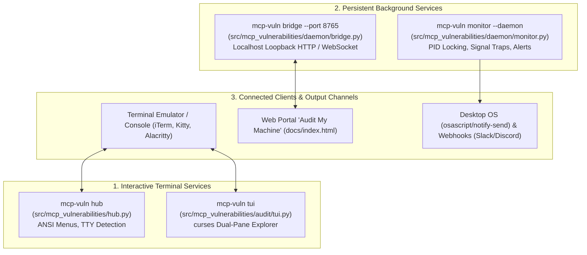

# Task 132: Track C — Code Review & Resilience Audit of Interactive & Daemon Services (P0)

**Subsystem:** Interactive UI & Daemon Services (`src/mcp_vulnerabilities/hub.py`, `src/mcp_vulnerabilities/audit/tui.py`, `src/mcp_vulnerabilities/daemon/monitor.py`, `src/mcp_vulnerabilities/daemon/bridge.py`, `docs/reports/code_review_daemon_services.md`)  
**Priority:** `P0`  
**Parent Plan:** [master_plan_wave23_deep_empirical_audit_and_verification.md](master_plan_wave23_deep_empirical_audit_and_verification.md)

---

## 1. Objective & Problem Statement

As `mcp-vulnerabilities` expanded from a headless batch scanner into an interactive developer cockpit and continuous background defender, it introduced interactive terminal interfaces and persistent daemon processes:
1. **`mcp-vuln hub` (and zero-argument invocation)**: Interactive ANSI terminal dashboard with status telemetry, categorized workflows, and keyboard navigation.
2. **`mcp-vuln tui`**: Responsive dual-pane curses terminal interface matching `mcp-fingerprints`, offering live tool schema inspection, vulnerability exploration, and one-key remediation hotkeys (`f`, `c`, `p`, `r`, `q`).
3. **`mcp-vuln monitor --daemon`**: Background POSIX daemon executing periodic network scans and security drift evaluations, dispatching native desktop alerts and webhooks.
4. **`mcp-vuln bridge`**: Secure loopback HTTP and WebSocket bridge (`127.0.0.1:8765`) enabling browser-to-host live auditing on `docs/index.html`.

Interactive and daemon processes introduce unique failure modes: curses screen corruption on window resize, terminal left in unusable raw mode upon crashes, daemon lockfile contention, unrotated log files, and critical loopback interface binding traps.

This task conducts a rigorous code review of these four interactive and daemon services to guarantee stability, security boundary isolation, and flawless terminal restoration.

---

## 2. Service Architecture & Interaction Plane

---

## 3. Detailed Code Review Checklist & Failure Mode Matrix

### 3.1 `mcp-vuln hub` (Interactive Terminal Dashboard)
- **Protocols Supported**: Interactive ANSI terminal, fallback plain text.
- **Identified Failure Modes & Edge Cases**:
  - *Non-TTY Execution*: When invoked without a TTY (e.g. `mcp-vuln hub < /dev/null` or inside CI pipelines), attempting to read `sys.stdin` must not block indefinitely; it must display non-interactive status or help.
  - *Terminal Height Constraints*: If the terminal height is fewer than 18 rows, the menu must scroll cleanly or collapse rather than wrapping lines and breaking screen layout.
  - *Color Palette Fallback*: If `NO_COLOR` is set or `TERM=dumb`, all ANSI color codes must be stripped.

### 3.2 `mcp-vuln tui` (Curses Split-Pane Cockpit)
- **Protocols Supported**: Curses terminal control, standard keyboard event loop.
- **Identified Failure Modes & Edge Cases**:
  - *Terminal Resize (`curses.KEY_RESIZE`)*: Rapid terminal resizing must trigger safe layout recalculation without throwing `curses.error`. If dimensions fall below `80x24`, display a centered warning banner (`"Terminal too small (min 80x24)"`).
  - *Terminal Teardown Invariant*: Abnormal exceptions must never leave the user's terminal in raw, non-echoing mode. Curses teardown (`curses.nocbreak()`, `curses.echo()`, `curses.endwin()`) must be wrapped in `finally:` blocks or `curses.wrapper()`.
  - *Unicode & Emoji Widths*: Emoji badges (`🚨`, `⚠️`, `✅`, `🔧`) occupy 2 visual columns; string slicing by character count rather than column width causes right-pane border misalignment. Must use `wcwidth` calculations.

### 3.3 `mcp-vuln monitor --daemon` (Background Monitor Daemon)
- **Protocols Supported**: POSIX double-fork daemonization, systemd user service, launchd agent.
- **Identified Failure Modes & Edge Cases**:
  - *Stale PID Lockfiles*: If the host reboots or daemon is terminated via `SIGKILL`, the PID file persists. The daemon must verify whether the stored PID belongs to an active `mcp-vuln` process (`os.kill(pid, 0)` with process cmdline check) before rejecting startup.
  - *Log File Rotation*: Continuous logging across days must not exhaust workstation disk space. Must use `logging.handlers.RotatingFileHandler` (max 10 MB, 5 backups).
  - *Asynchronous Webhook Resilience*: Webhook HTTP calls to Slack/Discord must have strict 3-second timeouts to avoid delaying monitoring intervals.

### 3.4 `mcp-vuln bridge` (Localhost Web Bridge)
- **Protocols Supported**: HTTP 1.1 REST, WebSocket streaming on `127.0.0.1:8765`.
- **Identified Failure Modes & Edge Cases**:
  - *Strict Loopback Confinement*: Must strictly bind to `127.0.0.1` (and `::1`). Binding to `0.0.0.0` or accepting connections with non-loopback `Host` headers must be strictly prohibited to prevent LAN attacks.
  - *Origin & CORS Verification*: Only requests originating from `https://jmartynov.github.io` or `http://localhost:*` / `http://127.0.0.1:*` are permitted. Cross-origin requests from arbitrary websites must be rejected with HTTP 403.
  - *One-Time Session Token Authentication*: The bridge must generate an ephemeral session token printed to the terminal on startup; browser requests must pass this token in the `Authorization` header.

---

## 4. Verification & Hardening Plan

1. **Static Analysis & Linting**:
   - `ruff check src/mcp_vulnerabilities/daemon/ src/mcp_vulnerabilities/hub.py src/mcp_vulnerabilities/audit/tui.py`
   - `mypy --strict src/mcp_vulnerabilities/daemon/`
2. **Automated Terminal & Daemon Testing**:
   - Headless curses simulation testing terminal resize and emoji column rendering.
   - Daemon lifecycle testing: double-fork startup, PID locking, SIGTERM graceful shutdown, and log rotation.
   - Web bridge security testing: external interface bind rejection, unauthorized origin rejection, and token verification.

---

## 5. Deliverables & Integration Checklist

- [ ] Complete code review of `hub.py`, `tui.py`, `monitor.py`, and `bridge.py`.
- [ ] Author and commit `docs/reports/code_review_daemon_services.md`.
- [ ] Implement robust curses teardown wrappers and `wcwidth` alignment in `tui.py`.
- [ ] Enforce strict origin validation and ephemeral token authentication in `bridge.py`.
- [ ] Author regression test suites in `tests/daemon/` and `tests/test_interactive_hub.py`.
