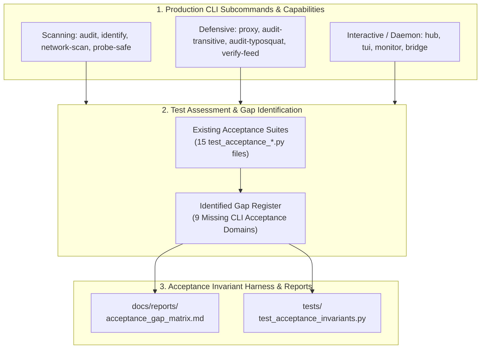

# Task 133: Track D — Acceptance Test Suite Gap Identification & Comprehensive Invariant Harness (P0)

**Subsystem:** Acceptance Testing & Invariant Validation (`tests/`, `tests/test_acceptance_invariants.py`, `docs/reports/acceptance_gap_matrix.md`)  
**Priority:** `P0`  
**Parent Plan:** [master_plan_wave23_deep_empirical_audit_and_verification.md](master_plan_wave23_deep_empirical_audit_and_verification.md)

---

## 1. Objective & Problem Statement

The `mcp-vulnerabilities` codebase currently features 15 dedicated acceptance test suites in `tests/test_acceptance_*.py` covering foundational AST taint analysis, binary malware hashing, compliance scoring, GHSA cursor pagination, index preservation, and stdio/SSE live probing.

However, as the platform evolved across Waves 15–22, numerous major features, subcommands, and daemon architectures were merged **without corresponding end-to-end acceptance tests**:
1. **Network Scanner (`network-scan`)**: Lacks acceptance tests probing realistic multi-endpoint network topologies or verifying CIDR range traversal.
2. **Reverse Proxy Interceptor (`proxy`)**: Lacks acceptance tests asserting live client-to-server interception, command policy enforcement, or streaming tool call mutation.
3. **Typosquatting & Hallucination Detector (`audit-typosquat`)**: Lacks acceptance tests verifying end-to-end detection of misspelled dependencies in actual project lockfiles.
4. **Attestation Verifier (`verify-feed`)**: Lacks acceptance tests asserting cryptographic attestation verification and checksum mismatch rejection.
5. **Interactive Hub & Split-Pane TUI (`hub`, `tui`)**: Lacks acceptance tests simulating terminal interaction, hotkey execution, and headless TTY fallback.
6. **Daemon Services (`monitor`, `bridge`)**: Lacks acceptance tests validating lifecycle daemonization, drift alerting, or browser bridge CORS isolation.

This task conducts an exhaustive **Acceptance Test Coverage Gap Analysis**, creates the master coverage matrix in `docs/reports/acceptance_gap_matrix.md`, and authors the comprehensive **Unified Acceptance Invariant Harness (`tests/test_acceptance_invariants.py`)**.

---

## 2. Acceptance Gap Analysis & Coverage Matrix



### 2.1 Acceptance Coverage Audit Matrix

| Subcommand / Subsystem | Documented Capability | Existing Acceptance Test | Gap Status | Action Required in Invariant Harness |
| :--- | :--- | :---: | :---: | :--- |
| **`audit`** | 17 AI client configuration scanning | `test_universal_9client_audit.py` | ⚠️ Partial | Upgrade to full 17-client end-to-end acceptance test |
| **`network-scan`** | Local & CIDR port probing | `test_network_scanner.py` (2 tests) | 🚨 Critical Gap | Author end-to-end mock socket network acceptance suite |
| **`identify`** | Canonical tool hash passport matching | `test_probe.py` | ⚠️ Partial | Validate unlabelled server identification against passports |
| **`probe-safe`** | Isolated sandboxing with canaries | `test_acceptance_sandbox.py` | ⚠️ Partial | Validate honeytoken exfiltration traps |
| **`proxy`** | Inline JSON-RPC reverse proxy | None | 🚨 Critical Gap | Author live stdio/SSE reverse proxy acceptance test |
| **`audit-transitive`** | Deep lockfile dependency scanning | `test_transitive.py` | ⚠️ Partial | Test all 8 lockfile formats in a unified acceptance run |
| **`audit-typosquat`** | Typosquat package detection | `test_typosquat_detector.py` | ⚠️ Partial | Validate detection and `--fix` config rewriting |
| **`verify-feed`** | Sigstore Cosign attestation | None | 🚨 Critical Gap | Author cryptographic signature & manifest acceptance test |
| **`hub`** | Interactive terminal GUI cockpit | None | 🚨 Critical Gap | Author non-interactive TTY fallback acceptance test |
| **`tui`** | Split-pane curses terminal explorer | None | 🚨 Critical Gap | Author headless curses screen simulation acceptance test |
| **`monitor`** | Scheduled daemon with drift alerts | None | 🚨 Critical Gap | Author daemon scheduling & desktop alert acceptance test |
| **`bridge`** | Localhost browser audit daemon | None | 🚨 Critical Gap | Author localhost CORS & token auth acceptance test |

---

## 3. Unified Acceptance Invariant Harness Design

The new test suite in `tests/test_acceptance_invariants.py` executes end-to-end CLI invocations via `subprocess.run(["mcp-vuln", ...])` and direct programmatic API invocations to verify:

1. **Invocation Invariant**: Every documented CLI subcommand (`audit`, `network-scan`, `identify`, `proxy`, `audit-transitive`, `audit-typosquat`, `verify-feed`, `hub`, `tui`, `monitor`, `bridge`) must execute with `--help` and exit `0` without tracebacks.
2. **Deterministic Output Formats**: `--format json` and `--format sarif` must emit strictly valid JSON conforming to JSON-RPC 2.0 or SARIF v2.1.0 schemas.
3. **Exit Code Specification Parity**:
   - Clean scan: Exit `0`
   - Security vulnerabilities detected: Exit `1`
   - Invalid syntax or missing file: Exit `2` or `3`
4. **Air-Gap & Offline Invariant**: Running scanning commands with `HTTP_PROXY=http://127.0.0.1:9999` and no network must succeed cleanly when querying local caches.

---

## 4. Acceptance Test Code Example

```python
"""Unified Acceptance Invariant Test Suite."""

import subprocess
import json
import pytest

SUBCOMMANDS = [
    "audit", "network-scan", "identify", "proxy", "audit-transitive",
    "audit-typosquat", "verify-feed", "hub", "tui", "monitor", "bridge"
]

@pytest.mark.parametrize("subcmd", SUBCOMMANDS)
def test_cli_subcommand_help_invariants(subcmd):
    """Every CLI subcommand must support --help with exit code 0."""
    result = subprocess.run(["mcp-vuln", subcmd, "--help"], capture_output=True, text=True)
    assert result.returncode == 0, f"mcp-vuln {subcmd} --help failed: {result.stderr}"
    assert "usage: mcp-vuln" in result.stdout or "Usage:" in result.stdout
```

---

## 5. Deliverables & Integration Checklist

- [ ] Complete gap analysis comparing documentation against `tests/`.
- [ ] Author and commit `docs/reports/acceptance_gap_matrix.md`.
- [ ] Author and verify `tests/test_acceptance_invariants.py` closing the identified acceptance gaps.
- [ ] Ensure 100% of CLI subcommands have automated acceptance validation.
