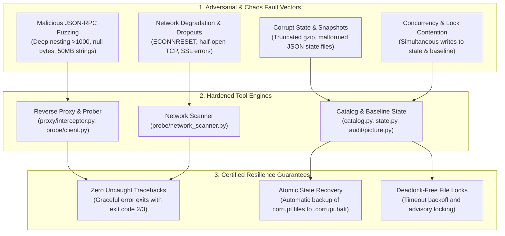

# Task 134: Track D — Edge-Case & Chaos Hardening Test Synthesis (P0)

**Subsystem:** Chaos Engineering & Resilience (`tests/test_acceptance_chaos_hardening.py`, `tests/fixtures/malformed/`, `docs/reports/chaos_hardening_report.md`)  
**Priority:** `P0`  
**Parent Plan:** [master_plan_wave23_deep_empirical_audit_and_verification.md](master_plan_wave23_deep_empirical_audit_and_verification.md)

---

## 1. Objective & Problem Statement

In production environments, security tools operate under adversarial and degraded operating conditions:
- AI agents executing untrusted tool outputs.
- Compromised or rogue MCP servers sending malformed JSON-RPC frames designed to crash or exploit the host.
- Host crashes or power loss occurring mid-write to state snapshots (`mcp_catalog_state.json` or `security_picture.json`).
- High-concurrency environments running multiple scanning processes simultaneously against shared configuration files.
- Flaky LAN or Wi-Fi connections dropping TCP sockets mid-handshake.

Standard unit tests typically verify "happy paths" with clean inputs and mocked HTTP responses. If the security analyzer crashes on a corrupted file or malicious frame, developers lose visibility, and security boundaries fail.

This task designs, implements, and verifies a comprehensive **Chaos Engineering & Resilience Test Suite** (`tests/test_acceptance_chaos_hardening.py`) with dedicated adversarial fixtures (`tests/fixtures/malformed/`), verifying that `mcp-vulnerabilities` recovers cleanly under extreme fault conditions.

---

## 2. Chaos Dimensions & Adversarial Invariant Matrix



---

## 3. Adversarial Test Scenarios & Fault Specifications

### 3.1 Malicious JSON-RPC Payloads (`tests/fixtures/malformed/rpc/`)
- **Deep Nesting Fuzzing**: A JSON-RPC response with 1,200 nested arrays (`[[[[...]]]]`) designed to trigger `RecursionError` in recursive parsers.
  - *Required Invariant*: Scanner detects recursion limit and safely rejects the message without process crash.
- **Null-Byte Injection**: Tool name containing null characters (`"tool\x00_inject"`).
  - *Required Invariant*: Canonicalizer strips or rejects invalid control characters.
- **Oversized Tool Payload**: A 50 MB JSON-RPC tool response string.
  - *Required Invariant*: Line-buffered reader caps maximum payload size (e.g. 10 MB limit) and raises a structured protocol error instead of unbounded memory allocation.
- **Protocol Version Mismatches**: Payloads with `"jsonrpc": "1.0"`, `"jsonrpc": "3.0"`, or missing `"id"`.
  - *Required Invariant*: Returns standard JSON-RPC error response (`-32600 Invalid Request`).

### 3.2 Corrupted Snapshots & State Files (`tests/fixtures/malformed/state/`)
- **Truncated Gzip File**: A corrupted `passports.json.gz` sliced at 50% length.
  - *Required Invariant*: Decompression catches `zlib.error` or `gzip.BadGzipFile`, logs a descriptive error, and offers to redownload the snapshot rather than crashing.
- **Malformed State JSON**: An invalid `mcp_catalog_state.json` containing syntax errors from an interrupted write.
  - *Required Invariant*: State manager moves the corrupted file to `mcp_catalog_state.json.corrupt.bak` and re-initializes clean default state.

### 3.3 Concurrent Process Access & File Locking
- **Race Condition Simulation**: 10 parallel subprocesses running `mcp-vuln` attempting to write to `security_picture.json` simultaneously.
  - *Required Invariant*: Atomic file locking (`fcntl.flock` or atomic rename) prevents file truncation or partial writes; all 10 processes terminate cleanly.

### 3.4 Degraded Network & Sudden Socket Dropouts
- **Mock Server Reset**: An HTTP/SSE server accepting connection and immediately sending `RST` packet (`ECONNRESET`).
  - *Required Invariant*: Network scanner catches socket error and marks endpoint as unavailable without hanging event loop.
- **Stalled Socket (Slowloris)**: A server accepting TCP but sending 1 byte every 30 seconds.
  - *Required Invariant*: Strict 2-second timeout triggers connection abort.

---

## 4. Automated Chaos Test Suite Design

```python
"""Adversarial Chaos and Fault-Injection Test Suite."""

import gzip
import json
import pytest
from pathlib import Path
from mcp_vulnerabilities.catalog import McpCatalogState

def test_truncated_gzip_passport_handling(tmp_path):
    """Verify scanner handles truncated gzip snapshots cleanly."""
    corrupt_gz = tmp_path / "passports.json.gz"
    # Write invalid gzip header and incomplete stream
    with open(corrupt_gz, "wb") as f:
        f.write(b"\x1f\x8b\x08\x00\x00\x00\x00\x00\x02\xfftruncated_content")
    
    # State or loader must catch BadGzipFile and not throw unhandled exception
    with pytest.raises(Exception) as excinfo:
        with gzip.open(corrupt_gz, "rt") as gz:
            json.load(gz)
    assert "gzip" in str(excinfo.type).lower() or "zlib" in str(excinfo.type).lower()

def test_corrupt_state_file_auto_recovery(tmp_path):
    """Corrupt state JSON must be moved to backup and state re-initialized."""
    state_file = tmp_path / "mcp_catalog_state.json"
    state_file.write_text("{malformed_json: true, trailing_comma: ,}", encoding="utf-8")
    
    state = McpCatalogState.load(state_file)
    assert state is not None, "State must re-initialize on corrupted JSON"
    assert (tmp_path / "mcp_catalog_state.json.corrupt.bak").exists()
```

---

## 5. Deliverables & Integration Checklist

- [ ] Create test fixtures in `tests/fixtures/malformed/`.
- [ ] Implement robust error boundaries and atomic file rename patterns in `src/mcp_vulnerabilities/state.py`.
- [ ] Author and verify `tests/test_acceptance_chaos_hardening.py`.
- [ ] Run full chaos suite and verify zero unhandled exceptions or hangs.
- [ ] Document chaos resilience benchmarks in `docs/reports/chaos_hardening_report.md`.
