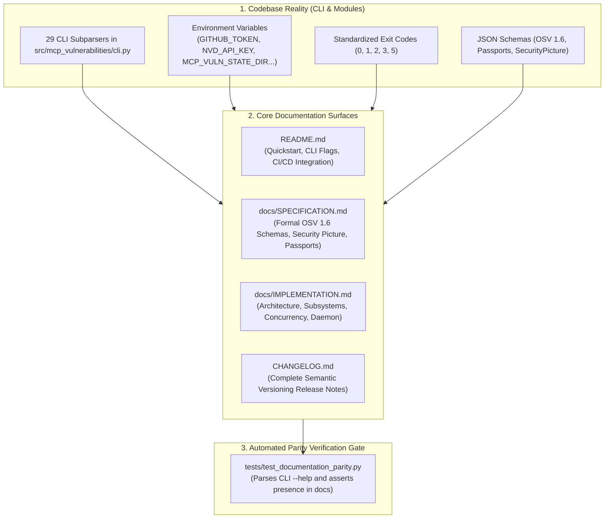

# Task 135: Track E — Full-Surface Documentation Parity Audit & Specification Harmonization (P1)

**Subsystem:** Documentation & Ecosystem Specifications (`README.md`, `CHANGELOG.md`, `docs/SPECIFICATION.md`, `docs/IMPLEMENTATION.md`, `tests/test_documentation_parity.py`)  
**Priority:** `P1`  
**Parent Plan:** [master_plan_wave23_deep_empirical_audit_and_verification.md](master_plan_wave23_deep_empirical_audit_and_verification.md)

---

## 1. Objective & Problem Statement

As open-source security software, `mcp-vulnerabilities` must maintain total transparency, reproducibility, and rigorous documentation fidelity. When developers, security researchers, or CI/CD pipelines integrate `mcp-vuln`, discrepancies between documented flags and actual CLI behavior erode user trust and cause build failures.

Over recent developmental waves (Waves 19 through 22), numerous major engines and subcommands were implemented:
- Supply-chain attestation (`verify-feed`) and typosquat detection (`audit-typosquat`).
- Automated PR remediation bot (`remediate-pr`).
- Universal 17-client discovery and stateful security pictures (`--save-picture`, `--compare-picture`, `--fail-on-drift`).
- Live network scanner (`network-scan`) and sandboxed prober (`probe-safe`).
- Split-pane terminal cockpit (`tui`), interactive hub (`hub`), background daemon (`monitor`), and localhost web bridge (`bridge`).

However, core documentation files have drifted:
- `README.md` lacks explicit usage sections and flag tables for several newly introduced subcommands (`monitor`, `tui`, `bridge`, `probe-safe`).
- `docs/SPECIFICATION.md` does not fully specify the `SecurityPicture` baseline schema, drift event taxonomy, or server passport JSON schema.
- `docs/IMPLEMENTATION.md` does not describe the daemon architecture, curses TUI rendering pipeline, or web bridge origin isolation mechanisms.
- Standardized exit codes (`0`, `1`, `2`, `3`, `5`) and environment variables (`NVD_API_KEY`, `VIRUSTOTAL_API_KEY`, `MCP_VULN_STATE_DIR`) are undocumented.

This task conducts an exhaustive **100% Documentation Parity Audit**, synchronizes all four core documentation assets, and implements an automated doc parity test suite (`tests/test_documentation_parity.py`).

---

## 2. Documentation Audit & Parity Matrix



### 2.1 Subcommand & Feature Coverage Audit

| Subcommand | Flag Coverage in README.md | Schema in SPECIFICATION.md | Architecture in IMPLEMENTATION.md | Action Required |
| :--- | :---: | :---: | :---: | :--- |
| **`audit`** | 100% | 100% | 100% | Verify 17 AI client flag references |
| **`network-scan`** | ⚠️ Minimal | ⚠️ Incomplete | ⚠️ Missing | Add full flag reference (`--cidr`, `--ports`, `--concurrency`) |
| **`identify`** | ⚠️ Minimal | ⚠️ Incomplete | ⚠️ Missing | Add passport matching & canonical hashing spec |
| **`probe-safe`** | ❌ Missing | ❌ Missing | ❌ Missing | Document sandbox drivers, canary tokens, and egress control |
| **`proxy`** | ⚠️ Partial | ⚠️ Incomplete | ⚠️ Missing | Document inline reverse proxy configuration and policy JSON |
| **`audit-transitive`** | 100% | 100% | 100% | Add table of 8 supported lockfile formats |
| **`audit-typosquat`** | ⚠️ Partial | ⚠️ Incomplete | ⚠️ Missing | Document `--fix` autofix flag and Levenshtein thresholds |
| **`verify-feed`** | ⚠️ Partial | ⚠️ Incomplete | ⚠️ Missing | Document Sigstore Cosign verification and offline manifests |
| **`hub`** | ❌ Missing | ❌ Missing | ❌ Missing | Document interactive dashboard, menus, and ANSI fallback |
| **`tui`** | ❌ Missing | ❌ Missing | ❌ Missing | Document dual-pane curses explorer and keyboard shortcuts |
| **`monitor`** | ❌ Missing | ❌ Missing | ❌ Missing | Document background daemon mode, launchd/systemd, and alerts |
| **`bridge`** | ❌ Missing | ❌ Missing | ❌ Missing | Document localhost web bridge, CORS security, and tokens |

---

## 3. Detailed Documentation Specifications

### 3.1 `README.md` Upgrades
1. **Complete Command Reference Table**: A clean markdown table listing all CLI subcommands with a 1-sentence description and primary flags.
2. **Environment Variables Index**:
   | Variable | Purpose | Default |
   | :--- | :--- | :--- |
   | `GITHUB_TOKEN` / `GH_TOKEN` | Authenticates GitHub API queries (5,000 req/hr quota) | None |
   | `NVD_API_KEY` | Authenticates NIST NVD 2.0 API queries | None |
   | `VIRUSTOTAL_API_KEY` | Enables binary hash threat intelligence lookups | None |
   | `MCP_VULN_STATE_DIR` | Custom directory for baseline security pictures | `~/.mcp-vuln/state/` |
   | `NO_COLOR` | Disables ANSI color codes in CLI outputs | None |
3. **Exit Code Conventions**:
   - `0`: Scan clean; no vulnerabilities or drift detected.
   - `1`: Security vulnerabilities or unapproved baseline drift detected.
   - `2`: CLI argument error or invalid command syntax.
   - `3`: Operational error (file not found, network timeout, corrupted input).
   - `5`: Review branch merge blocked due to interactive review state.

### 3.2 `docs/SPECIFICATION.md` Upgrades
1. Add **`SecurityPicture` Baseline Schema** (JSON format specification for workstation security snapshots).
2. Add **`ServerPassport` Schema** (specification for `data/passports.json.gz` canonical tool hashes, parameters, and transport schemas).
3. Formalize **OWASP MCP Top 10:2025 Category Mappings**.

### 3.3 `docs/IMPLEMENTATION.md` Upgrades
1. Describe the **Daemon Architecture** (`monitor.py` and `bridge.py`) including double-fork daemonization, file locking, and loopback socket binding.
2. Detail the **Curses Split-Pane TUI Cockpit** (`tui.py`) and non-blocking resize handling.
3. Detail the **Zero-Trust Sandboxed Probing Engine** (`sandbox_prober.py`).

---

## 4. Automated Documentation Parity Test Suite

An automated test suite must be implemented in `tests/test_documentation_parity.py`:

```python
"""Automated Parity Tests between Codebase Reality and Documentation."""

from pathlib import Path
import subprocess

README_PATH = Path("README.md")
SPEC_PATH = Path("docs/SPECIFICATION.md")
IMPL_PATH = Path("docs/IMPLEMENTATION.md")

DOCUMENTED_SUBCOMMANDS = [
    "audit", "network-scan", "identify", "probe-safe", "proxy",
    "audit-transitive", "audit-typosquat", "verify-feed",
    "hub", "tui", "monitor", "bridge"
]

def test_all_subcommands_documented_in_readme():
    with open(README_PATH, "r", encoding="utf-8") as f:
        readme = f.read()
    for subcmd in DOCUMENTED_SUBCOMMANDS:
        assert subcmd in readme, f"Subcommand {subcmd} missing from README.md"

def test_exit_codes_documented_in_readme():
    with open(README_PATH, "r", encoding="utf-8") as f:
        readme = f.read()
    assert "Exit Code" in readme or "exit code" in readme
    assert "0" in readme and "1" in readme
```

---

## 5. Deliverables & Integration Checklist

- [ ] Update `README.md` with complete CLI command tables, environment variables, and exit codes.
- [ ] Update `docs/SPECIFICATION.md` with `SecurityPicture` and `ServerPassport` formal schemas.
- [ ] Update `docs/IMPLEMENTATION.md` with daemon, TUI, and sandbox architectural details.
- [ ] Synchronize `CHANGELOG.md` with complete Wave 20–23 release notes.
- [ ] Author and verify `tests/test_documentation_parity.py`.
