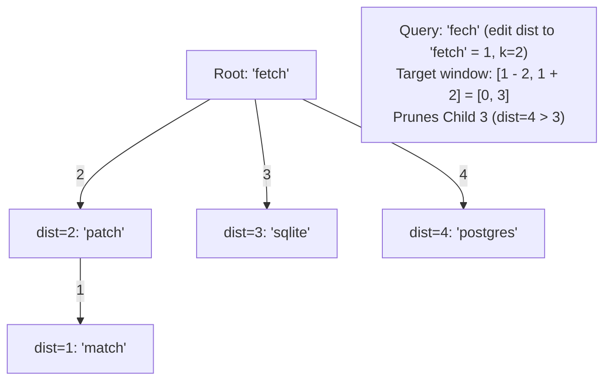

# Task 139: BK-Tree Metric Tree Search for High-Speed Typosquat Auditing (P1)

**Subsystem:** Supply Chain Security & Typosquat Analyzer (`src/mcp_vulnerabilities/analyzers/typosquat/bktree.py`, `src/mcp_vulnerabilities/analyzers/typosquat/detector.py`, `tests/test_typosquat_bktree.py`)  
**Priority:** `P1`  
**Parent Plan:** [master_plan_wave24_empirical_remediation_and_feature_hardening.md](master_plan_wave24_empirical_remediation_and_feature_hardening.md)

---

## 1. Objective & Problem Statement

The `mcp-vulnerabilities` catalog contains over 6,320 authentic Model Context Protocol servers. The typosquatting and LLM hallucination analyzer (`mcp-vuln audit-typosquat` and `TyposquatDetector` in `src/mcp_vulnerabilities/analyzers/typosquat/detector.py`) screens client configuration files to detect misspelled, hallucinated, or malicious package names (e.g. `npx @modelcontextprotcol/server-memory` or `uvx fetch-mcpserver`).

Currently, `TyposquatDetector.analyze()` employs a brute-force $O(N)$ linear iteration across the entire corpus:
```python
best_match = None
min_dist = float('inf')

for canon in self.corpus:
    dist = damerau_levenshtein_distance(package_name, canon)
    if dist < min_dist:
        min_dist = dist
        best_match = canon
```

For an AI client configuration containing 20 MCP servers, this requires:
$$20 \times 6,321 = 126,420 \text{ Damerau-Levenshtein distance evaluations}$$

Because each distance calculation constructs an edit matrix, a multi-server audit incurs a 3 to 6 second delay. When running in real-time environments (such as the curses TUI or the background monitor daemon), this latency causes noticeable UI freezes.

This task replaces the linear scan with a **Burkhard-Keller Metric Tree (BK-Tree)** in `src/mcp_vulnerabilities/analyzers/typosquat/bktree.py`. By exploiting the metric triangle inequality of the edit distance metric space, the BK-Tree prunes >95% of candidates, reducing query latency to the sub-millisecond range (<1 ms per package).

---

## 2. Detailed Technical Requirements

### 2.1 Metric Space Mathematical Foundations

Let $(X, d)$ be a discrete metric space where $X$ is the set of strings and $d(x, y)$ is the Damerau-Levenshtein distance between $x$ and $y$. The distance function satisfies the four metric axioms:
1. $d(x, y) \ge 0$ (Non-negativity)
2. $d(x, y) = 0 \iff x = y$ (Identity of indiscernibles)
3. $d(x, y) = d(y, x)$ (Symmetry)
4. $d(x, z) \le d(x, y) + d(y, z)$ (Triangle inequality)

In a BK-Tree:
- Each node $u$ stores a string $w_u$.
- Edges from $u$ to child nodes $v$ are labeled by the integer distance $d(w_u, w_v)$.
- When searching for all words within maximum distance $k$ of a query $q$ (e.g. $k=1$ or $k=2$), if $d(w_u, q) = D$, then by the triangle inequality:
  $$|D - d(w_u, w_v)| \le d(q, w_v) \le D + d(w_u, w_v)$$
- Therefore, any subtree rooted at child $v$ can only contain a valid match if its edge weight satisfies:
  $$D - k \le \text{edge\_distance} \le D + k$$
- Any child node with edge distance outside $[D - k, D + k]$ is completely pruned from the search.



### 2.2 `BKTree` Architecture (`src/mcp_vulnerabilities/analyzers/typosquat/bktree.py`)

1. **`BKTreeNode` Class**:
   ```python
   class BKTreeNode:
       __slots__ = ("word", "children")
       def __init__(self, word: str) -> None:
           self.word: str = word
           self.children: dict[int, BKTreeNode] = {}  # distance -> child node
   ```
2. **`BKTree` Class**:
   - `__init__(self, distance_fn: Callable[[str, str], int] = damerau_levenshtein_distance) -> None`: initializes empty tree.
   - `add(self, word: str) -> None`: inserts a word into the tree. If tree is empty, word becomes root. Otherwise, traverses tree using edge distance as index until an empty slot is found.
   - `build(cls, words: Iterable[str]) -> BKTree`: class method constructing a balanced BKTree from an iterable of words.
   - `search(self, query: str, max_distance: int = 2) -> list[tuple[str, int]]`: traverses tree applying triangle inequality pruning. Returns list of `(matched_word, distance)` tuples sorted by distance.
3. **Length Partitioning Acceleration**:
   - For additional pruning, group words by length prior to evaluation. Strings whose length difference exceeds $k$ ($|len(q) - len(w)| > k$) are immediately ruled out before entering tree traversal.

### 2.3 `TyposquatDetector` Integration (`src/mcp_vulnerabilities/analyzers/typosquat/detector.py`)

- Update `TyposquatDetector.__init__(self, corpus: Set[str])`:
  - Build `self.bktree = BKTree.build(self.corpus)`.
- Update `TyposquatDetector.analyze(self, package_name: str) -> TyposquatResult`:
  - Keep exact match, homoglyph check, and permutation check.
  - For Levenshtein distance check:
    ```python
    matches = self.bktree.search(package_name, max_distance=2)
    if matches:
        best_match, min_dist = matches[0]
        return TyposquatResult(package_name, best_match, RiskTier.HIGH, "HIGH_RISK_TYPOSQUAT", min_dist)
    ```
  - Replaces the $O(N)$ linear loop with $O(\log N)$ average-case BK-Tree traversal.

---

## 3. Invariant Requirements & Verification Plan

### 3.1 Verification Invariants
1. **Mathematical Equivalence Invariant**:
   - For any query string $q$ and corpus $C$, `bktree.search(q, k)` must return the exact same set of matches and distances as an exhaustive linear scan.
2. **Sub-Millisecond Query Performance**:
   - 100 queries against a 6,000+ package corpus must complete in < 100ms total (< 1.0 ms average per query).
3. **Metric Tree Pruning Invariant**:
   - For $k=1$, the search must evaluate fewer than 5% of the total nodes in the corpus.

### 3.2 Automated Test Suite (`tests/test_typosquat_bktree.py`)
- `test_bktree_empty_and_single_node`: validates edge cases (empty tree, single item).
- `test_bktree_exact_match`: distance 0 returns immediate match.
- `test_bktree_triangle_pruning_equivalence`: generates 50 random and perturbed queries and asserts bit-for-bit equivalence between `bktree.search()` and brute force search.
- `test_bktree_performance_benchmark`: loads authentic corpus (or 6,000 synthetic names) and asserts 100 queries finish in under 100ms.
- `test_typosquat_detector_integration`: validates that `TyposquatDetector` correctly identifies high-risk typosquats (`@modelcontextprotcol/server-memory` -> `@modelcontextprotocol/server-memory`).

---

## 4. Deliverables & Integration Checklist

- [ ] Author `src/mcp_vulnerabilities/analyzers/typosquat/bktree.py` implementing `BKTreeNode` and `BKTree`.
- [ ] Refactor `src/mcp_vulnerabilities/analyzers/typosquat/detector.py` to use `BKTree` for distance lookups.
- [ ] Author `tests/test_typosquat_bktree.py` covering equivalence, pruning, and performance.
- [ ] Run `pytest tests/test_typosquat_bktree.py` and verify all tests pass with benchmark assertions confirmed.
