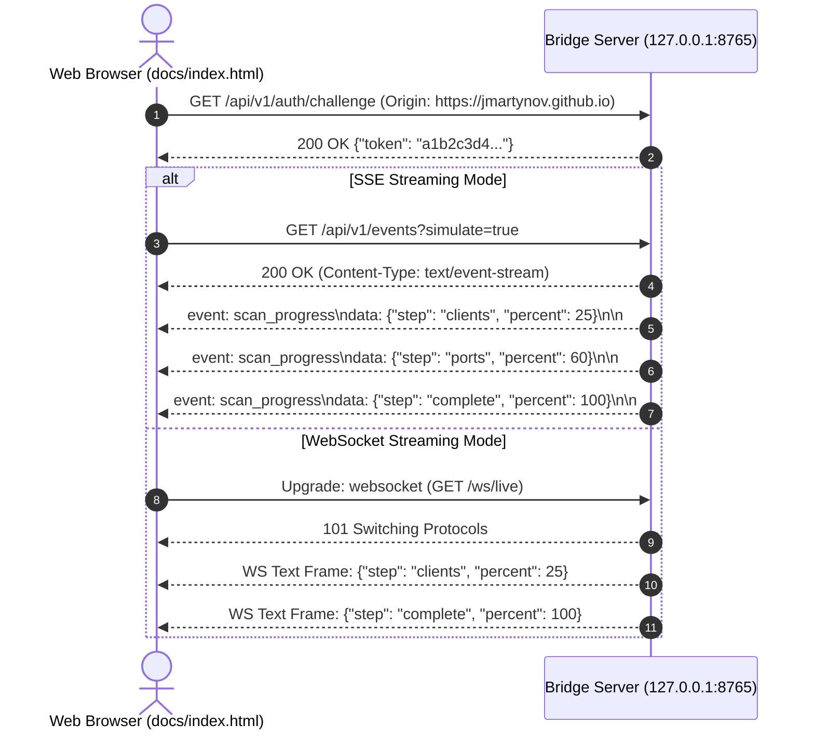

# Task 140: Live WebSocket & SSE Protocol Bridge Simulator (P2)

**Subsystem:** Localhost Daemon & Streaming Protocol Bridge (`src/mcp_vulnerabilities/daemon/bridge.py`, `tests/daemon/test_bridge_stream.py`)  
**Priority:** `P2`  
**Parent Plan:** [master_plan_wave24_empirical_remediation_and_feature_hardening.md](master_plan_wave24_empirical_remediation_and_feature_hardening.md)

---

## 1. Objective & Problem Statement

The static web portal (`docs/index.html`) includes the Workstation Audit Tab ("Audit My Machine"), allowing users to inspect local AI client installations and detect active network MCP listeners from the convenience of their browser without sending any client configuration data to the cloud.

To enable seamless browser-to-workstation communication, the portal connects to a local daemon bridge: `mcp-vuln bridge --port 8765`. However, developing and testing this browser interface presents significant challenges:
1. **Frontend & CI Testing Barriers**: Testing progress bars, cancel buttons, and streaming event listeners in web browsers or automated CI test harnesses is difficult if the bridge strictly requires real AI clients and network port probing on the host machine.
2. **Dual Streaming Transport Needs**: Different browser environments and corporate firewalls exhibit varying support for streaming protocols. The bridge must support both Server-Sent Events (SSE) (`/api/v1/events`) and WebSocket streams (`/ws/live`).
3. **Security Perimeter & Anti-CSRF**: Because the bridge runs on localhost, a malicious third-party website opened in the user's browser could attempt cross-origin requests to probe local ports or extract configurations. The bridge must enforce strict origin validation, loopback confinement (`127.0.0.1` only), and an ephemeral challenge token handshake.

This task implements a lightweight, zero-dependency local bridge daemon in `src/mcp_vulnerabilities/daemon/bridge.py` featuring a high-fidelity **Simulator Mode** (`--simulate` / `--mock`) that streams real-time synthetic progress events over SSE and WebSocket.

---

## 2. Detailed Technical Requirements

### 2.1 Bridge Server Architecture (`src/mcp_vulnerabilities/daemon/bridge.py`)

1. **Loopback Binding & Zero External Dependencies**:
   - Implemented using Python's standard library `asyncio` or `http.server` / `socketserver` to ensure zero required external dependencies.
   - Host binding: strictly restricted to `127.0.0.1` (IPv4) or `::1` (IPv6). Passing any external address (e.g. `0.0.0.0`) must be rejected immediately with an error.
   - Default port: `8765` (configurable via `--port`).
2. **Strict Origin & CORS Controls**:
   - Validates the HTTP `Origin` header against an allowlist:
     - `https://jmartynov.github.io` (production GitHub Pages portal)
     - `http://localhost:*`, `http://127.0.0.1:*` (local development)
   - Rejects unauthorized origins with `403 Forbidden`.
   - Injects standard CORS headers:
     ```http
     Access-Control-Allow-Origin: <validated_origin>
     Access-Control-Allow-Methods: GET, POST, OPTIONS
     Access-Control-Allow-Headers: Content-Type, X-MCP-Bridge-Token
     ```
3. **Challenge Token Handshake (CSRF Defense)**:
   - On startup, generates a cryptographically random session token: `secrets.token_hex(16)`.
   - `GET /api/v1/auth/challenge`: Returns `{"token": "<session_token>"}`.
   - Mutation endpoints (e.g. `POST /api/v1/fix`) require `X-MCP-Bridge-Token` matching the session token; otherwise returns `401 Unauthorized`.

### 2.2 Streaming Protocol Endpoints



1. **Server-Sent Events (SSE) Endpoint (`/api/v1/events`)**:
   - `Content-Type: text/event-stream`
   - `Cache-Control: no-cache`
   - `Connection: keep-alive`
   - Emits structured progress payloads:
     ```text
     event: scan_progress
     data: {"step": "discovering_clients", "percent": 25, "message": "Discovered 14 AI clients"}

     event: scan_progress
     data: {"step": "probing_ports", "percent": 60, "message": "Probing ports 3000-8800"}

     event: scan_progress
     data: {"step": "analyzing_drift", "percent": 85, "message": "Comparing with SecurityPicture"}

     event: scan_complete
     data: {"step": "done", "percent": 100, "servers_found": 8, "vulnerabilities": 1}
     ```
2. **WebSocket Endpoint (`/ws/live`)**:
   - Supports standard RFC 6455 handshake:
     - Calculates `Sec-WebSocket-Accept` via SHA-1 of `Sec-WebSocket-Key` + `"258EAFA5-E914-47DA-95CA-C5AB0DC85B11"`.
     - Returns HTTP `101 Switching Protocols`.
   - Streams JSON text frames corresponding to real or simulated scan progress.
3. **Simulated Progress Engine (`--simulate` / `--mock`)**:
   - When running in simulation mode (or when request includes `?simulate=true`), generates deterministic, stepped progress events with configurable intervals (e.g. 50ms for tests, 300ms for browser demos) without modifying local files or probing sockets.

---

## 3. Invariant Requirements & Verification Plan

### 3.1 Verification Invariants
1. **Origin Defense Invariant**:
   - Any request from an unapproved origin (e.g. `Origin: http://evil.example.com`) must receive `403 Forbidden` with zero data disclosed.
2. **Loopback Binding Invariant**:
   - Attempting to bind the bridge server to `0.0.0.0` or any non-loopback IP must raise `ValueError` or exit code 2.
3. **SSE Formatting Invariant**:
   - SSE output must adhere to the W3C EventSource standard (`event: ...\ndata: ...\n\n`) and maintain persistent chunked transfer without premature EOF.
4. **WebSocket Handshake Invariant**:
   - WebSocket connection handshake must negotiate `101 Switching Protocols` and decode standard masked client frames.

### 3.2 Automated Test Suite (`tests/daemon/test_bridge_stream.py`)
Author an integration test suite asserting:
- `test_bridge_health_endpoint`: validates `GET /health` returns valid JSON status.
- `test_bridge_origin_filtering`: approved origins pass; unapproved origins receive 403 Forbidden.
- `test_bridge_csrf_token_handshake`: challenge token is required for mutation endpoints.
- `test_bridge_sse_progress_stream`: connects to `/api/v1/events?simulate=true` and validates sequential progress frames from 25% to 100%.
- `test_bridge_websocket_stream`: connects to `/ws/live` and validates framed WebSocket messages.

---

## 4. Deliverables & Integration Checklist

- [ ] Create `src/mcp_vulnerabilities/daemon/__init__.py`.
- [ ] Author `src/mcp_vulnerabilities/daemon/bridge.py` implementing HTTP, SSE, WebSocket, and simulation modes.
- [ ] Implement origin verification and challenge token handshake.
- [ ] Author `tests/daemon/test_bridge_stream.py` with full stream and security tests.
- [ ] Run `pytest tests/daemon/test_bridge_stream.py` and verify all tests pass.
