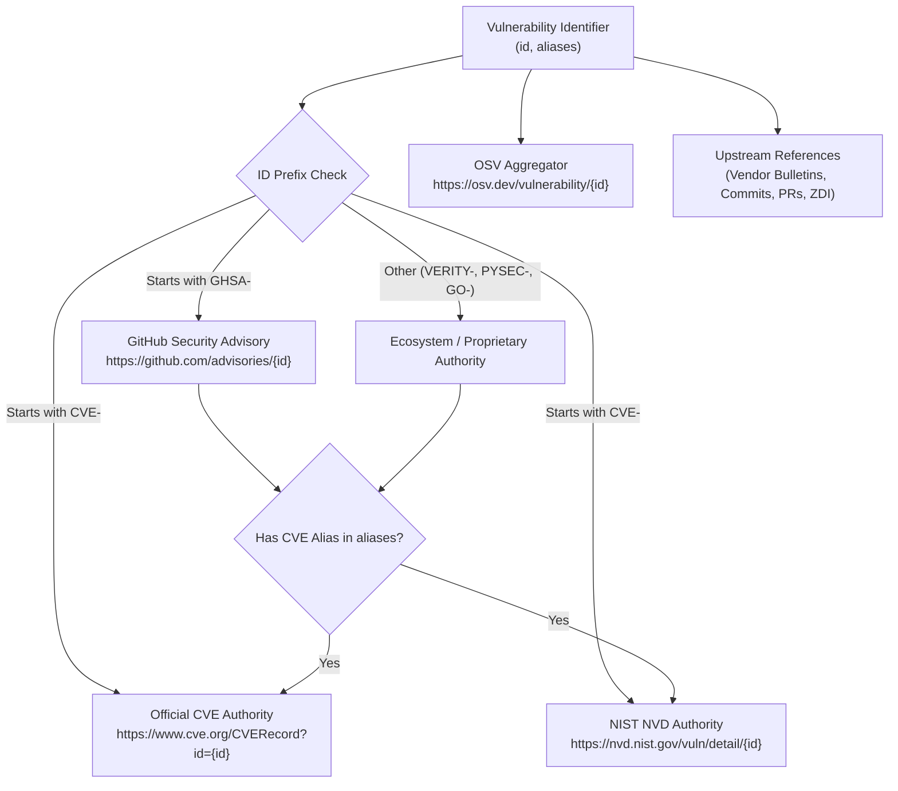

# Task 141: CVE Source Provenance URLs in Web Portal and CLI (P0)

**Subsystem:** Web Portal & Security CLI (`docs/app.js`, `docs/updates.js`, `docs/index.html`, `docs/updates.html`, `src/mcp_vulnerabilities/`)  
**Priority:** `P0`  
**Target Wave:** Wave 25 (Authoritative Upstream Traceability & Source Provenance)  
**Parent Plan:** [master_plan_wave25_cve_source_provenance_and_evidence_traceability.md](master_plan_wave25_cve_source_provenance_and_evidence_traceability.md)

---

## 1. Objective & Problem Statement

Across the entire `mcp-vulnerabilities` ecosystem, users, security analysts, and automated pipelines inspect vulnerabilities affecting Model Context Protocol (MCP) servers. However, the current presentation of vulnerability data suffers from a significant provenance gap:

1. **Missing Authoritative Primary Links in Web Modals**:
   - In the Server Deep-Dive Inspector modal (`#server-modal` in `docs/app.js`), vulnerabilities for specific package versions are rendered inside `.version-vuln-matrix` as plain text badges (e.g. `<span class="badge badge-danger">${escapeHtml(adv.id || "CVE")}</span>`), leaving users unable to click directly into the authoritative CVE record or NVD disclosure.
   - In the in-browser Config Auditor dropzone (`#drop-zone` in `docs/app.js`), advisories only render a single link to `https://osv.dev/vulnerability/{id}`, omitting the primary CVE Record at CVE.org or GitHub Security Advisory.
   - In the Advisory Explorer cards (`docs/app.js`) and Live Updates feed (`docs/updates.js`), cards render plain text ID labels without quick-action direct links to the official originating registry.
   - In the Advisory Detail Modal (`openAdvisoryModal` in both `docs/app.js` and `docs/updates.js`), only a single external link to OSV is provided, lacking direct buttons to the official CVE Program authority, NIST NVD, or GitHub Advisories.
2. **Truncation and Loss of Upstream References**:
   - The OSV data specification includes an array of `references` (containing vendor security bulletins, commit patches, pull requests, bug tracker tickets, and Zero Day Initiative (ZDI) disclosures). In `docs/app.js` and `docs/updates.js`, these references are completely discarded when rendering version matrices.
   - In the CLI text report (`mcp-vuln audit` in `src/mcp_vulnerabilities/cli.py`), the report arbitrarily truncates references to `f.references[0]`, hiding crucial patch commits and vendor bulletins from the terminal user.
   - `mcp-vuln search` and `mcp-vuln lookup` do not display canonical provenance URLs for CVE.org, NVD, or GHSA.
3. **Trust and Verification Latency**:
   - Security engineers triaging high-severity findings need instant, 1-click verification against the authoritative Source of Truth (CVE Numbering Authority / CVE.org, NIST National Vulnerability Database, and GitHub Advisory Database) rather than navigating manually through aggregators.

This task resolves these issues comprehensively by designing and deploying an **Authoritative Provenance URL Resolution Engine** and **Upstream Reference Extractor** across both the web portal frontend (`docs/app.js`, `docs/updates.js`, `docs/style.css`) and the Python security CLI (`src/mcp_vulnerabilities/cli.py`, `src/mcp_vulnerabilities/audit/reporters.py`).

---

## 2. Detailed Technical Requirements

### 2.1 Authoritative Provenance URL Resolution Specification

Every vulnerability in the system possesses a primary identifier (e.g., `CVE-2025-10193`, `GHSA-w48q-v783-6mg3`) and may contain alternate alias identifiers (`aliases`). The provenance resolution logic must deterministically generate authoritative URLs:



#### Canonical URL Mapping Rules:
1. **Official CVE Record**:
   - Target URL: `https://www.cve.org/CVERecord?id={CVE_ID}`
   - Applied whenever `id` starts with `CVE-`, or when any entry in `aliases` starts with `CVE-`.
   - Display Label: `CVE.org` (or `Official CVE`)
2. **NIST National Vulnerability Database (NVD)**:
   - Target URL: `https://nvd.nist.gov/vuln/detail/{CVE_ID}`
   - Applied whenever a valid `CVE-*` identifier exists (as primary `id` or in `aliases`).
   - Display Label: `NVD`
3. **GitHub Security Advisory (GHSA)**:
   - Target URL: `https://github.com/advisories/{GHSA_ID}`
   - Applied whenever `id` starts with `GHSA-`, or when any entry in `aliases` starts with `GHSA-`.
   - Display Label: `GitHub Advisory` (or `GHSA`)
4. **Open Source Vulnerability (OSV) Database**:
   - Target URL: `https://osv.dev/vulnerability/{id}`
   - Applied universally to all advisories as the baseline schema aggregator.
   - Display Label: `OSV.dev`
5. **Upstream Source References**:
   - Extracted from `adv.references` (or `finding.references`).
   - Categorized and tagged by origin domain:
     - `Vendor Advisory`: Vendor security domains (e.g. `anthropic.com`, `oracle.com`, `redhat.com`, `apple.com`).
     - `Security Bulletin / Exploit`: Disclosures from `zerodayinitiative.com`, `exploit-db.com`, `packetstormsecurity.com`.
     - `Patch Commit`: Git commits (`github.com/.../commit/`, `gitlab.com/.../commit/`).
     - `Issue / Pull Request`: GitHub/GitLab pull requests or issues (`github.com/.../pull/`, `issues`).

---

### 2.2 Web Portal Full-Surface UX Integration

#### 2.2.1 Deep-Dive Server Inspector Modal (`#server-modal` in `docs/app.js`)
- In `selectVersion(v)`:
  - Inside `.vuln-matrix-header`, transform the static advisory badge into an interactive provenance badge row:
    - The advisory ID becomes a clickable link to its primary authoritative source (`target="_blank"` with `rel="noopener noreferrer"`).
    - Render compact clickable authority pills: `CVE.org`, `NIST NVD`, `GitHub Advisory`, and `OSV.dev`.
  - Add an expandable or dedicated `.vuln-upstream-sources` section:
    - Display all upstream reference links associated with the advisory.
    - Each link displays an intuitive icon/label (e.g., `🔗 Vendor Advisory`, `🛠️ Patch Commit`, `📋 Issue Report`).

#### 2.2.2 In-Browser Config Auditor Dropzone (`#drop-zone` in `docs/app.js`)
- In `renderAuditResults()`:
  - In `.audit-cve-item`, enhance the `.cve-item-header`:
    - Instead of a single link to OSV, provide direct links to the primary CVE record at `cve.org`, the `nvd.nist.gov` record, and `osv.dev`.
    - If the finding contains multiple aliases, render pills for both the GHSA and CVE IDs.
  - Append an upstream reference links drawer inside `.audit-cve-item` when references are present.

#### 2.2.3 Advisory Explorer Cards & Detail Modal (`docs/app.js`)
- In `renderAdvisoryCards()`:
  - On each `.advisory-card`, add direct provenance icon pills in the card header. Clicking an authority pill opens the upstream URL immediately in a new tab without opening the modal (via `event.stopPropagation()`).
- In `openAdvisoryModal(id)`:
  - Enrich the modal footer/header with authoritative buttons:
    - `Primary Source` (links to CVE.org or GHSA).
    - `NVD Record` (if CVE available).
    - `OSV Database`.
  - In `modalBody`, render a dedicated `<h4>Upstream Sources & References</h4>` block iterating through all `adv.references`, presenting clean, sanitized external links.

#### 2.2.4 Live Updates Portal (`docs/updates.html`, `docs/updates.js`)
- In `renderUpdatedAdvisories()`:
  - Add provenance badges to advisory update cards linking to CVE.org, GHSA, and NVD.
- In `openAdvisoryModal(adv)`:
  - Provide identical authoritative source links and upstream reference rendering as `docs/app.js`.

---

### 2.3 Security CLI Integration (`src/mcp_vulnerabilities/`)

#### 2.3.1 `mcp-vuln audit` Text & JSON/SARIF Reports
- **Terminal Text Report**:
  - Update `cli.py` to format findings with full authoritative provenance:
    ```text
    [CONFIRMED VULNERABLE] Server: filesystem (@modelcontextprotocol/server-filesystem)
      Vulnerability:   CVE-2025-10193 [Severity: CRITICAL]
      CVSS Score:      9.8
      Installed:       0.1.0
      Affected Range:  <0.2.0
      Remediation:     Upgrade to >= 0.2.0
      Summary:         Path traversal vulnerability allows arbitrary filesystem read/write.
      Authoritative Sources:
        * Official CVE: https://www.cve.org/CVERecord?id=CVE-2025-10193
        * NIST NVD:     https://nvd.nist.gov/vuln/detail/CVE-2025-10193
        * OSV Record:   https://osv.dev/vulnerability/CVE-2025-10193
      Upstream References:
        - [ADVISORY] https://github.com/modelcontextprotocol/servers/security/advisories/GHSA-w48q-v783-6mg3
        - [FIX]      https://github.com/modelcontextprotocol/servers/commit/a1b2c3d4e5f6
    ```
- **SARIF Report (`src/mcp_vulnerabilities/audit/reporters.py`)**:
  - In `SarifReporter.generate_audit_sarif()`:
    - Set `rule["helpUri"]` to the authoritative primary source URL (CVE.org or GHSA).
    - In `help["markdown"]`, include direct markdown links to CVE.org, NVD, OSV, and all upstream references.
- **JSON Report (`--format json`)**:
  - Include `provenance_urls` dictionary (`cve_org`, `nvd`, `ghsa`, `osv`) and complete `references` list in each finding.

#### 2.3.2 `mcp-vuln search` & `mcp-vuln lookup`
- In `search`:
  - Output canonical provenance URLs for each matched advisory.
- In `lookup`:
  - Output primary authoritative URLs (CVE.org, NVD, GHSA, OSV) alongside aliases and references.

#### 2.3.3 Interactive CLI Hub (`mcp-vuln hub`)
- When displaying vulnerabilities discovered during interactive audits in `src/mcp_vulnerabilities/audit/hub.py`, print clickable terminal links to CVE.org and OSV.

---

## 3. Invariant Requirements & Verification Plan

### 3.1 Verification Invariants

- [ ] **INVARIANT_141_1 (Authoritative Provenance URL Resolution)**:
  For any advisory identifier:
  - If the identifier starts with `CVE-`:
    - Canonical CVE URL MUST be `https://www.cve.org/CVERecord?id={id}`.
    - Canonical NVD URL MUST be `https://nvd.nist.gov/vuln/detail/{id}`.
  - If the identifier starts with `GHSA-`:
    - Canonical GHSA URL MUST be `https://github.com/advisories/{id}`.
  - If any alias starts with `CVE-`:
    - The CVE.org and NVD URLs for that alias MUST also be generated.
  - An OSV URL `https://osv.dev/vulnerability/{id}` MUST be generated for all advisories.

- [ ] **INVARIANT_141_2 (Web Portal Surface Parity)**:
  Across all five web portal presentation surfaces:
  1. `#server-modal` version vulnerability matrix (`docs/app.js`),
  2. In-browser Config Auditor dropzone results (`docs/app.js`),
  3. Global Advisory Explorer cards (`docs/app.js`),
  4. Advisory Inspector modal (`docs/app.js` and `docs/updates.js`),
  5. Live Updates Portal advisory feed (`docs/updates.js`),
  Every vulnerability rendered MUST display direct, clickable HTML anchors (`<a href="..." target="_blank" rel="noopener noreferrer">`) targeting the authoritative source URLs. Plain text vulnerability labels without source links are strictly prohibited.

- [ ] **INVARIANT_141_3 (Exhaustive Upstream Reference Preservation)**:
  Whenever an OSV advisory contains non-empty `references`, all reference URLs must be preserved, categorized, and displayed. Truncation to `references[0]` in CLI or omission in web modals is strictly prohibited.

- [ ] **INVARIANT_141_4 (CLI Provenance Usability & Terminal Formatting)**:
  `mcp-vuln audit`, `mcp-vuln search`, `mcp-vuln lookup`, and `mcp-vuln hub` in terminal output MUST output direct, copyable/clickable URLs to CVE.org / NVD / GHSA / OSV for all findings.

- [ ] **INVARIANT_141_5 (Strict Safe Protocol Validation & XSS Defense)**:
  All URLs injected into DOM attributes (`href`) MUST start strictly with `https://` or `http://`. Any URL containing `javascript:`, `data:`, or `vbscript:` must be rejected. All rendered IDs, labels, and text must be processed through `escapeHtml()`.

---

### 3.2 Automated Test Suite (`tests/test_cve_provenance_urls.py`)

Author a dedicated automated test suite asserting:
1. `test_authoritative_url_resolution_cve`: Validates CVE-2024-54133 maps to `cve.org`, `nvd.nist.gov`, and `osv.dev`.
2. `test_authoritative_url_resolution_ghsa_with_alias`: Validates GHSA-w48q-v783-6mg3 with CVE alias maps to `github.com/advisories`, `cve.org`, and `nvd.nist.gov`.
3. `test_authoritative_url_resolution_other`: Validates proprietary/other IDs map to `osv.dev` and resolves alias links.
4. `test_cli_audit_report_provenance_urls`: Runs `mcp-vuln audit` against a mock vulnerable package and verifies terminal output contains `https://www.cve.org` and `https://nvd.nist.gov`.
5. `test_cli_lookup_provenance_urls`: Runs `mcp-vuln lookup` and verifies authoritative sources are displayed.
6. `test_sarif_reporter_provenance_help_uri`: Asserts `helpUri` and markdown in SARIF reports contain authoritative links.
7. `test_web_app_js_provenance_helpers`: Checks `docs/app.js` and `docs/updates.js` contain `resolveAdvisorySourceUrls` and render clickable anchors across modals and dropzones.
8. `test_safe_url_sanitization`: Asserts malicious URLs with `javascript:` are neutralized.

---

## 4. Deliverables & Integration Checklist

- [ ] Author shared Python provenance utility `src/mcp_vulnerabilities/provenance.py` implementing `resolve_provenance_urls()`.
- [ ] Update `src/mcp_vulnerabilities/audit/reporters.py` to embed authoritative links into SARIF and text reports.
- [ ] Update `src/mcp_vulnerabilities/cli.py` to output full authoritative source URLs and exhaustive upstream references in `audit`, `search`, and `lookup`.
- [ ] Update `src/mcp_vulnerabilities/audit/hub.py` to display source links in interactive TTY audit summaries.
- [ ] Author shared JavaScript provenance helper in `docs/app.js` and `docs/updates.js` (`resolveAdvisorySourceUrls`).
- [ ] Update `#server-modal` in `docs/app.js` to render clickable provenance badges and an Upstream Sources section.
- [ ] Update `#drop-zone` Config Auditor in `docs/app.js` to render authoritative links and reference pills.
- [ ] Update Advisory Explorer cards and modal in `docs/app.js` to render provenance links and upstream references.
- [ ] Update Live Updates Portal in `docs/updates.js` and `docs/updates.html` for complete provenance parity.
- [ ] Add CSS styling in `docs/style.css` for source pills, provenance badge rows, and reference drawers.
- [ ] Author test suite `tests/test_cve_provenance_urls.py` and verify all tests pass.
- [ ] Update documentation (`README.md`, `docs/SPECIFICATION.md`, `docs/tasks/README.md`) reflecting Wave 25 source provenance.
