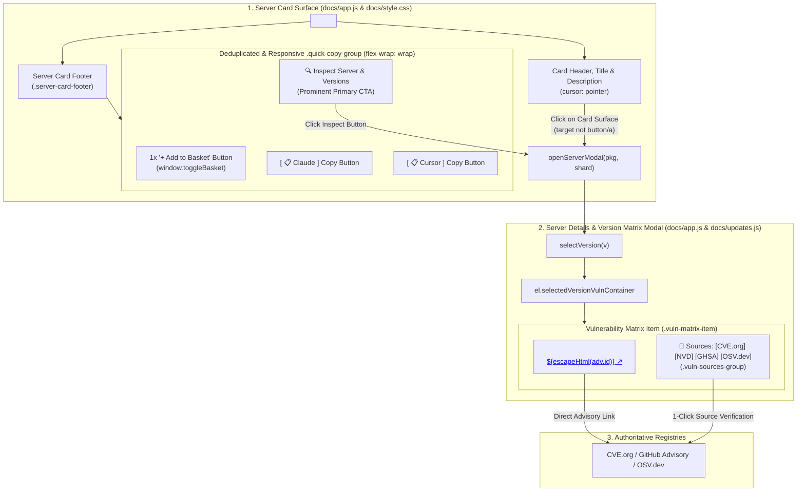

# Task 142: Card Footer Button Deduplication, 1-Click Card Inspection, and Universal Clickable CVE Provenance Links (P0)

**Subsystem:** Web Portal UI & Modal UX (`docs/app.js`, `docs/updates.js`, `docs/style.css`, `tests/test_web_card_footer_ux.py`)  
**Priority:** `P0`  
**Target Wave:** Wave 26 (Card Footer Button Deduplication, 1-Click Card Inspection, and Universal Clickable CVE Provenance Links)  
**Parent Plan:** Wave 26 Front-End Hygiene & Modal Provenance  

---

## 1. Objective & Problem Statement

The `mcp-vulnerabilities` web portal (`docs/index.html` and `docs/updates.html`) is the primary visual interface through which security researchers, enterprise architects, and AI developers discover MCP servers, evaluate security risks, configure client workstations, and inspect CVE vulnerability records.

Recent visual inspections and user experience telemetry revealed four interrelated UX bugs and workflow frictions across the Directory Explorer and Server Inspection modals:

### 1.1 Triplicate "+ Add to Basket" Button Defect in Card Footer
In `docs/app.js` (lines 1429–1438), the server card template accidentally duplicates the basket toggle button three times:
```javascript
<div class="quick-copy-group">
  <button type="button" class="${basketBtnClass}" onclick="window.toggleBasket('${escapeHtml(s.package_name)}')">${basketBtnText}</button>
  <button type="button" class="${basketBtnClass}" onclick="window.toggleBasket('${escapeHtml(s.package_name)}')">${basketBtnText}</button>
  <button type="button" class="btn btn-quick-copy" data-client="claude" data-pkg="${escapeHtml(s.package_name)}">[ 📋 Claude ]</button>
  <button type="button" class="${basketBtnClass}" onclick="window.toggleBasket('${escapeHtml(s.package_name)}')">${basketBtnText}</button>
  <button type="button" class="btn btn-quick-copy" data-client="cursor" data-pkg="${escapeHtml(s.package_name)}">[ 📋 Cursor ]</button>
  <button type="button" class="btn btn-inspect" data-pkg="${escapeHtml(s.package_name)}" data-shard="${escapeHtml(s.shard_file || "")}">
    🔍 Inspect Server & Versions
  </button>
</div>
```
This defect causes three duplicate `+ Add to Basket` buttons to be stacked in every single catalog card footer across all 6,321 catalog entries. It creates visual clutter, confuses users as to which button activates the drawer, and unnecessarily expands vertical card height.

### 1.2 Layout Squashing and Lack of Flexbox Wrapping
In `docs/style.css` (lines 1642–1646), `.quick-copy-group` is defined without flex wrapping:
```css
.quick-copy-group {
  display: flex;
  gap: 8px;
  align-items: center;
}
```
When responsive columns narrow on laptop displays or multi-column grids (e.g. tablet viewports or split-screen layouts), the action buttons inside `.quick-copy-group` lack permission to wrap (`flex-wrap: wrap`). This causes the quick-copy buttons and inspect button to squash, text labels to truncate, and buttons to horizontally overflow card boundaries.

### 1.3 Suboptimal 1-Click Server Card Affordance & Primary CTA Hierarchy
Users browsing catalog cards naturally expect that clicking anywhere on the card header, title, or body will open the comprehensive Server & Versions Inspector modal (`openServerModal(s.package_name, s.shard_file)`). Currently:
- Only clicking the small button `.btn-inspect` located at the very bottom right of the card triggers the modal.
- The rest of the card is a passive `<div>` / `<article>`, forcing users to aim precisely at the bottom button.
- The `🔍 Inspect Server & Versions` button itself is styled with a subtle secondary appearance (`var(--surface-hover)`), failing to communicate that inspecting server versions, schemas, and CVEs is the primary action on the card.
- Direct card body clicking must be implemented intuitively using event delegation while strictly preserving the independent click behavior of interactive child elements (repo/homepage external links, client copy buttons, tool pill drawers, fingerprint copy tooltips, and basket toggle buttons).

### 1.4 Unclickable CVE Badges in Modal Version Vulnerability Matrix
In the Server Deep-Dive Inspector modal (`#server-modal` in `docs/app.js`) and Live Updates modal (`docs/updates.js`), when users inspect a vulnerable release version (`selectVersion(v)`), the Version Vulnerability Matrix (`el.selectedVersionVulnContainer`) renders CVE identifiers as static HTML `<span>` badges:
```javascript
<div class="vuln-matrix-header">
  <span class="badge badge-danger">${escapeHtml(adv.id || "CVE")}</span>
  <span class="badge risk-high">Severity: ${escapeHtml(adv.severity || "UNKNOWN")}</span>
  ...
</div>
```
Because these badges are plain text spans:
1. Security analysts cannot click on the CVE/GHSA badge to view the official vulnerability record.
2. The card lacks direct, 1-click provenance access to the authoritative sources of information (CVE Program at `cve.org`, NIST NVD at `nvd.nist.gov`, GitHub Security Advisories at `github.com/advisories`, and OSV at `osv.dev`).
3. While Task 141 added provenance helpers, they were not fully wired into the version vulnerability item headers across both `docs/app.js` and `docs/updates.js`.

---

## 2. Technical Architecture & Component Flow



---

## 3. Detailed Technical Requirements

### 3.1 Card Footer Template Deduplication (`docs/app.js`)
1. Remove lines 1430, 1431, and 1433 redundancy.
2. The card footer action group MUST contain exactly one "+ Add to Basket" button, followed by the client quick-copy buttons and the inspect button:
   ```html
   <div class="quick-copy-group">
     <button type="button" class="${basketBtnClass}" onclick="window.toggleBasket('${escapeHtml(s.package_name)}')">${basketBtnText}</button>
     <button type="button" class="btn btn-quick-copy" data-client="claude" data-pkg="${escapeHtml(s.package_name)}">[ 📋 Claude ]</button>
     <button type="button" class="btn btn-quick-copy" data-client="cursor" data-pkg="${escapeHtml(s.package_name)}">[ 📋 Cursor ]</button>
     <button type="button" class="btn btn-inspect" data-pkg="${escapeHtml(s.package_name)}" data-shard="${escapeHtml(s.shard_file || "")}">
       🔍 Inspect Server & Versions
     </button>
   </div>
   ```
3. When toggling basket state (`window.toggleBasket`), ensure only the single button corresponding to that package is updated in the DOM.

### 3.2 Responsive Card Footer & Flex Wrapping (`docs/style.css`)
1. Update `.quick-copy-group` in `docs/style.css` to enable responsive flex wrapping:
   ```css
   .quick-copy-group {
     display: flex;
     flex-wrap: wrap;
     gap: 8px;
     align-items: center;
   }
   ```
2. Ensure `.server-card-footer` and `.quick-copy-group` properly adapt to narrow columns, mobile screens, and multi-line wrapping without overlapping or horizontal overflow.

### 3.3 1-Click Card Inspection Affordance
1. **Card Root Dataset**:
   The `<article class="server-card">` element MUST carry `data-pkg="${escapeHtml(s.package_name)}"` and `data-shard="${escapeHtml(s.shard_file || "")}"`.
2. **Event Delegation**:
   In `renderServers()`, attach a click event listener to each card (or delegate at `el.serversContainer`):
   ```javascript
   card.addEventListener("click", (e) => {
     // Ignore clicks on nested interactive elements
     if (e.target.closest("button, a, input, [role='button'], .drawer-toggle-btn, .fp-badge, .tool-pill")) {
       return;
     }
     openServerModal(card.dataset.pkg, card.dataset.shard);
   });
   ```
3. **Keyboard Accessibility**:
   Add `tabindex="0"` and an `onkeydown` handler (or listener) to trigger `openServerModal` on `Enter` or `Space` when the card is focused, ensuring compliance with accessibility guidelines.
4. **Visual Cursor & Hover**:
   Add cursor styling and subtle card elevation on hover:
   ```css
   .server-card {
     cursor: pointer;
   }
   .server-card .server-card-footer button,
   .server-card .card-links a,
   .server-card .fp-badge {
     cursor: pointer;
   }
   ```
5. **Prominent Primary Action Styling for `.btn-inspect`**:
   Style `.btn-inspect` as the prominent primary call-to-action on the card:
   ```css
   .btn-inspect {
     background: var(--accent-color, #2563eb);
     border: 1px solid var(--accent-color, #2563eb);
     color: #ffffff;
     padding: 6px 14px;
     border-radius: var(--radius-sm);
     font-size: 0.85rem;
     font-weight: 600;
     cursor: pointer;
     transition: all 0.2s ease-in-out;
     box-shadow: 0 1px 2px rgba(0, 0, 0, 0.15);
   }

   .btn-inspect:hover {
     background: var(--accent-hover, #1d4ed8);
     border-color: var(--accent-hover, #1d4ed8);
     transform: translateY(-1px);
     box-shadow: 0 3px 6px rgba(37, 99, 235, 0.3);
   }
   ```

### 3.4 Universal Clickable CVE Badges & Provenance Link Group
1. **Direct Clickable CVE Anchor**:
   In `selectVersion(v)` across both `docs/app.js` and `docs/updates.js`:
   - Resolve authoritative URLs for each advisory `adv`:
     ```javascript
     const urls = resolveAdvisorySourceUrls(adv.id, adv.aliases);
     const primaryCveUrl = urls.cve || urls.ghsa || urls.osv || `https://osv.dev/vulnerability/${escapeHtml(adv.id)}`;
     ```
   - Render the advisory identifier badge as a clickable link:
     ```html
     <a href="${escapeHtml(primaryCveUrl)}" target="_blank" rel="noopener noreferrer" class="badge badge-danger cve-link" title="View official advisory record (${escapeHtml(adv.id)})">
       ${escapeHtml(adv.id || "CVE")} ↗
     </a>
     ```
2. **Direct Provenance Sources Group**:
   Under or beside the header badges in each `.vuln-matrix-item`, render a dedicated sources provenance pill group:
   ```html
   <div class="vuln-sources-group">
     <span class="sources-label">🔗 Sources:</span>
     ${urls.cve ? `<a href="${escapeHtml(urls.cve)}" target="_blank" rel="noopener noreferrer" class="badge badge-source badge-primary" title="Official CVE Record">CVE.org</a>` : ""}
     ${urls.nvd ? `<a href="${escapeHtml(urls.nvd)}" target="_blank" rel="noopener noreferrer" class="badge badge-source badge-primary" title="NIST NVD Details">NVD</a>` : ""}
     ${urls.ghsa ? `<a href="${escapeHtml(urls.ghsa)}" target="_blank" rel="noopener noreferrer" class="badge badge-source badge-primary" title="GitHub Security Advisory">GHSA</a>` : ""}
     ${urls.osv ? `<a href="${escapeHtml(urls.osv)}" target="_blank" rel="noopener noreferrer" class="badge badge-source badge-secondary" title="Google OSV Database">OSV.dev</a>` : ""}
   </div>
   ```
3. **Styling in `docs/style.css`**:
   - Provide styling for `.cve-link`, `.vuln-sources-group`, and `.badge-source`:
     ```css
     .cve-link {
       text-decoration: none;
       display: inline-flex;
       align-items: center;
       gap: 4px;
       transition: opacity 0.2s;
     }
     .cve-link:hover {
       text-decoration: underline;
       opacity: 0.9;
     }
     .vuln-sources-group {
       display: flex;
       align-items: center;
       gap: 6px;
       flex-wrap: wrap;
       margin-top: 6px;
       font-size: 0.8rem;
     }
     .vuln-sources-group .sources-label {
       color: var(--text-muted);
       font-weight: 500;
     }
     .badge-source {
       text-decoration: none;
       padding: 2px 8px;
       border-radius: var(--radius-sm);
       font-size: 0.75rem;
       font-weight: 600;
     }
     .badge-source:hover {
       filter: brightness(1.15);
       text-decoration: underline;
     }
     ```
4. **Surface Parity**:
   Ensure identical behavior between `docs/app.js` and `docs/updates.js` so version vulnerabilities inspected via either entrypoint offer identical 1-click source navigation.

---

## 4. Invariants & Acceptance Criteria

- [ ] **INVARIANT_142_1 (Single Basket Button per Card)**:
  Every rendered server card footer in `docs/app.js` MUST contain exactly ONE basket button element matching `onclick="window.toggleBasket(...)"` or `.btn-basket`. Duplicate consecutive or interspersed basket buttons are strictly forbidden.

- [ ] **INVARIANT_142_2 (1-Click Card Surface Inspection)**:
  Clicking on the server card header, title, or body outside of nested interactive controls (`<button>`, `<a>`, `<input>`, `[role="button"]`, `.drawer-toggle-btn`) MUST trigger `openServerModal(pkgName, shardFile)` for that card.

- [ ] **INVARIANT_142_3 (Clickable CVE Badges & Sources Group)**:
  Every vulnerability rendered in `el.selectedVersionVulnContainer` (`docs/app.js` and `docs/updates.js`) MUST render:
  1. The advisory ID badge as a valid clickable HTML link (`<a ... class="... cve-link">`) pointing to `cve.org`, `github.com/advisories`, or `osv.dev`.
  2. A dedicated `🔗 Sources:` link group offering direct 1-click links to available registries (`CVE.org`, `NVD`, `GHSA`, `OSV.dev`).

- [ ] **INVARIANT_142_4 (Responsive Footer Flex Wrapping)**:
  The `.quick-copy-group` class in `docs/style.css` MUST have `flex-wrap: wrap;`, preventing button squashing or horizontal overflow on narrow viewports.

---

## 5. Verification & Testing Strategy

Author an automated test suite `tests/test_web_card_footer_ux.py` verifying:
1. `test_card_footer_no_duplicate_basket_buttons`: Inspects `docs/app.js` template to verify exactly one basket button exists per card template.
2. `test_card_footer_flex_wrap`: Asserts `docs/style.css` contains `.quick-copy-group` with `flex-wrap: wrap;`.
3. `test_card_surface_click_delegation`: Asserts `docs/app.js` attaches click handling to server cards and excludes buttons, links, and input elements.
4. `test_prominent_inspect_button_styling`: Asserts `docs/style.css` provides primary action styling for `.btn-inspect`.
5. `test_clickable_cve_badges_in_version_matrix`: Asserts both `docs/app.js` and `docs/updates.js` render `<a>` tags with `cve-link` and the `vuln-sources-group` inside `selectedVersionVulnContainer`.
6. `test_safe_url_sanitization`: Asserts all resolved URLs are escaped using `escapeHtml()` and validate safe web protocols (`https://`).

---

## 6. Deliverables & Integration Checklist

- [ ] Deduplicate basket buttons in `docs/app.js` card footer template.
- [ ] Add `flex-wrap: wrap;` and responsive spacing to `.quick-copy-group` in `docs/style.css`.
- [ ] Implement 1-click card surface click delegation to `openServerModal` in `docs/app.js`.
- [ ] Style `.btn-inspect` prominently as primary CTA in `docs/style.css`.
- [ ] Transform static CVE badges into clickable anchors `<a class="cve-link">` in `docs/app.js` and `docs/updates.js`.
- [ ] Add `🔗 Sources:` provenance link group to vulnerability cards in `docs/app.js` and `docs/updates.js`.
- [ ] Add CSS styling for `.cve-link`, `.vuln-sources-group`, and `.badge-source` in `docs/style.css`.
- [ ] Author test suite `tests/test_web_card_footer_ux.py` and verify all tests pass.
- [ ] Update `docs/tasks/README.md` to register Wave 26 and Task 142.
