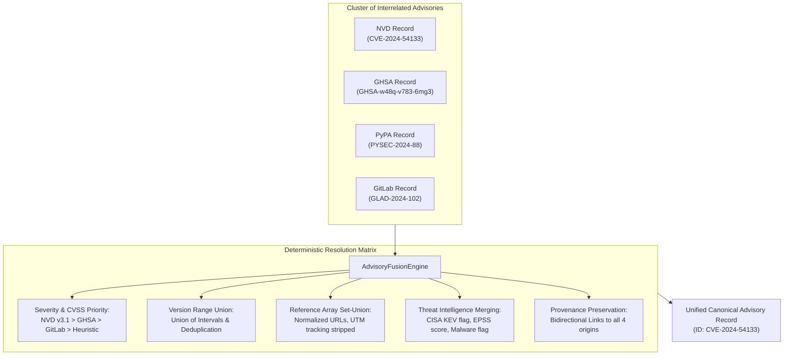

# Task 150: Smart Cross-Source Advisory Deduplicator & Canonical Alias Graph Engine (P0)

**Subsystem:** Core Ingestion & Advisory Graph Deduplication (`src/mcp_vulnerabilities/dedup/`, `src/mcp_vulnerabilities/graph/alias_graph.py`, `src/mcp_vulnerabilities/pipeline.py`, `src/mcp_vulnerabilities/site_builder.py`)  
**Priority:** `P0`  
**Target Wave:** Wave 27 (Threat Intelligence, Exploit Prediction & Multi-Source Deduplication)  
**Parent Plan:** [master_plan_wave27_threat_intel_exploit_prediction_and_deduplication.md](master_plan_wave27_threat_intel_exploit_prediction_and_deduplication.md)

---

## 1. Objective & Problem Statement

With the implementation of Waves 25 and 27, `mcp-vulnerabilities` ingests advisory and threat intelligence telemetry across **8 distinct upstream sources**:
1. **Google OSV.dev** (Aggregate open-source feeds)
2. **GitHub Security Advisories (GHSA)** (Curated developer advisories)
3. **NIST NVD & CVEListV5** (Authoritative CVE Numbering Authority records)
4. **CISA KEV** (Active exploitation catalog — Task 145)
5. **FIRST.org EPSS** (Exploit prediction scoring — Task 146)
6. **OpenSSF Malicious Packages** (Trojan & backdoor catalog — Task 147)
7. **PyPA Advisory Database** (Python-specific security database — Task 148)
8. **GitLab Advisory Database** (Multi-ecosystem curated database — Task 149)

### 1.1 The Multi-Source Ingestion Dilemma
When an identical underlying vulnerability is reported across multiple sources, significant data fragmentation and divergence occur:
- **Multiple Disjoint Identifiers**: The same flaw is cataloged as `CVE-2024-54133`, `GHSA-w48q-v783-6mg3`, `PYSEC-2024-88`, and `GLAD-2024-102`. Naive systems display 4 duplicate cards for the exact same flaw, skewing package risk metrics by 400%.
- **Divergent CVSS Scores**: NVD evaluates the flaw as CVSS 8.8 (`HIGH`), GHSA evaluates it as CVSS 7.5 (`HIGH`), while GitLab rates it CVSS 9.1 (`CRITICAL`).
- **Discrepant Affected Version Ranges**: One database specifies `<1.2.0`, another specifies `>=1.0.0,<=1.1.9`, and a third specifies explicit versions `["1.0.0", "1.1.0"]`.
- **Fragmented Threat Intelligence**: CISA KEV lists `CVE-2024-54133` as actively exploited, but the corresponding `GHSA` record lacks the KEV notation.
- **Reference Loss**: Dropping secondary records discards critical upstream patch commits, vendor advisories, or bug reports exclusive to that source.

Task 150 solves this by designing and deploying the **Smart Cross-Source Advisory Deduplicator & Canonical Alias Graph Engine**.

---

## 2. Detailed Technical Requirements

### 2.1 Canonical Alias Graph (`src/mcp_vulnerabilities/graph/alias_graph.py`)

Implement `CanonicalAliasGraph`:

1. **Disjoint-Set Forest (Union-Find) with Connected Components**:
   - Every vulnerability identifier across all namespaces (`CVE-`, `GHSA-`, `PYSEC-`, `MAL-`, `GLAD-`) is a node in the graph.
   - For every advisory, add edges between the primary `id` and every entry in its `aliases` list.
   - Use Disjoint-Set Union (DSU) with **path compression** and **union-by-rank** to achieve near $O(1)$ amortized operations ($\alpha(N)$):
     ```python
     class CanonicalAliasGraph:
         def __init__(self) -> None:
             self.parent: dict[str, str] = {}
             self.rank: dict[str, int] = {}
             self.clusters: dict[str, set[str]] = {}

         def add_alias(self, id_a: str, id_b: str) -> None: ...
         def find(self, item: str) -> str: ...
         def union(self, item_a: str, item_b: str) -> None: ...
         def get_cluster(self, identifier: str) -> set[str]: ...
     ```

2. **Deterministic Canonical ID Hierarchy**:
   For each connected component cluster, deterministically select the primary canonical identifier:
   1. `CVE-*` (Authoritative international standard) — if multiple CVEs exist in the same cluster, select the lowest numerical year and sequence (e.g. `CVE-2024-1000` over `CVE-2024-2000`).
   2. `GHSA-*` (GitHub standard).
   3. `MAL-*` (OpenSSF malicious package standard).
   4. `PYSEC-*` (PyPA standard).
   5. `GLAD-*` (GitLab standard).
   6. Fallback: Lexicographical order.

---

### 2.2 Deduplication & Attribute Fusion Engine (`src/mcp_vulnerabilities/dedup/fusion.py`)

Implement `AdvisoryFusionEngine` to resolve conflicts across records in the same alias cluster:



#### Deterministic Conflict Resolution Matrix:
1. **Severity & CVSS Score**:
   - Priority Hierarchy:
     1. Authoritative NIST NVD / CVE Program CVSS v3.1 vector string and numerical base score.
     2. GitHub Security Advisory (GHSA) CVSS vector.
     3. GitLab Advisory Database CVSS vector.
     4. Highest nominal score among remaining sources.
   - If CVSS vector strings differ, store the authoritative vector in `severity` and preserve alternative evaluations in `database_specific.divergent_severities`.
2. **Affected Version Ranges**:
   - Parse all ranges into discrete interval representations: $[v_{\text{intro}}, v_{\text{fixed}})$.
   - Compute the mathematical **union** of affected version intervals:
     - If Source A states `[0.1.0, 0.3.0)` and Source B states `[0.2.0, 0.3.2)`, the unified range is $[0.1.0, 0.3.2)$.
   - Deduplicate explicit `versions` lists using SemVer sorting.
3. **Descriptions & Summaries**:
   - Primary `summary`: Prefer the concise, standardized summary from CVE/NVD or GitLab.
   - Primary `details`: Prefer the richest formatted markdown description (typically provided by GHSA).
4. **References & Provenance Preservation**:
   - Compute the set-union of all reference URLs across all source records.
   - URL Normalization:
     - Convert protocol and domain to lowercase (`https://github.com/` vs `HTTPS://GITHUB.COM/`).
     - Strip HTTP tracking parameters (`utm_source`, `utm_medium`, `fbclid`).
     - Remove trailing slashes (`https://example.com/advisory` $\equiv$ `https://example.com/advisory/`).
   - Retain complete provenance records (`origin_sources: ["osv", "ghsa", "nvd", "pypa", "gitlab"]`).
5. **Threat Intelligence Attachment**:
   - If CISA KEV (Task 145) flags any identifier in the cluster, stamp `known_exploited = True` on the unified record.
   - If FIRST EPSS (Task 146) provides scores for any CVE in the cluster, attach `epss_score` and `epss_percentile`.
   - If OpenSSF (Task 147) flags the package as malware, elevate the cluster to `MALICIOUS / CRITICAL` tier.

---

### 2.3 Pipeline Integration (`src/mcp_vulnerabilities/pipeline.py`)

1. **Pipeline Execution Sequence**:
   - In `VulnerabilityPipeline.sync_all()`:
     1. Execute all upstream sync adapters (OSV, GHSA, NVD, CISA KEV, EPSS, OpenSSF, PyPA, GitLab).
     2. Collect raw normalized advisories into staging memory.
     3. Feed all advisories and declared aliases into `CanonicalAliasGraph`.
     4. Resolve connected component clusters.
     5. Execute `AdvisoryFusionEngine.fuse_cluster()` for each cluster.
     6. Persist unified canonical advisories to `data/vulnerabilities.json` and `docs/data/vulnerabilities.json`.
     7. Build server security passports (`passports.json.gz`) from the deduplicated index.
2. **Deterministic Output Invariant**:
   - Output must be strictly deterministic: identical input datasets must generate bit-for-bit identical JSON files, ensuring zero noisy diffs in git or CI.

---

## 3. Invariant Requirements & Verification Plan

### 3.1 Verification Invariants

- [ ] **INVARIANT_150_1 (Zero Data Loss in Fusion)**: Deduplication must never discard an alias, unique reference URL, or valid affected version constraint present in any upstream source.
- [ ] **INVARIANT_150_2 (Deterministic Canonical ID Selection)**: Given the exact same set of aliases, the canonical primary ID chosen must be 100% deterministic, strictly following the hierarchy: `CVE-*` > `GHSA-*` > `MAL-*` > `PYSEC-*` > `GLAD-*`.
- [ ] **INVARIANT_150_3 (Union Range Soundness)**: The fused affected version range must represent the true mathematical union of all source constraints, never narrowing the affected window.
- [ ] **INVARIANT_150_4 (Threat Intelligence Inheritance)**: If any alias in a cluster is listed in CISA KEV or has an EPSS score, the unified canonical record MUST inherit those threat intelligence attributes.
- [ ] **INVARIANT_150_5 (Idempotency and Permutation Invariance)**: Ingesting sources in reverse order (e.g. GitLab $\to$ PyPA $\to$ GHSA $\to$ OSV vs OSV $\to$ GHSA $\to$ PyPA $\to$ GitLab) must produce the exact same deduplicated result.

### 3.2 Automated Test Suite (`tests/test_smart_cross_source_deduplicator.py`)

Author a dedicated test suite with the following tests:
1. `test_alias_graph_connected_components`: Builds a graph with overlapping alias pairs (`CVE-A = GHSA-B`, `GHSA-B = PYSEC-C`, `PYSEC-C = GLAD-D`) and asserts all 4 collapse into a single cluster.
2. `test_canonical_id_selection_hierarchy`: Asserts `CVE-*` is chosen over `GHSA-*`, and `GHSA-*` is chosen over `PYSEC-*`.
3. `test_severity_conflict_resolution`: Fuses records with conflicting CVSS scores (NVD 8.8 vs GHSA 7.5) and asserts NVD official score is prioritized.
4. `test_version_range_union`: Fuses overlapping ranges (`[1.0.0, 1.2.0)` and `[1.1.0, 1.3.0)`) and verifies resulting range is `[1.0.0, 1.3.0)`.
5. `test_reference_url_deduplication`: Fuses records with duplicate URLs having tracking parameters and trailing slashes, asserting clean deduplication.
6. `test_threat_intel_inheritance`: Asserts KEV flag on `CVE-A` is inherited when querying by `GHSA-B`.
7. `test_permutation_invariance`: Feeds identical datasets in 5 randomized orderings and asserts identical output JSON hashes.

---

## 4. Deliverables & Integration Checklist

- [ ] Implement `src/mcp_vulnerabilities/graph/alias_graph.py` (`CanonicalAliasGraph`).
- [ ] Implement `src/mcp_vulnerabilities/dedup/fusion.py` (`AdvisoryFusionEngine`).
- [ ] Implement URL normalizer in `src/mcp_vulnerabilities/dedup/url_normalizer.py`.
- [ ] Refactor `src/mcp_vulnerabilities/pipeline.py` to route all advisories through the deduplication engine.
- [ ] Update `site_builder.py` to compile catalog statistics from the deduplicated canonical dataset.
- [ ] Author test suite `tests/test_smart_cross_source_deduplicator.py` and verify all tests pass.
- [ ] Update `docs/SPECIFICATION.md` and `README.md` documenting multi-source deduplication and alias graph resolution.
