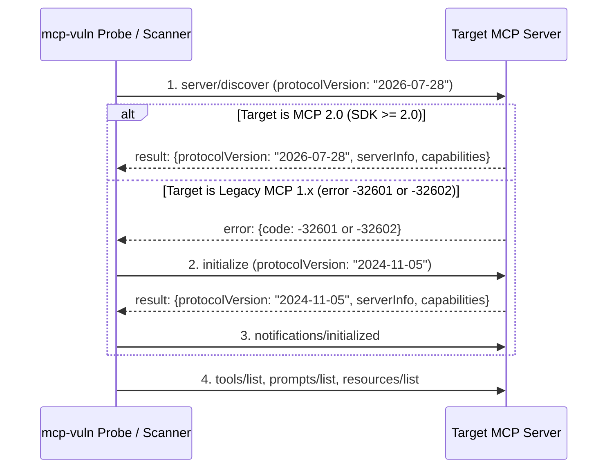

# Task 169: MCP 2.0 Protocol Negotiation (`2026-07-28` + Legacy Fallback)

## 1. Objective
Upgrade the live probing client, network port scanner, and runtime fingerprint resolver in `mcp-vulnerabilities` (`mcp-vuln`) to negotiate **MCP 2.0 (`2026-07-28` via `server/discover`)** first, with automatic fallback to legacy **`initialize()` (`2024-11-05`)** when scanning older MCP 1.x servers.

## 2. Files to Modify in `JMartynov/mcp-vulnerabilities`

| # | File Path | Current Behavior | Required Change |
|:---:|:---|:---|:---|
| 1 | `src/mcp_vulnerabilities/probe/client.py` | Hard-codes `"protocolVersion": "2024-11-05"` in `McpProbeClient` (L106). | Add `SUPPORTED_PROTOCOL_VERSIONS = ("2026-07-28", "2025-11-25", "2025-06-18", "2024-11-05")`. Send `server/discover` (`2026-07-28`) first; if server returns JSON-RPC error `-32601` or `-32602`, automatically fall back to `initialize` (`2024-11-05`) followed by `notifications/initialized`. Store negotiated `protocol_version` in probe result metadata. |
| 2 | `src/mcp_vulnerabilities/probe/network_scanner.py` | Hard-codes `"protocolVersion": "2024-11-05"` (L62) in HTTP POST probe. | Send `"MCP-Protocol-Version": "2026-07-28"` HTTP request header; try `server/discover` first and fall back to `initialize` (`2024-11-05`) if rejected with `-32601` / `-32602`, recording the detected `protocolVersion` in scan findings. |
| 3 | `src/mcp_vulnerabilities/fingerprints/resolver.py` | Hard-codes `"protocolVersion": "2024-11-05"` (L191) during live stdio resolution. | Use two-stage `server/discover` -> `initialize` negotiation so MCP 2.0 stdio servers resolve cleanly without failing handshake. |
| 4 | `tests/test_mcp2_protocol_negotiation.py` *(new)* | N/A | Add unit tests for: (a) `McpProbeClient` negotiating `2026-07-28` via `server/discover`, (b) automatic fallback to `initialize` (`2024-11-05`) on `-32601`/`-32602`, (c) `network_scanner` detecting both MCP 2.0 and legacy 1.x HTTP listeners, and (d) `resolver` handling both protocol versions. |

## 3. Technical Specification & Handshake Flow



### Helper Contract for `src/mcp_vulnerabilities/probe/client.py`

```python
SUPPORTED_PROTOCOL_VERSIONS: tuple[str, ...] = (
    "2026-07-28",
    "2025-11-25",
    "2025-06-18",
    "2024-11-05",
)
LATEST_PROTOCOL_VERSION = "2026-07-28"
LEGACY_PROTOCOL_VERSION = "2024-11-05"


def is_discover_unsupported_error(resp: dict[str, Any]) -> bool:
    """Return True if the server rejected server/discover with -32601 or -32602."""
    err = resp.get("error")
    if not isinstance(err, dict):
        return False
    return err.get("code") in (-32601, -32602)
```

## 4. Acceptance Criteria & Verification Commands
- `pytest tests/test_mcp2_protocol_negotiation.py -v` passes 100%.
- `pytest tests/ -k "probe or network or resolver" -v` passes without regressions.
